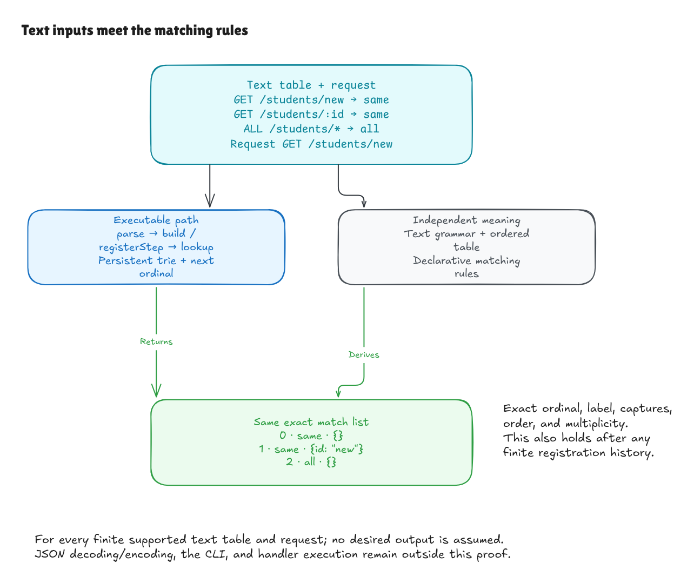

# hono-lean

A web router in the style of [Hono](https://hono.dev), written in Lean 4, with
a machine-checked proof that it follows a written specification.

A router takes a request like `GET /users/42` and decides which registered
routes match it. Hono's router supports exact methods, the `ALL` method,
named parameters such as `/users/:id`, and wildcards such as `/files/*`. This
project rebuilds that behavior in Lean and proves it never returns a wrong
match and never misses a right one.

## The main theorem

`build_lookup_iff` in
[HonoLean/Adapter/Lookup/Correctness.lean](HonoLean/Adapter/Lookup/Correctness.lean)
says the following. For any list of route strings and any request, building the
router and looking up the request returns a result if and only if both parse
and that result is what the matching rules require. The result has the right routes, the right
captured parameters, and the original registration order.

The matching rules live in [HonoLean/Literal/Spec.lean](HonoLean/Literal/Spec.lean).
They describe matching one route at a time, with no data structure. The real
router uses a prefix tree (a trie) that shares common path prefixes, so it
has more cases to get wrong.
The proof shows the two always agree. In the same file,
`registrations_build_correct` extends this to any sequence of added routes,
including rejected ones. Malformed input gets an error instead of a result, and
`accepts_iff` and `rejects_iff` say exactly which inputs are rejected.



The proof uses no `sorry` and only Lean's three standard axioms (`propext`,
`Classical.choice`, and `Quot.sound`). Run `#print axioms` on the theorem to
check this yourself.

## What is not proved

- The matching rules are a choice. If they describe the wrong behavior, the
  proof still passes. A person has to read `Spec.lean` and agree with it.
- JSON input and output and the command-line tool are tested, not proved.
- Hono's own TypeScript is not proved equivalent. A differential test compares
  the two (see below), and the experiment at the end goes further.
- The Lean compiler and runtime are trusted.

## Try it

Install Lean with [elan](https://lean-lang.org/install/). The `lean-toolchain`
file picks the version. The project has no other Lean dependencies.

```sh
lake build
lake exe hono-lean
lake exe adapter-tests
python3 tests/adapter_cli.py
```

The JSON command takes a route table and a list of steps:

```sh
.lake/build/bin/hono-lean-json <<'JSON'
{
  "routes": [{"method": "GET", "pattern": "/students/:id", "handler": "read"}],
  "steps": [{"op": "lookup", "request": {"method": "GET", "path": "/students/s1"}}]
}
JSON
```

The response lists one match, registration 0, with its captured parameter:

```json
{"nextRegistration":1,"results":[{"matches":[{"handler":"read","params":{"id":"s1"},"registration":0}]}]}
```

## Checked against real Hono

`tests/compare_hono.py` runs the same inputs through this router and through
Hono's `TrieRouter` at a pinned commit. The default run has 468 lookups, with
467 agreements and one known difference. For the route `GET /:__proto__`,
this router captures `{"__proto__": "alpha"}`, and Hono returns
`{"__proto__": {}}`. That difference comes from how JavaScript objects treat
the `__proto__` key. Any new difference fails the test. The
[router guide](docs/router/README.md#compare-with-the-pinned-hono-trie) explains
how to run it.

## Read the code

1. [HonoLean/Literal/Spec.lean](HonoLean/Literal/Spec.lean) has the matching rules.
2. [HonoLean/Literal/Trie.lean](HonoLean/Literal/Trie.lean) has the trie.
3. [HonoLean/Literal/Correctness.lean](HonoLean/Literal/Correctness.lean) proves the trie follows the rules.
4. [HonoLean/Router.lean](HonoLean/Router.lean) adds routes one at a time, and
   [HonoLean/Router/Correctness.lean](HonoLean/Router/Correctness.lean) proves that keeps working.
5. [HonoLean/Adapter/](HonoLean/Adapter) parses route and request strings, with a proof for each grammar.

The [router guide](docs/router/README.md) has worked examples, the full list of
theorems, and a first Lean lesson. The [walkthroughs](docs/router/) explain each
proof step by step.

## Experiment: verifying Hono's actual source

The router above is a rewrite. The harder question is whether you can prove
things about Hono's real TypeScript. `HonoLean/Upstream/` tries this one small
function at a time. Lean parses the exact source text of a Hono function,
runs it in a small model of JavaScript, and proves it follows an independent
rule. Scripts in `verification/` check that the source text matches the pinned
Hono commit byte for byte.

This part is unfinished and much larger, with about 50,000 lines of Lean
covering small pieces of Hono's trie router and URL helpers. Every result depends on the
JavaScript model being accurate, which is not proved. It builds separately:

```sh
lake build HonoLeanUpstream
verification/run_checks.sh /path/to/hono
```

Start with the [`splitPath` walkthrough](docs/upstream/splitpath-source-bridge.md),
then the [experiment overview](docs/upstream/README.md).

## How this was built

I wrote this with heavy help from ChatGPT, over about nine days in October
2026. ChatGPT wrote most of the Lean code and docs. I set the goals and the
scope, and I am working through the proofs to understand them. Lean's kernel
checks every proof no matter who wrote it, so the proofs don't depend on
trusting the author. The matching rules still need a careful human reader.

## License

MIT. See [LICENSE](LICENSE). Hono's source excerpts keep Hono's MIT notice in
[THIRD_PARTY_NOTICES.md](THIRD_PARTY_NOTICES.md).
