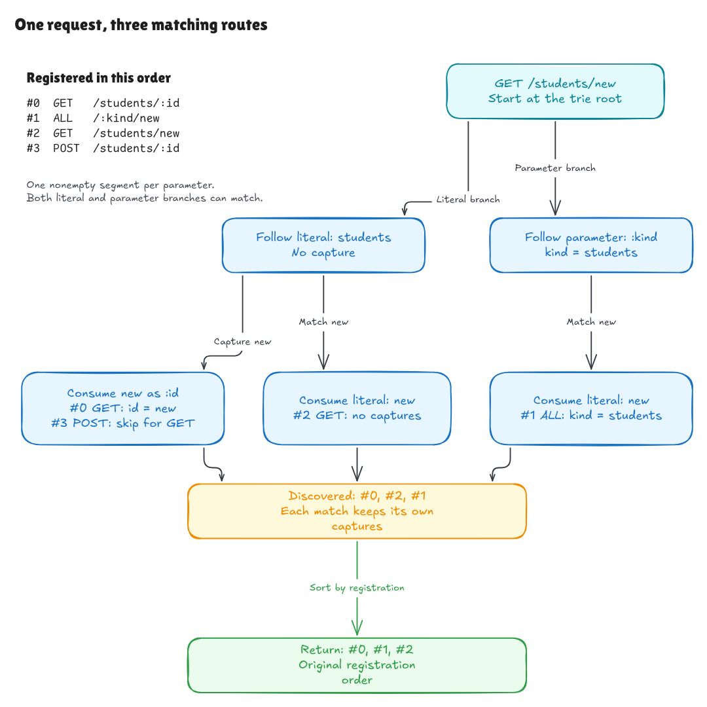
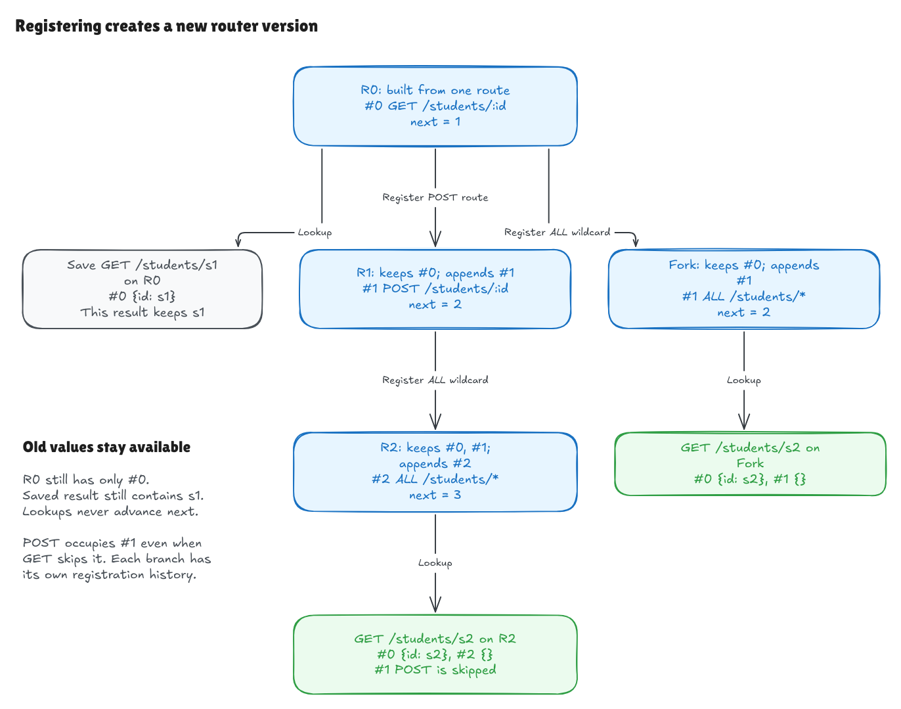
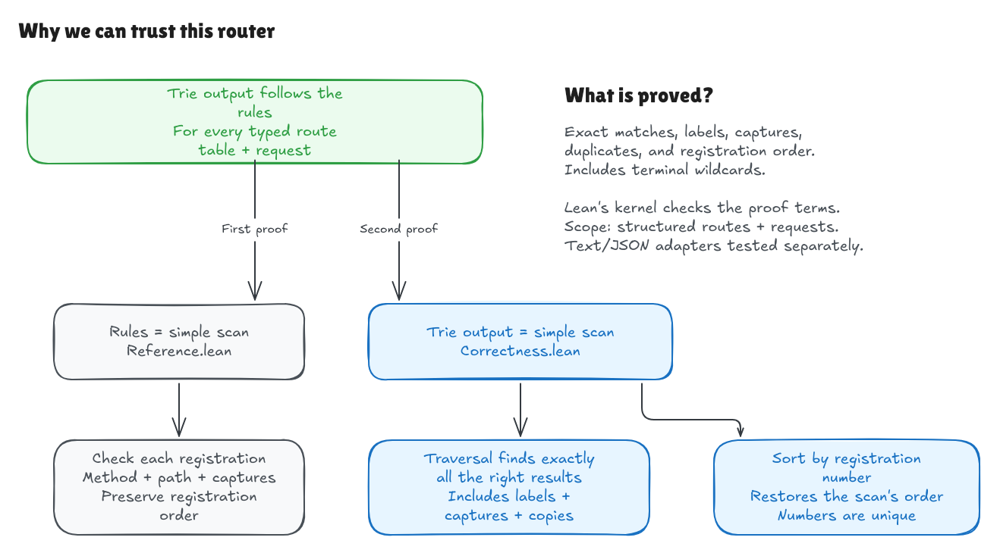

# The verified router in detail

This page expands on the [project README](../../README.md). It covers the JSON
command, the comparison against real Hono, benchmarks, worked examples, the
full list of proved theorems, and a first Lean lesson.

## Use the JSON command

After `lake build`, send one document containing initial routes and ordered
lookup/register steps:

```sh
.lake/build/bin/hono-lean-json <<'JSON'
{
  "routes": [{"method":"GET","pattern":"/students/:id","handler":"read"}],
  "steps": [{"op":"lookup","request":{"method":"GET","path":"/students/s1"}}]
}
JSON
```

The response contains registration 0, label `read`, and `params: {"id":"s1"}`.
A valid miss succeeds with an empty match list. Invalid routes and requests
return categorized errors. A rejected registration keeps the previous router
and next number; an invalid initial build exposes no partial router.

See the [adapter boundary diagram](../diagrams/adapter-boundary.png) and
[failed-registration diagram](../diagrams/adapter-failure.png). Both have
[editable sources](../diagrams/README.md). The
[adapter walkthrough](history/adapter-milestone.md) documents the JSON protocol,
error categories, and test coverage.

## Compare with the pinned Hono trie

The harness compares the compiled Lean JSON command with Hono's raw `TrieRouter`
at revision `5ca49b0720755c585c9a9835f0a479ceea36fb52`. It checks the exact Git
revision and clean checkout, and uses Bun 1.4.0 without installing Hono's
development dependencies.

```sh
lake build
python3 tests/compare_hono.py --fetch
python3 tests/comparison_tests.py --hono .hono-cache
```

`--fetch` creates an ignored private cache and never resets an existing checkout.
Use `--hono /path/to/hono` instead to compare an existing clean checkout at the
pin. With an asdf Bun shim, prefix the command with `ASDF_BUN_VERSION=1.4.0`.

The default seed 1729 run covers 20 contract scenarios and 32 generated scenarios:
468 lookup observations and 98 actual append events. It found **467 agreements,
one exact D1 observation, and no unexpected differences**. Generated tables vary
registration order and overlapping literal, parameter, wildcard, and method
matches, including duplicate registrations and requests between appends.

**D1:** for `GET /:__proto__` looked up at `/alpha`, the contract and Lean return
`{"__proto__":"alpha"}`. The pinned Hono trie returns `{"__proto__":{}}`.
The harness recognizes only that complete recorded case. Lean must always match
the normative contract; a new or changed difference fails and saves a reproducer.
The comparator preserves result order, multiplicity, parameter values, and JSON
types, while ignoring object-key iteration order.

The report in `.comparison-results/report.json` records the verified revision,
runtime versions, seed, input hash, counts, and unexpected failures with full
expected/observed traces. See the [comparison diagram](../diagrams/comparison-harness.png)
and [D1 diagram](../diagrams/comparison-d1.png), with
[editable sources](../diagrams/README.md).

This is finite compatibility evidence. The formal proof establishes that the
Lean core follows its rules; the comparison does not prove Hono's TypeScript
equivalent over every input. The [generator settings](../../comparison/baseline.json)
make the sampled domain explicit. This run makes no performance claim.

## Measure construction and lookup separately

```sh
python3 benchmarks/run.py --hono .hono-cache
python3 benchmarks/tests.py --hono .hono-cache
```

These use the same verified Hono pin and Bun version as the comparison harness.
Construction creates fresh routers; lookup reuses a built router. Process
startup, JSON transport, and full semantic preflight are outside both timers.
The lookup timer includes a small result-consumption checksum. Both backends'
complete results must match the independent model before measurement.

The checked-in [raw example](../../benchmarks/example-results.json) used 64 routes,
32 requests, three warmups, and seven measured samples. Each build sample made
16 routers; each lookup sample made 4,096 queries. Medians of batch-average
microseconds per operation were:

| Workload | Phase | Lean, µs | Hono, µs |
| --- | --- | ---: | ---: |
| Shared prefix | Build a 64-route router | 22.096 | 27.711 |
| Shared prefix | Lookup + result sink | 0.525 | 0.315 |
| Overlapping | Build a 64-route router | 5.859 | 35.096 |
| Overlapping | Lookup + result sink | 7.075 | 4.875 |

Hono had lower lookup costs in this local run. Lean's typed-core build medians
were lower, but construction boundaries differ: Lean receives parsed components;
Hono handles path text with a warm pattern cache. Hono build samples had a wide
spread. These are measurements of specific workloads and runtimes, not a
universal speed ranking or per-request latency percentiles.

The overlapping fixture returned 46.5 matches per query on average, compared
with 0.594 for shared-prefix queries. That extra output work matters to lookup
cost. See the [timing-boundary diagram](../diagrams/benchmark-timers.png),
[workload diagram](../diagrams/benchmark-workloads.png), and
[walkthrough](history/benchmark-milestone.md) for ranges, metadata, and limitations.

## Follow one request

For `GET /students/new`, both literal and parameter branches can match. Each
result keeps the captures belonging to its own route. `ALL` accepts the request
method, while a `POST` registration is skipped. Trie traversal discovers the
matches as `#0, #2, #1`; sorting restores registration order: `#0, #1, #2`.



[Full-size image](../diagrams/router-request.png) ·
[Editable Excalidraw source](../diagrams/router-request.excalidraw)

## Append a route and keep the old version

`Router.build` constructs the initial table. `Router.register` inserts one new
registration and returns a new router. `Router.lookup` can query either version;
saved results keep their original captures. `Router.registerMany` appends a
finite list by repeating the same single-registration operation.



[Full-size image](../diagrams/registration-versions.png) ·
[Editable Excalidraw source](../diagrams/registration-versions.excalidraw)

The router stores only the trie and the next registration number. Every accepted
registration consumes a number, even when it does not match a later lookup.
Two branches from the same old router have separate histories, so both may
assign the same next number to their own new registration.

## What the proof guarantees

> For every finite table of valid typed routes, supported request method, and
> request path represented as a list of segments, trie lookup returns exactly
> the matching registrations, with their correct labels and parameter captures,
> in original registration order.

This includes all matching registrations, preserves repeated registrations as
separate results, and gives each result exactly its own route's captures.
Parameters consume one nonempty segment; a literal match does not suppress a
parameter or wildcard match. A terminal wildcard accepts zero or more remaining
segments and adds no capture: `/students/:id/*` matches both `/students/s1` and
`/students/s1/worksheets/w2`, returning only `{id: "s1"}` for that route. It still
requires the whole prefix, so it does not match `/students`.



[Full-size image](../diagrams/correctness-proof.png) ·
[Editable Excalidraw source](../diagrams/correctness-proof.excalidraw)

The first proof connects the declarative matching rules in
[Spec.lean](../../HonoLean/Literal/Spec.lean) to the simple route-by-route scan in
[Reference.lean](../../HonoLean/Literal/Reference.lean). The second proves that trie
traversal finds the same complete results, possibly in a different order, and
sorting restores the reference order. Together they establish
`HonoLean.Literal.Trie.lookup_build_iff_rules` in
[Correctness.lean](../../HonoLean/Literal/Correctness.lean).

For incremental registration, the invariant says that the stored trie represents
the route table and the next number equals that table's length. Building
establishes this invariant; each append preserves it. Therefore the same lookup
guarantee holds after any finite append sequence. The public headline theorem is
`Router.lookup_registerMany_build_iff_rules` in
[Router/Correctness.lean](../../HonoLean/Router/Correctness.lean).
The [registration proof diagram](../diagrams/registration-proof.png) shows why
inserting one route agrees with building the appended table; its
[editable source](../diagrams/registration-proof.excalidraw) is included.

Lean's kernel checks this general argument; the claim is not limited to the
examples we run. The diagrams explain the argument, while the Lean files contain
the checked proof. The guarantee is agreement with the formalized matching
rules, so those rules still need human review.

The matching proof covers the Lean core for structured inputs. The separate
`PathText.parsePath_iff` theorem in
[Path/Correctness.lean](../../HonoLean/Adapter/Path/Correctness.lean) proves request-path
parsing against the independent grammar in
[Path/Spec.lean](../../HonoLean/Adapter/Path/Spec.lean). Its corollaries cover root,
canonical round trips, unique decomposition, and rejection of exactly the
unsupported paths with category `invalid_request`.

The separate `MethodText.parseMethod_iff` theorem in
[Method/Correctness.lean](../../HonoLean/Adapter/Method/Correctness.lean) connects method
parsing to the independent [method grammar](../../HonoLean/Adapter/Method/Spec.lean).
It proves exact spelling; its corollaries prove acceptance from the grammar
alone, a typed-name round trip, and rejection with the caller's error category.
The separate record proof now covers the special `ALL` route branch; `ALL`
never becomes a request method.

`PatternText.parsePattern_iff` in
[Pattern/Correctness.lean](../../HonoLean/Adapter/Pattern/Correctness.lean) proves exact
pattern components and the suffix flag against the independent
[pattern grammar](../../HonoLean/Adapter/Pattern/Spec.lean). Its corollaries cover
grammar-only acceptance and `invalid_route` rejection. Parameter names are valid
and unique, literal spelling is preserved, and `*` appears only at the end as a
whole component. `/` is exact root; `*` and `/*` are equivalent wildcard aliases.

`RecordText.parseRoute_iff` and `parseRequest_iff` in
[Record/Correctness.lean](../../HonoLean/Adapter/Record/Correctness.lean) compose these
field promises into exact records, including handler preservation and the
route-only `ALL` selector. Their acceptance and rejection corollaries characterize
both complete record grammars and their error categories.

`BuildText.build_iff` in
[Build/Correctness.lean](../../HonoLean/Adapter/Build/Correctness.lean) connects each
initial text table to exactly the router built from its ordered parsed table.
Acceptance requires every record to satisfy the grammar. A rejected build
returns `invalid_route`; a successful build has one registration per input
occurrence and `nextOrdinal` equal to the input length.

`RegistrationText.step_correct` and `trace_correct` in
[Registration/Correctness.lean](../../HonoLean/Adapter/Registration/Correctness.lean)
extend that representation through every finite sequence of valid and invalid
text registrations. The total `registerStep` returns the old next ordinal on
success, and the exact prior router with `invalid_route` on failure. The JSON
registration branch uses this helper after decoding.

`LookupText.build_lookup_iff` in
[Lookup/Correctness.lean](../../HonoLean/Adapter/Lookup/Correctness.lean) connects a
successful text build and public text lookup to the independent text-level
matching rules, in both directions, without assuming an expected runtime result.
`registrations_build_correct` extends this to every finite valid/invalid append
history and proves the final ordinal equals the retained table length.

JSON decoding/encoding and CLI behavior are tested.
There is no composed JSON-input-to-JSON-output theorem yet. The adapter
rejects inputs needing URL normalization. Method spelling and parameter-name
validity are enforced by the core input types; core request segments remain
raw strings, with a nonempty
check when a parameter consumes one. Handler execution, Hono's TypeScript,
performance, and the compiler/runtime remain outside this proof claim.

See the [diagram notes](../diagrams/README.md) for editing and update guidance.

## Contract and examples

- [Specification](../../SPEC.md): supported inputs, matching rules, required proofs,
  and the boundary between the verified core and tested adapters.
- [Examples and decisions](examples.md): the original plain-English contract,
  including the documented D1 difference from the pinned Hono trie.
- [Exact v1 corpus](../../examples/v1.json): 20 scenarios with 52 lookups and 30
  rejected-input cases. All are checked through the compiled JSON command,
  including the actual lookup/registration sequence. Invalid routes are also
  tested as rejected registrations followed by valid appends.

The original tiny first-proof lesson remains below and in
`HonoLean/Literal.lean`.

## Run it

Lean is pinned in `lean-toolchain`. Elan selects that version in this directory.

```sh
lake build
lake exe hono-lean
lake exe adapter-tests
python3 tests/adapter_cli.py
lake env leanchecker --fresh HonoLean
```

The executable checks literal, method, parameter, wildcard, and registration
examples, plus a sequence retaining old routers and results across appends.
Each result is `(registration ordinal, label, capture pairs)`.
An excerpt:

```text
HEAD /get-only: []
GET /students/s1/worksheets/w2: [(8, "worksheet", [("studentId", "s1"), ("worksheetId", "w2")])]
GET /students/empty: reject empty capture: []
```

Every proof and regression module is built through the root import. Warnings are
errors, and axiom guards enforce the expected main-proof dependencies. CI also
replays the root module and its imports through Lean's kernel in a fresh environment.

Named parameters consume one nonempty segment. Lookup can explore both literal
and parameter branches, builds branch-local captures, and emits wildcard
registrations once when their prefix is reached. Each trie node has separate
exact and wildcard terminals; only exact terminals require the path to end.
Lookup then sorts the complete candidate list by ordinal. The proof establishes
candidate permutation, strict reference ordinal order, and exact sorted equality,
including map contents.

Methods carry their spelling-validity proof; routes carry valid and unique
parameter-name evidence. The text adapter validates external strings before
calling this core. It performs no trimming, URL decoding, or case conversion.

## Lesson 1: read the router

Open `HonoLean/Literal.lean` in VS Code. The Lean InfoView shows the proof state
as you move the cursor through the proof.

1. `abbrev Path := List String` gives a name to a list of strings. We represent
   `/students/new` as `["students", "new"]`, and `/` as `[]`. This lesson assumes
   the path has already been parsed. These lists do not enforce a URL grammar.
2. `structure Route` is a record with a path and a handler ID. Handler IDs are
   strings; this router does not execute handler functions.
3. `lookup` takes a list of routes and a request path. Its result is a list of
   handler IDs. It compares whole lists, so a prefix is not an exact match.
4. `[]` is an empty list. `route :: rest` splits a nonempty list into its first
   route and remaining routes. The recursive call always consumes that first
   route, which lets Lean establish termination.
5. When a route matches, `route.handler :: ...` puts its handler before the
   remaining matches. When it does not, lookup continues without adding it.
   Each registration is visited once; repeated registrations remain in order.

The current demo uses the expanded examples in
`HonoLean/Literal/Examples.lean`. Predict their outputs before running it, then
change a path and predict the new behavior.

## Lesson 1: read the proof

```lean
theorem lookup_singleton_self (route : Route) :
    lookup [route] route.path = [route.handler] := by
  simp [lookup]
```

Read the statement as: "For every route, looking up that route's own path in a
table containing only that route returns a list containing its handler."

- `(route : Route)` is an arbitrary route, not a particular test fixture.
- `[route]` is a one-element route table.
- `=` states a proposition that requires a proof. In the executable function,
  `==` performs a Boolean equality comparison.
- `by` starts the proof.
- `simp [lookup]` unfolds lookup and applies established simplification rules.
  The path equals itself, so the matching branch is selected. The recursive
  lookup of an empty route table returns `[]`, leaving `[route.handler]`.

Move the cursor to just after `by` to inspect the goal. Move it after `simp`
to see that the goal is finished. The simplifier constructs a proof that Lean
checks; it does not replace the theorem with a collection of test results.

This theorem covers every route value, but only a one-route table queried at
that route's own path. It does not yet establish correctness of arbitrary
tables, prove a trie equivalent, verify parsing, or verify Hono's TypeScript.

For an interactive experiment, replace `simp [lookup]` with `rfl` in your
editor and inspect the result. Then restore the checked proof.

## Next exercise

As a learning exercise, state a theorem that a one-route table returns no
handlers when its route path differs from the request path. It needs a hypothesis
of the form `route.path ≠ requestPath`. The method-aware literal trie and its more general
correctness theorem are already implemented; this small exercise remains useful
for practicing how assumptions enter a proof.

## Learning resources

- [Lean installation](https://lean-lang.org/install/)
- [Functional Programming in Lean](https://lean-lang.org/functional_programming_in_lean/)
- [Theorem Proving in Lean 4](https://lean-lang.org/theorem_proving_in_lean4/)
- [Validating a Lean proof](https://lean-lang.org/doc/reference/latest/ValidatingProofs/)
