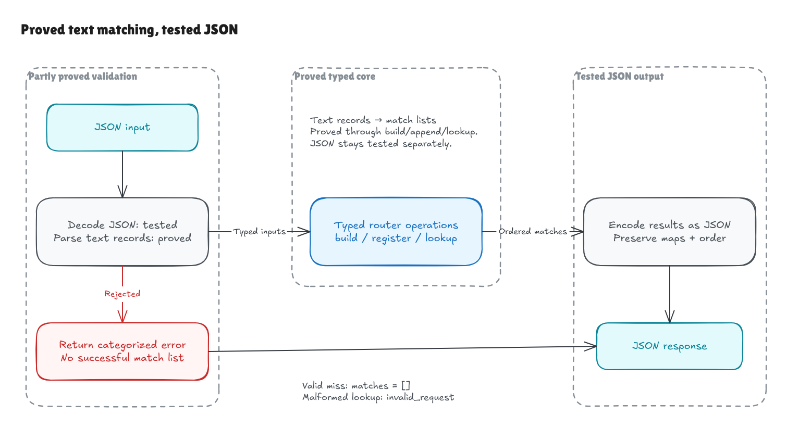
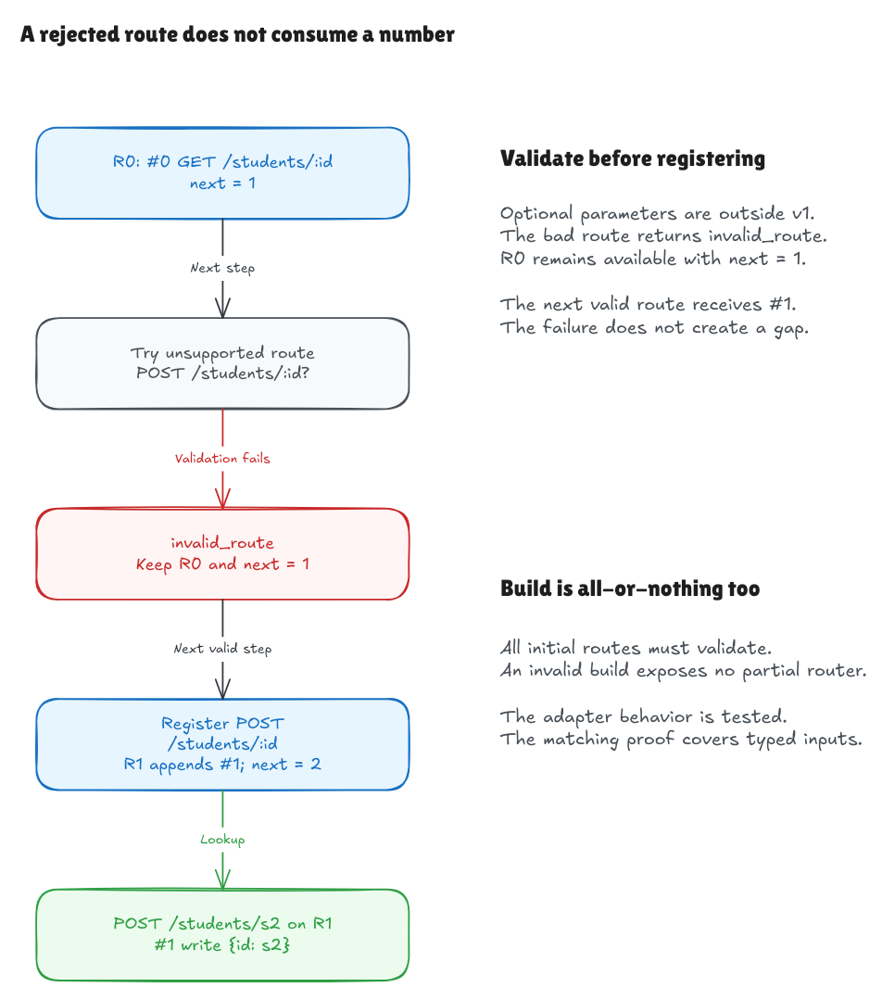

# Text and JSON at the edge of the verified router

This walkthrough describes the milestone at `f74a7f7`. The pinned Hono comparison
harness is now implemented; see the [comparison walkthrough](comparison-milestone.md)
for the compatibility evidence. Request-path and method parsing were subsequently
proved in the [path](../path-parser-walkthrough.md) and
[method](../method-parser-walkthrough.md) extensions, followed by the
[completed text goal](../text-boundary-goal.md) through match lists. The boundary
diagram shows those additions. The remaining text describes the original
adapter milestone and its tested boundary.

The router now accepts route patterns and requests as text, validates their
grammar, and converts them to the typed values used by the proved core. A small
JSON executable lets another program build a table, append routes, and issue
lookups. The existing `lake exe hono-lean` teaching demo still works.

The matching and registration theorems are unchanged. The new adapters are
**tested, not formally verified**. A method or route returned by the parser
carries the existing type's checked validity evidence, but that does not prove
the whole parser accepts exactly the intended text language.

## One request crosses three boundaries

Consider this route and request:

```text
route:   GET /students/:id/* -> read
request: GET /students/s1/worksheets/w2
```

The adapter turns the route into literal `students`, parameter `id`, and the
suffix flag. It turns the request path into four segments. The existing matcher
then returns `{id: "s1"}` for the route; the suffix adds no capture. JSON output
formats that same ordinal, handler label, and parameter map.

Parsing the input and formatting the output are tested boundaries. Between them,
the existing theorem applies to the typed matching operation. A mistake in a
parser or formatter would not be ruled out by the matching proof alone.



[Full-size image](../../diagrams/adapter-boundary.png) ·
[Editable Excalidraw source](../../diagrams/adapter-boundary.excalidraw)

## Validation follows the existing contract

[Adapter.lean](../../../HonoLean/Adapter.lean) contains the text adapter. It exposes
`parseRoute`, `parseRequest`, and pure `build`, `register`, and `lookup` wrappers.
`TextRoute` contains `method`, `pattern`, and `handler` strings; `TextRequest`
contains `method` and `path` strings.

- Methods use nonempty uppercase ASCII letters. `ALL` is a route selector;
  requests cannot use it. Custom methods such as `CUSTOM` and `PURGE` are valid.
- Literal segments contain ASCII letters, digits, underscores, and hyphens.
  `/` becomes an empty path. Empty segments, trailing slashes, Unicode path
  characters, dots, percent encoding, query strings, and full URLs are rejected.
- A parameter name follows `[A-Za-z_][A-Za-z0-9_]*` and occurs only once within
  its route. `constructor` and `__proto__` remain ordinary names.
- A whole terminal `/*` accepts the remaining suffix. `*` and `/*` both produce
  the empty-prefix wildcard. A wildcard in the middle, `/assets*`, optional
  parameters, and regex patterns are rejected.
- Handler labels are opaque strings, including empty labels, Unicode, quotes,
  and newlines. The path grammar does not restrict handler text.

The adapter does not trim input, decode URL escapes, case-fold, or repair paths.
Standard JSON escapes are decoded by the JSON transport first: `"\u002fa"`
represents `/a`, while `/a%2Fb` remains a forbidden percent-encoded path.

The grammar checks precede construction of the core values. Deciding
`ValidMethod` and `ValidPattern` supplies the proof fields those types require;
this uses the existing checked definitions and adds no axioms or native proof
shortcuts. Literal-segment and canonical-path validation are adapter behavior,
covered by tests.

## Errors preserve the useful distinction

`Except Error value` represents either success or an error. The category is:

| Category | Meaning |
| --- | --- |
| `invalid_route` | Malformed route object, method, or pattern; invalid initial route collection. |
| `invalid_request` | Malformed request object, method, or path. |
| `invalid_input` | Malformed JSON, non-object document, missing/malformed steps, or unsupported operation. |

A valid lookup with no matches succeeds with `[]`. An invalid request returns an
error, so callers can distinguish bad input from an ordinary miss.

Build parses the entire input route list before exposing a router. An invalid
route makes the whole build fail; no partial router is returned. Register parses
the new route before calling the pure core operation. If parsing fails, the
caller still has the exact previous router, including its next ordinal and
earlier registrations. A later valid registration receives that same next
number. These adapter behaviors are tested.



[Full-size image](../../diagrams/adapter-failure.png) ·
[Editable Excalidraw source](../../diagrams/adapter-failure.excalidraw)

## A small JSON protocol

[Adapter/Json.lean](../../../HonoLean/Adapter/Json.lean) decodes required fields and
formats results using Lean's bundled JSON library. No dependency was added.

The command consumes one complete JSON document on standard input and emits one
JSON document on standard output:

```sh
lake build
printf '%s\n' '{"routes":[{"method":"GET","pattern":"/students/:id","handler":"read"}],"steps":[{"op":"lookup","request":{"method":"GET","path":"/students/s1"}}]}' | .lake/build/bin/hono-lean-json
```

The response is equivalent to:

```json
{
  "results": [
    {"matches": [{"registration": 0, "handler": "read", "params": {"id": "s1"}}]}
  ],
  "nextRegistration": 1
}
```

The input envelope requires `routes` and `steps` arrays. Each initial route has
string fields `method`, `pattern`, and `handler`. Each step has one of these
forms:

```json
{"op":"lookup","request":{"method":"GET","path":"/students/s1"}}
```

```json
{"op":"register","route":{"method":"ALL","pattern":"/students/*","handler":"log"}}
```

A successful registration returns `{"registration": 1}`. A rejected step returns
an object such as:

```json
{"error":{"category":"invalid_route","message":"Parameter names must be valid and unique"}}
```

Later steps continue using the previous router after an error. Results appear in
step order, and `nextRegistration` is the final counter. If the initial build
fails, the whole response contains only its `error` object: there is no partial
step output or counter. Invalid JSON or envelope input similarly returns a
single error object. Human-readable messages are not stable contract values.

Unknown object fields are ignored. This allows fixture metadata such as `id`,
`why`, and `expected` without changing execution; required fields and their
types are checked. This is a JSON-envelope policy, not a relaxation of the route
or request grammar. JSON object-key order is immaterial; result-array order and
parameter string values are preserved. Parameter maps are JSON objects built
from their own string pairs, including names such as `__proto__`.

The CLI exits successfully after producing a JSON response even when that
response contains a data error. Callers inspect error categories. The executable
processes one document and holds no state between invocations.

## Checks and remaining work

Run:

```sh
lake build
lake exe adapter-tests
python3 tests/adapter_cli.py
lake exe hono-lean
lake env leanchecker --fresh HonoLean
```

[AdapterTests.lean](../../../AdapterTests.lean) checks parser shape, wildcard aliases,
atomic build/registration failures, old router values, retained captures, and
the distinction between an invalid request and a successful miss.

[tests/adapter_cli.py](../../../tests/adapter_cli.py) runs the actual compiled executable
against all 20 existing corpus scenarios: 52 normative lookups and two append
events. It checks all 30 rejected-input fixtures and repeats the 14 invalid-route
inputs as failed registration sequences followed by a successful append.
Additional cases exercise unsupported grammar, malformed JSON and field types,
ordinary string keys, custom methods, opaque handler formatting, and JSON
transport escapes. D1 uses the normative string capture; the baseline exception
does not change the expected Lean output. CI runs both test entry points.

Independent review also ran 2,893 checks against the compiled command, including
1,640 request cases and 1,110 registration attempts judged by a separate regex
model of the written grammar. Additional checks exercised failed builds with an
invalid route in the middle, the diagram's failure/continuation sequence, and
opaque handler round trips with Unicode, surrogate-pair JSON escapes, control
characters, quotes, and newlines. These are finite tests, not a parser proof.

Fault experiments used separate temporary projects. The unchanged control built
and passed the permanent CLI suite. Three deliberately broken adapters still
compiled along with the core proofs, but each failed the permanent adapter tests:

- accepting dots in route/request segments;
- returning an empty successful match list for an invalid request;
- consuming a registration number when a step fails.

The matching theorem still applies to the typed core in those faulty variants.
It does not establish that their adapters implement the text/JSON contract. The
test failures demonstrate why the adapter needs its own evidence.

Fresh kernel replay remains a check of the existing matching/registration proofs
and their imported definitions. It is not a formal verification of JSON decoding,
path parsing, error behavior, formatting, or the CLI.

The full pinned-Hono comparison harness, generated compatibility cases, release
benchmarks, and parser correctness proofs remain future work. The project does
not claim that Hono's TypeScript, handler code, or a surrounding HTTP application
has been verified.
