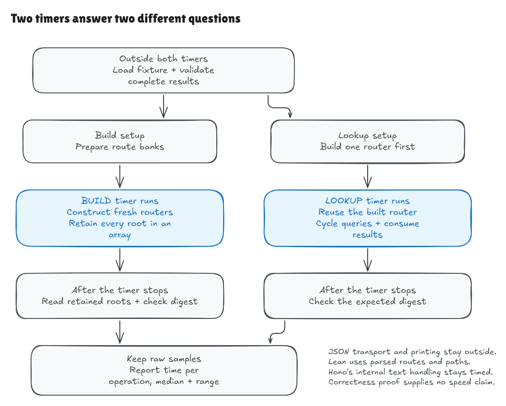
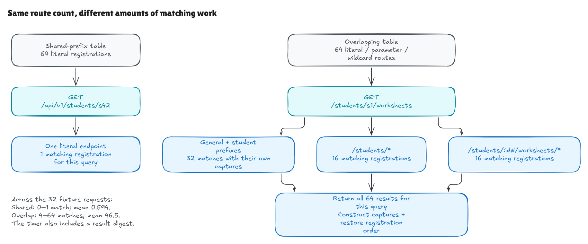

# Measuring construction and lookup separately

The benchmark runs the compiled Lean router and the pinned raw Hono `TrieRouter`
inside their own processes. It measures construction separately from lookup,
with fixed workloads, warmups, repeated samples, and observable result sinks.
Neither the correctness proof nor the comparison harness implies a speed result.



[Full-size image](../../diagrams/benchmark-timers.png) ·
[Editable Excalidraw source](../../diagrams/benchmark-timers.excalidraw)

## Run it

```sh
lake build
ASDF_BUN_VERSION=1.4.0 python3 benchmarks/run.py --hono ../hono
ASDF_BUN_VERSION=1.4.0 python3 benchmarks/tests.py --hono ../hono
```

A regular Bun installation needs version `1.4.0` on PATH; the environment
assignment above selects this machine's asdf installation. `--fetch` can replace
`--hono ../hono` to use the comparison harness's isolated pinned-source cache.
The same exact-HEAD and clean-checkout checks apply. No Hono dependencies are
installed.

The driver builds `router-bench` before preflight, outside any timer, so a stale
executable is not silently used. It then validates both implementations before
launching either measured process. The default raw report goes to ignored
`.benchmark-results/report.json`. Use `--report PATH` to save another run, or
`--config PATH` to select explicit settings. `--smoke` uses a small two-sample
configuration for semantic/report checks; it is not a performance result.

The checked-in [example report](../../../benchmarks/example-results.json) preserves the
actual measurements below. It includes raw nanosecond samples and checksums,
settings, input and source hashes, native binary hash, verified Hono revision,
runtime/compiler versions and flags, and host metadata. It was measured before
the benchmark commit, so the project revision points to the prior comparison
commit and the dirty-worktree flag is true. A later wording-only metadata edit
is recorded separately; the sample durations and checksums were preserved.

## What is measured

| Phase | Included | Outside the timer |
| --- | --- | --- |
| Build | A fresh router, all insertions, and one retained-root array push per build. | JSON decoding, text validation, post-stop result consumption. |
| Lookup | Lookup on one existing router, plus a small length/ordinal checksum of every result. | Router construction, JSON formatting, full semantic equality checks. |

The native Lean runner is [BenchMain.lean](../../../BenchMain.lean). All route patterns,
methods, and request paths are parsed into the existing core types before timing.
No lookup starts a subprocess or parses JSON. Hono's
[runner](../../../benchmarks/hono.ts) calls its raw `add` and `match` operations with
canonical text; their internal path splitting and pattern handling are included.
These are deliberately stated boundaries, not identical parsing costs.

Fresh-router construction is measured in a **warm process**. Hono's module-level
pattern cache is already warm; this is not cold startup or first-use pattern
compilation. Each construction iteration still creates a fresh router and
performs all registrations.

Every newly built root stays live in an array until the stop timestamp. After
the timestamp, the runner looks up a query through every retained root and
consumes its result. This keeps the actual trees observable without charging a
lookup to construction. The array-push overhead is included on both sides. Lean's
deterministic teardown of the current batch happens outside the construction
timer; garbage from earlier Hono batches may be collected during later samples.
The runtimes' allocation and reclamation strategies are part of this limitation.

Lookup keeps one prebuilt router and cycles through runtime-selected requests.
Its checksum consumes ordinals, handler lengths, capture counts, and capture
name/value lengths, modulo 2^32. That sink is timed on both sides. It is a
liveness check, not a collision-resistant correctness oracle. Full maps, labels,
ordering, and multiplicity are compared against the independent model before
timing.

The Lean entry points use `noinline` IO wrappers. Construction alternates between
two runtime-selected registration orders; lookup selects a different query on
each loop iteration. Generated C was inspected: the build loop calls
`freshBuild`, which calls the real `Router.build`, and retains its returned root;
the lookup loop calls `actualLookup`, which calls the real `Router.lookup`.
This and the post-stop tree consumption provide evidence against timing a
reused constant result. They are not a universal theorem about every compiler.

An independent native sanity check doubled both iteration counts while keeping
the workload fixed. Median elapsed batch times grew by factors of 1.88–2.20
across the four workload/phase pairs, and all exact sample checksums passed at
both counts. This supports the live-loop interpretation; it is review evidence,
not a machine-speed threshold in CI.

## Two workloads

[config.json](../../../benchmarks/config.json) fixes seed `1729`, 64 registrations,
32 requests, three warmup samples, and seven measured samples. Each construction
sample builds 16 routers; each lookup sample performs 4,096 lookups. The report
stores the concrete input hash. Both workloads have two route-order variants;
the lookup phase uses the first variant throughout.

1. **Shared prefix.** Literal routes share `/api/v1/students/` and finish with
   distinct literal IDs. Requests include hits, misses, and method mismatches.
   This run returned zero or one match per query, averaging 0.594.
2. **Overlapping routes.** Literal and named-parameter prefixes overlap with
   terminal wildcards and `ALL`. Requests can match many registrations, including
   parameters before an empty or longer suffix. This run returned 4–64 matches
   per query, averaging 46.5.

The generator and independent list-model expectations live in
[run.py](../../../benchmarks/run.py). All 128 request/table combinations per backend
(two workloads, two variants, 32 requests) are fully checked before measurement.
These workloads avoid the known D1 special-name difference; D1 remains tested
and disclosed by the comparison harness.



[Full-size image](../../diagrams/benchmark-workloads.png) ·
[Editable Excalidraw source](../../diagrams/benchmark-workloads.excalidraw)

The literal query in this diagram illustrates the generated table; the overlap
query is also one of the measured fixture requests. Both result counts were
checked against the fixture model. Indexed parameter names stand for the
distinct names generated for those routes.

## What this run found

Host: macOS 26.6.2, arm 64, 14 reported logical CPUs. CPU marketing name was not
available from the permitted host APIs. Lean was `4.35.0` Release; its actual
Lake C compilation command used clang `23.1.0` with `-O3 -DNDEBUG`. Bun was
`1.4.0`. The sanitized compile trace is in the example report.

The table gives median microseconds per operation, followed by the minimum and
maximum sample values. Each build operation constructs the complete 64-route
table; each lookup operation processes one request and its result sink.
Each sample is elapsed batch time divided by operation count. These summaries
describe batch-average costs, not individual-request p50 or tail latencies.

| Workload | Phase | Lean median (min–max), µs | Hono median (min–max), µs |
| --- | --- | ---: | ---: |
| Shared prefix | Build | 22.096 (19.987–24.990) | 27.711 (24.271–81.021) |
| Shared prefix | Lookup | 0.525 (0.501–0.547) | 0.315 (0.258–0.521) |
| Overlapping | Build | 5.859 (5.531–7.151) | 35.096 (25.016–62.378) |
| Overlapping | Lookup | 7.075 (6.964–8.752) | 4.875 (4.519–5.170) |

Hono had lower median lookup time in both workloads on this run. Lean's measured
typed-core construction was lower, especially for the overlapping table. The
construction boundaries differ: Lean receives parsed components, while Hono
receives text and performs its internal processing with a warm pattern cache.
These observations do not justify declaring one implementation universally
faster.

The overlapping workload produces far more results per request. Its higher
lookup cost includes exploring compatible branches, constructing captures,
ordering results, and consuming those results. A literal-only timing would miss
this part of the algorithm's behavior.

Hono's construction samples had substantial spread. JIT compilation, allocation,
and garbage collection can affect a small suite. The processes ran sequentially,
with no CPU affinity, controlled power/thermal state, or load isolation. Raw
samples are retained so the median does not conceal this variation. These are
local measurements rather than an HTTP throughput or production-capacity claim.

## Checks and remaining scope

[tests.py](../../../benchmarks/tests.py) checks workload properties, rejects altered
semantic outputs, checks sample counts/clock values/checksums, rejects bad
configuration, executes a live smoke run, and confirms that a wrong Hono source
pin fails before producing measurements. CI runs the same smoke checks without
any speed threshold.

The existing formal theorems, adapter tests, and Hono comparison remain separate
evidence. This milestone does not prove performance, complexity, parser
correctness, Hono's implementation, or the compiler/runtime. It provides a
reproducible way to measure the chosen operations and inspect their costs.
