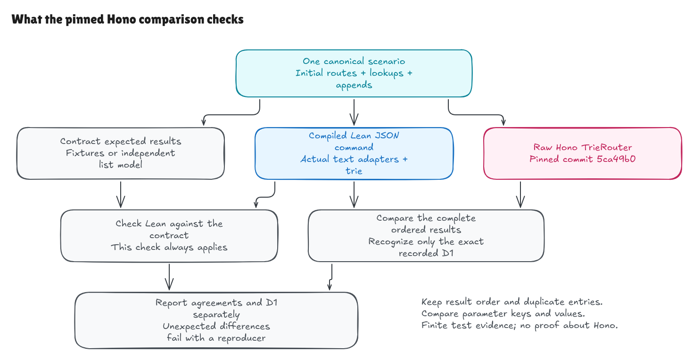
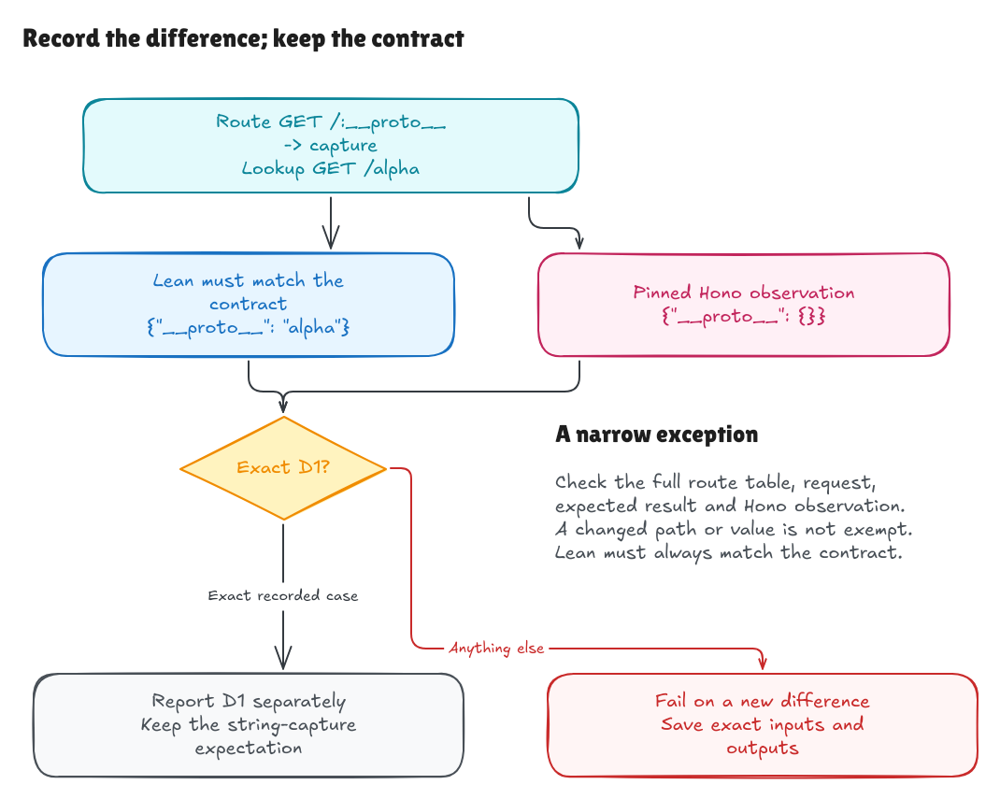

# Comparing the verified router with pinned Hono

This walkthrough records the comparison milestone at `5499996`. Construction
and lookup benchmarks are now implemented; see the
[benchmark walkthrough](benchmark-milestone.md) for measured costs and timing
boundaries. The comparison procedure below remains available.

The harness sends the same valid route tables and lookup/register sequences to
the compiled Lean JSON command and Hono's raw `TrieRouter`. It compares complete
results: registration numbers, unchanged handler labels, per-result captures,
list order, and repeated registrations.

The baseline is Hono commit
`5ca49b0720755c585c9a9835f0a479ceea36fb52`, recorded in
[baseline.json](../../../comparison/baseline.json). This is a comparison with that exact
source, rather than a claim about every Hono version or MathMigo's installed
router. The Lean matching and registration proofs remain unchanged.

## Run the comparison

Build the Lean executables, then use a clean existing Hono checkout:

```sh
lake build
ASDF_BUN_VERSION=1.4.0 python3 tests/compare_hono.py --hono ../hono
ASDF_BUN_VERSION=1.4.0 python3 tests/comparison_tests.py --hono ../hono
```

The `ASDF_BUN_VERSION` assignment selects the installed Bun on this development
machine. A regular Bun installation only needs `bun` version `1.4.0` on PATH.
The driver checks that exact runtime version. Python uses only its standard
library, and the report records its version too. There is no Hono package install.

Alternatively, explicitly fetch the pinned source into this project's ignored
cache:

```sh
ASDF_BUN_VERSION=1.4.0 python3 tests/compare_hono.py --fetch
```

`--fetch` creates `.hono-cache` only when it does not exist. An existing cache
must already pass the same pin and cleanliness checks; the helper never resets,
stashes, cleans, or overwrites an existing checkout. The helper is tested using
real local Git fetch/checkout operations against a temporary cache, without
network access or modification of the source checkout.

The harness requires the exact Git HEAD, a clean tracked/untracked status, and
the raw trie source file. A different commit or a dirty source checkout is an
error before comparison begins. Package-version strings do not select the
baseline. CI checks out the same commit separately, installs Bun `1.4.0`, runs
the comparison tests and harness, and saves the JSON report as an artifact.

## Three things are checked

1. **Lean versus the contract.** Original fixtures retain their normative
   expectations. A small independent Python rule matcher checks those
   expectations and supplies expected results for generated cases. The Lean
   output must match this trace exactly, including every registration response
   and final counter. Hono output is never used to decide what Lean should do.
2. **Hono versus the same expected trace.** The Bun runner imports
   `src/router/trie-router/router.ts` directly. It calls `add` and `match` with
   canonical text, attaching our zero-based ordinal and handler label as the
   handler payload. Each router has its own ordinal sequence, even though Hono
   uses a module-level score internally. This comparison does not exercise
   SmartRouter, HTTP dispatch, URL normalization, or HEAD fallback.
3. **Retained Hono results.** The runner saves each actual raw result and an
   immediate snapshot. After later lookups and registrations, it reads that raw
   result again. The driver requires one before/after record per lookup and
   checks both against the corresponding immediate result. Earlier captures
   must remain unchanged.

Hono's `add` updates its router; Lean's `register` returns a new router value.
The harness compares corresponding ordered tables after each append. The Lean
old-version persistence guarantee comes from its pure API and proof, while the
retained-result check observes Hono's returned capture objects directly.



[Full-size image](../../diagrams/comparison-harness.png) ·
[Editable Excalidraw source](../../diagrams/comparison-harness.excalidraw)

## Normalization must preserve meaningful differences

The [Bun runner](../../../comparison/hono_runner.ts) copies own object entries into
JSON-compatible values. This removes irrelevant backing-prototype differences.
Object-key order is ignored when comparing maps; result-list order is preserved.
The comparison does not sort matches, deduplicate registrations, convert capture
values to strings, or discard unexpected keys. Non-JSON values such as
`undefined` cause a failure instead of disappearing during `JSON.stringify`.
Boolean, number, string, array, and object differences remain observable.

The comparator is in [compare_hono.py](../../../tests/compare_hono.py). It is a small
Python driver around the two programs, with a fixed-seed case generator and
failure reporting. The generator uses the seed, count, and parameter-name pool
recorded in `baseline.json`. Generated tables overlap literal, named-parameter,
terminal-wildcard, and global-wildcard routes, with GET, POST, ALL, HEAD, and
PURGE requests. It varies registration order and capture names, includes empty
and repeated labels, and interleaves real appends and lookups. The original
corpus supplies the exact special-name witness described below.

The default seed is `1729`, with 32 generated scenarios. The parameter pool is
`id`, `studentId`, `kind`, `worksheetId`, and `constructor`. This is a finite test
suite, not exhaustive coverage of the accepted language. The report records the
seed, Python/runtime versions, and hash of the concrete inputs so the run can
be identified and reproduced.

## What the default run found

| Inputs | Scenarios | Lookup observations | Append events |
| --- | ---: | ---: | ---: |
| Original contract corpus | 20 | 52 | 2 |
| Generated cases | 32 | 416 | 96 |
| Total | 52 | 468 | 98 |

The default run found **467 agreeing lookup observations, one exact known D1
observation, and zero unexpected differences**. All 468 retained raw Hono
results stayed unchanged after later operations. The concrete input SHA-256 was
`0fd28d389419e92003f1db8ca2258d9427d223fa0021f640ec237f2ebf22dc0c`.

The report is written to ignored `.comparison-results/report.json`. It includes
the actual verified commit, Bun/Python versions, seed, input hash, counts, and
complete reproducing scenarios with expected/Lean/Hono output for any failures.
Use `--report /path/to/report.json` to keep another run separately, and
`--seed N --generated N` to select another deterministic suite. A new mismatch
fails the command; it is not automatically added to an exception list.

## D1 remains a real difference

For the single route `GET /:__proto__ -> capture`, looking up `GET /alpha` gives:

```text
Lean:  {__proto__: "alpha"}
Hono:  {__proto__: {}}
```

The specification requires the string capture. The pinned Hono source produces
an object value in this exact observation. This is the known D1 difference,
already present in the original contract. It is not a security-vulnerability
claim or a claim about other Hono versions.

D1 recognition requires the entire approved route table, the single request,
ordinal, label, normative expectation, baseline annotation, and exact observed
Hono result object. Missing or changed metadata fails. A generated case cannot
inherit this exception, and any wrong Lean output fails regardless of D1.
Changing the observed Hono value or adding result fields also fails. This keeps
one documented observation from becoming permission to ignore other problems.



[Full-size image](../../diagrams/comparison-d1.png) ·
[Editable Excalidraw source](../../diagrams/comparison-d1.excalidraw)

## What the tests and proof each tell us

[comparison_tests.py](../../../tests/comparison_tests.py) contains nine tests with
negative probes for missing, reversed, duplicated, wrong-capture, and wrong-type
results; missing or altered retained observations; tampered fixture expectations;
changed D1 metadata, routes, requests, or outputs; wrong source pin; tracked and
untracked changes; cache overwrite refusal; isolated fetch; and an `undefined`
capture passed through the actual Bun runner.

Independent review ran another suite with seed `20261023` and 64 generated
scenarios. Together with the original corpus, it covered 884 lookups and 194
append events: 883 agreements, one exact D1 observation, and no unexpected
differences. Its input SHA-256 was
`fa3813548a3c4853d21533f14c129a1292741466a43215b48b6225469ebfe55d`.

Separate end-to-end fault experiments checked the actual driver and report
path. After an unchanged control passed, eight tampered-output/evidence cases
failed with complete reproducing traces. These included dropped, reversed,
deduplicated, and wrong-capture Lean results; Lean copying the D1 object value;
missing Hono retained records; a changed D1 observation; and an undefined capture.
In the copied-D1 fault, both implementations agreed on the wrong value, and the
independent Lean-versus-contract check still rejected it.

An isolated clone also confirmed that tracked changes, untracked files, and a
different Git HEAD are rejected before comparison. A matching source tree at a
different commit was insufficient. The private-cache fetch helper was exercised
with local Git transport and then reused the verified clean cache.

The 30 rejected-input fixtures remain adapter tests. They are intentionally not
sent to Hono for compatibility judgments: accepting text outside our declared
domain is not a Hono bug. Run `python3 tests/adapter_cli.py` for those checks.

The Lean theorem proves agreement with the formal matching rules for arbitrary
finite typed inputs. Adapter tests cover the text/JSON boundary. This differential
harness gives finite executable evidence about one pinned external implementation.
Agreement on these cases does not prove Hono or its surrounding application, and
it does not establish universal compatibility or a performance bound.

Release benchmarks and broader evidence remain future work. The harness makes
no speed claim and does not silently change the specification to make a run pass.
