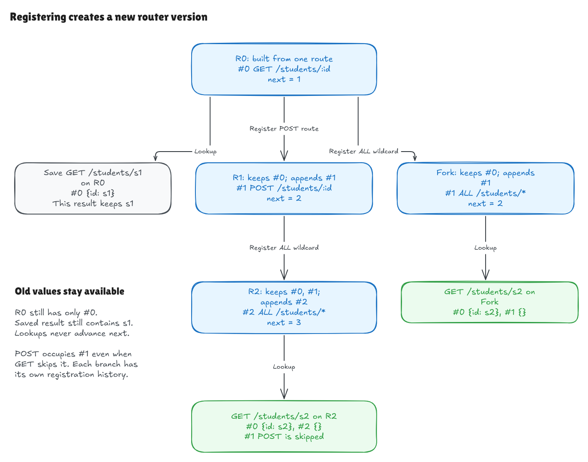
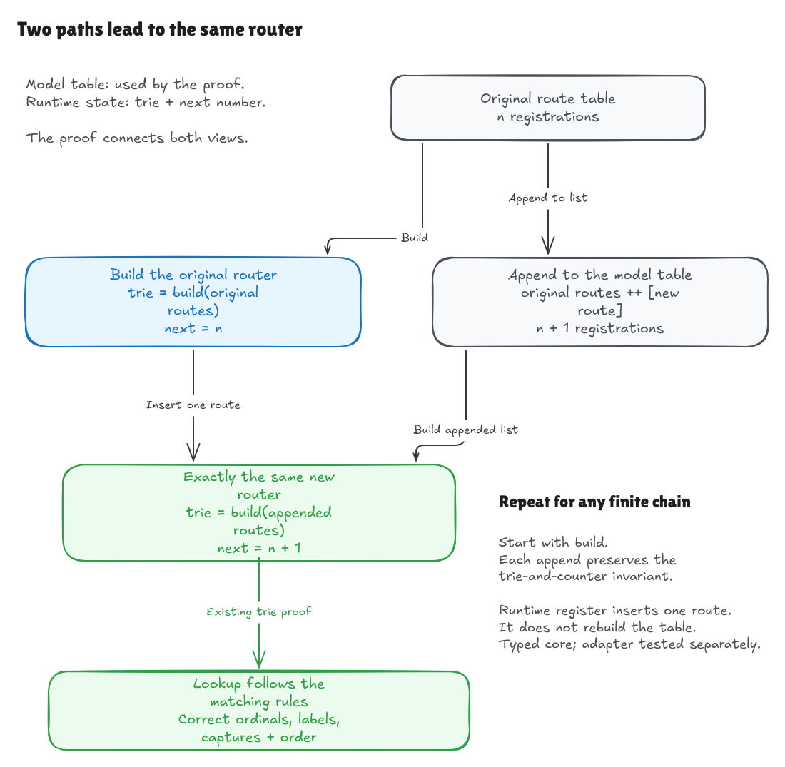

# Incremental registration with reusable router versions

This walkthrough describes the historical milestone at `4fa3868`. Text/JSON
adapters are now implemented and tested; see the
[adapter walkthrough](adapter-milestone.md) for the current input boundary.

This milestone adds a small public wrapper around the existing trie. You can
build a router, append a registration, and query either the old or new version.
Matching rules, parameter captures, terminal wildcards, and registration order
keep their existing meaning.

Text/JSON adapters, invalid-input errors, the full Hono comparison harness, and
release benchmarks remain future work. This is an incremental typed-core API.

## Registration creates a new value

Start with one registration:

```text
r0: #0 GET /students/:id -> read
```

Looking up `GET /students/s1` returns `#0 read {id: "s1"}`. Save that result.
Then append a POST route and append the GET route again:

```text
r1 = register(r0, POST /students/:id -> write)
r2 = register(r1, GET  /students/:id -> read)
```

The versions now describe these tables:

| Version | Registrations | Next ordinal |
| --- | --- | --- |
| r0 | #0 GET read | 1 |
| r1 | #0 GET read; #1 POST write | 2 |
| r2 | #0 GET read; #1 POST write; #2 GET read | 3 |

`GET /students/s4` against r2 returns registrations 0 and 2, both capturing
`id = "s4"`. The POST registration still consumed ordinal 1, even though it
does not match this request. The repeated GET registration remains a separate
result.

The old r0 still returns only its original registration. The saved s1 result
still contains `id = "s1"`. A later request for s4 cannot rewrite it.

You can also append independently from r0:

```text
fork = register(r0, ALL /students/* -> log)
```

This fork assigns ordinal 1 to `log`, because its own history contains one
earlier registration. Ordinals identify occurrences within one router's table;
different version branches can legitimately assign the same next number.

Lookups return result lists. They do not return modified router state, consume
ordinals, or change which number the next registration receives.

In this visual example, the second append is an `ALL` wildcard. Looking up GET
against R2 returns registrations 0 and 2; appending the same wildcard directly
from R0 gives it ordinal 1 on that independent branch.



[Full-size image](../../diagrams/registration-versions.png) ·
[Editable Excalidraw source](../../diagrams/registration-versions.excalidraw)

## The runtime representation stays small

[Router.lean](../../../HonoLean/Router.lean) contains the runtime API:

- `Router.empty`: a router with no registrations;
- `Router.build routes`: construct the initial ordered table;
- `Router.register router route`: append one registration;
- `Router.registerMany router routes`: append a finite list in order;
- `Router.lookup router method path`: run the existing trie lookup.

A `Router` holds only a finite trie and `nextOrdinal`. Registering inserts one
entry into that trie at the new route's prefix and increments the counter.
It does not store the original route list, rebuild the whole table, or call the
reference matcher. `registerMany` folds the same single-registration operation
over its input.

The router, trie, result lists, and capture pairs are immutable Lean values.
The functions are pure. This gives old-version and retained-result isolation
directly; there is no request cache or shared mutable capture map to reset.
The runtime API is 31 lines and introduces no dependency.

## The invariant connects the trie and counter

Imagine a router whose trie contains five registrations but whose counter says
the next ordinal is zero. Appending could reuse an existing number. Checking the
trie alone would not establish correct incremental behavior.

[Router/Correctness.lean](../../../HonoLean/Router/Correctness.lean) defines a proof-only
relation, `Router.Represents router routes`, with two facts:

1. The stored trie equals the trie built from that ordered route table.
2. The next ordinal equals the number of registrations in the table.

The route table in this relation is part of the mathematical explanation. It is
not a runtime field or a validation scan performed on each registration.

The structure constructor is private to guide clients toward the public API.
The guarantee is established for states created by those smart constructors,
and conditional theorems explicitly require `Represents` for any supplied state.
Constructor visibility alone is not the proof that every conceivable manually
altered state has a coherent trie and counter.



[Full-size image](../../diagrams/registration-proof.png) ·
[Editable Excalidraw source](../../diagrams/registration-proof.excalidraw)

## What the proof establishes

The new proof reuses the previous matching theorem rather than changing the
matching rules:

1. `Trie.buildFrom_append` proves that building a concatenated table is the same
   as building its first part, then continuing insertion with the correct
   ordinal. `Trie.build_append_singleton` specializes this to one new route.
2. `Router.register_represents` uses that identity to prove that appending one
   route preserves both parts of `Represents` for `routes ++ [route]`.
3. `Router.registerMany_represents` repeats the preservation argument for an
   arbitrary finite append sequence.
4. The existing trie/reference theorem then establishes exact lookup equality.
   `Router.lookup_registerMany_build_iff_rules` connects the public operation
   directly to the independent ordered matching rules.

The headline statement covers any initial finite route table, any finite list
of appended routes, and any supported method and structured request path. It
does not assume a particular output or a size bound. Equality preserves complete
results: ordinals, labels, parameter captures, duplicates, and registration order.

`Router.lookup_iff_rules` also applies after any custom sequence for which a
caller has `Represents`; `register_represents` is the step that maintains it.
Interleaved lookups do not change that invariant because lookup does not update
the router.

## Try the examples

Run:

```sh
lake build
lake exe hono-lean
lake env leanchecker --fresh HonoLean
```

The demo retains all 43 earlier examples, adds 12 registration examples, and
runs the actual retained-value/fork sequence described above. It checks result
contents and next ordinals using the public API. Cases include misses, methods
and ALL, wildcard suffixes, duplicate registrations, different parameter names,
ordinary-string `__proto__` capture, and an empty handler label.

Concrete logical examples use the general registration theorem, then evaluate
reference expectations in Lean's kernel. The executable separately performs the
real incremental trie operations. Main-proof axiom guards allow only the usual
Lean logical axioms `propext`, `Classical.choice`, and `Quot.sound`.

Independent review ran 247 public lookup-and-counter checks. All 52 normative
corpus expectations were exercised through initial builds and append-from-empty
construction, with actual registration calls for the corpus's append events.
Saved results and old router versions were checked again after later operations.
An additional append-heavy sequence covered methods, wildcards, duplicate
registrations, special parameter names, exact misses, and an independent branch
from a retained older version. The versions and outputs in the new Excalidraw
diagram were also checked against the public API.

The complete build, demo, axiom guards, and fresh kernel replay passed. In a
separate temporary project, an unchanged control build passed, then three
deliberately broken implementations typechecked but failed the general
registration proof:

- keeping the old counter instead of advancing it;
- assigning ordinal zero to every new entry;
- starting insertion from an empty trie, discarding existing registrations.

The first fault violates the counter half of `Represents`; the others violate
its trie half. This shows why both facts matter to the incremental guarantee.

## The remaining boundary

The API accepts already-structured routes and request segments. Methods and
parameter names carry their validity evidence; literal and request segments
remain raw strings. The future text adapter will enforce the canonical grammar.

This API does not yet decode malformed text or JSON, so this milestone does not
claim the specification's adapter error categories or failed-registration
atomicity tests. The formal result concerns the Lean core. It does not verify
Hono's TypeScript, handler execution, performance, or the compiler/runtime and
machine used to execute native code.
