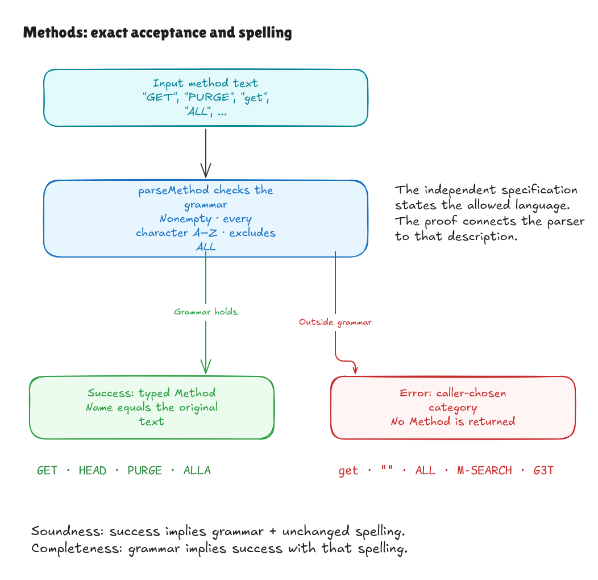
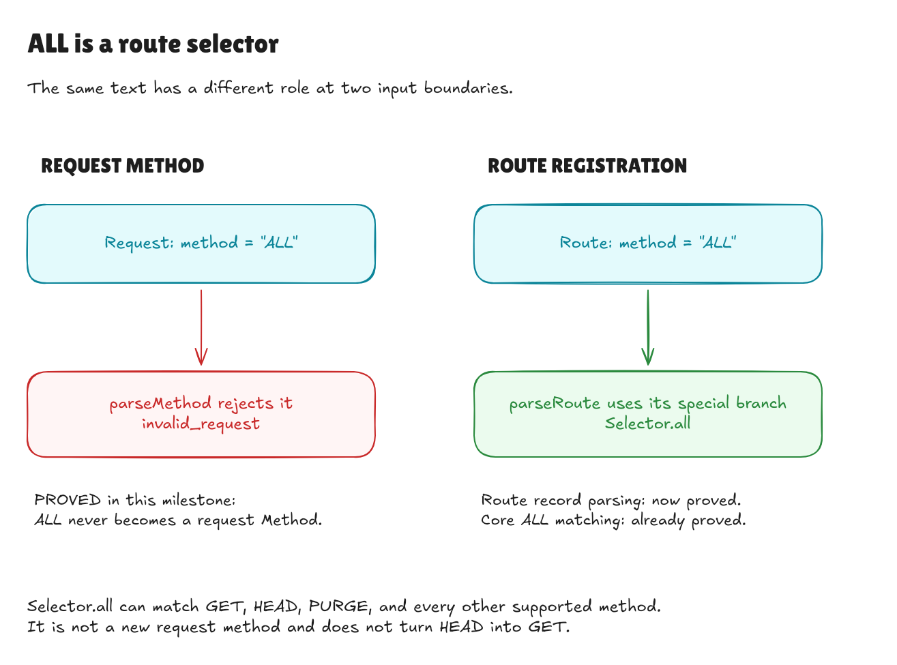

# Proving the method parser

This records the method milestone at `8952ce1`. The subsequent
[pattern-parser proof](pattern-parser-walkthrough.md) covers route-pattern
fields. The [completed text goal](text-boundary-goal.md) composes them through
match lists; boundaries below describe this method milestone.

The method parser now has a correctness proof against the written grammar.
Together with the earlier [path proof](path-parser-walkthrough.md), this covers
both individual text fields of a request. The proofs remain separate from the
whole JSON adapter and its surrounding lookup operation.

The grammar and executable behavior are unchanged:

```text
method = one or more ASCII uppercase letters A through Z, except exactly ALL
```

The existing `parseMethod` implementation needed no changes. This milestone
adds an independent description of its contract and a proof connecting them.

## What the two directions mean

**Soundness** says every successful parse is trustworthy. Its spelling follows
the grammar, and the returned method has exactly the original text. Preserving
the spelling matters: both `HEAD` and `GET` are valid methods, but returning
`GET` after reading `HEAD` would violate the contract.

**Completeness** says every grammar-valid spelling succeeds. A parser that
accepts only a short list of familiar HTTP methods would fail this promise:
`PURGE`, `CUSTOM`, and other uppercase words in our grammar must also work.
Completeness needs only the grammar as a premise; callers do not have to
construct a typed method or supply an existing parser result first.



[Full-size image](../diagrams/method-parser-contract.png) ·
[Editable source](../diagrams/method-parser-contract.excalidraw) ·
[Excalidraw canvas](https://app.excalidraw.com/s/8wot9n3ajqf/8SXp3iNROXq)

| Text | Required behavior |
| --- | --- |
| `GET`, `HEAD`, `OPTIONS` | Accept and preserve the exact name. |
| `PURGE`, `CUSTOM`, `A`, `Z` | Accept; the grammar allows custom and single-letter methods. |
| `ALL` | Reject as a method; this exact word is reserved for route selection. |
| `ALLA` | Accept; containing `ALL` is allowed. |
| Empty text, `get`, `Get` | Reject; no empty spelling or case conversion. |
| ` GET`, `GET `, `G3T`, `M-SEARCH` | Reject spaces, digits, and punctuation. |
| `@`, `[`, `GÉT`, `ＧＥＴ` | Reject characters outside ASCII `A` through `Z`. |

## Why ALL has two roles in the surrounding adapter

`parseMethod` produces one exact request-method value. Its grammar excludes
`ALL`. In the surrounding route parser, the special route spelling `ALL` is
recognized separately and produces the existing all-method selector. A route
registered with that selector can match `GET`, `HEAD`, or any other supported
request method. It does not introduce a request method named `ALL`.



[Full-size image](../diagrams/method-parser-all.png) ·
[Editable source](../diagrams/method-parser-all.excalidraw) ·
[Excalidraw canvas](https://app.excalidraw.com/s/8wot9n3ajqf/6l0ecAChQ2g)

The helper accepts an error category from its caller. Request parsing supplies
`invalid_request`; exact route-method parsing supplies `invalid_route`. The new
proof covers that helper for every supplied category and proves it preserves
the category when it rejects. The special route-selector branch remains part
of the separately tested surrounding route parser.

## How the proof is organized

[Method/Spec.lean](../../HonoLean/Adapter/Method/Spec.lean) defines `Character` using
plain character bounds and `Spelling` using nonempty character lists, membership
in that alphabet, and exclusion of the reserved word. `Denotes text method`
adds equality between the returned name and the original input. These
definitions call neither the parser nor the existing validity check.

[Method/Correctness.lean](../../HonoLean/Adapter/Method/Correctness.lean) first proves
that `Literal.ValidMethod` agrees with the independent grammar. It then proves:

```text
parseMethod kind text = success method
    if and only if
text follows the grammar and method.name = text
```

`sound` exposes the forward direction. `complete` constructs a successful
result from the grammar alone; `accepts_iff` states the language equivalence
without requiring a preconstructed typed method. `parse_name` proves that a
typed method's name parses back to that same method. `error_kind` and
`rejects_iff` establish that exactly the unsupported spellings reject, retaining
the caller's supplied error category.

This is a proof for every finite method string, including all supported custom
names. It does not prove that the chosen grammar covers every HTTP method form
or every feature of Hono. The restricted alphabet is the existing project
contract and remains open to human review.

Route-pattern parsing, JSON decoding/encoding, and the complete text-to-results
adapter operation remain separately tested. The existing core theorem still
covers matching and typed registration. No new end-to-end JSON theorem is
claimed here, and existing v1 benchmark samples remain historical records.

## Checking it locally

```sh
lake build
lake exe adapter-tests
python3 tests/adapter_cli.py
lake env leanchecker --fresh HonoLean
```

The root library imports the new proof and examples. Main acceptance and
rejection theorem guards allow only Lean's ordinary `propext`,
`Classical.choice`, and `Quot.sound` foundations. No unfinished proofs, custom
axioms, native proof shortcuts, or new dependencies were added.

The Lean examples exercise successful exact spellings and rejected boundary
cases. Direct compiled tests run eight accepted and thirteen rejected spellings
with each of the three error categories. The existing compiled JSON suite
continues to check the full v1 corpus. These finite checks exercise the
executable; the theorem establishes the universal parser contract.

An independent compiled-CLI audit checked 5,758 request spellings against a
regular-expression version of the written grammar: 865 succeeded with the
expected dispatch and 4,893 returned `invalid_request`. It also checked 271
registration attempts, of which 57 succeeded, including the special `ALL`
selector. Cases covered ASCII boundary characters, Unicode lookalikes, controls,
custom methods, and a 4,096-letter spelling. The helper's exact returned name
is additionally checked by the direct compiled cases above.

Three faults were tried in temporary copies: renaming valid methods to `GET`,
rejecting the valid custom name `PURGE`, and replacing the supplied error
category with `invalid_input`. Each changed adapter and independent grammar
compiled, while the correctness proof failed; an unchanged control passed.
These faults exercise exact spelling, completeness, and rejection-category
preservation respectively. No production source changes or benchmark sample
updates were needed for this milestone.
