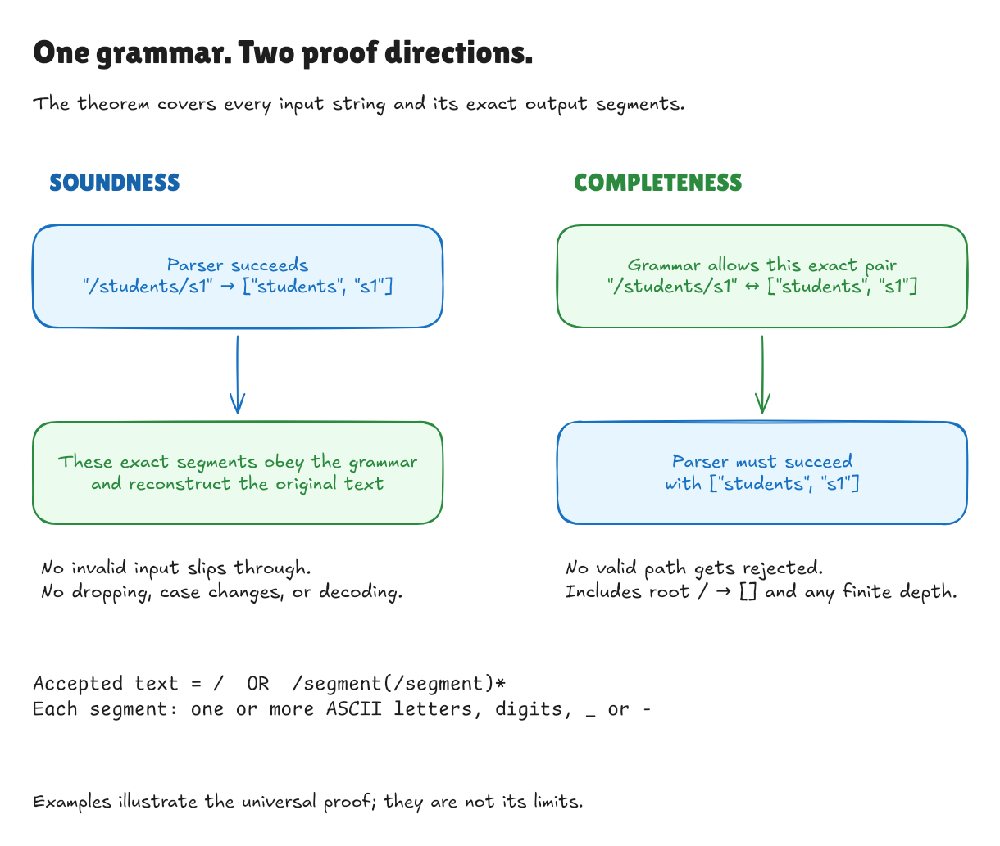
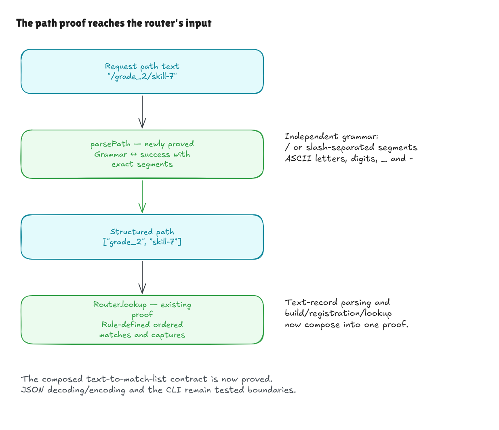

# Proving the request-path parser

This records the path milestone at `b6c35cb`. The subsequent
[method-parser proof](method-parser-walkthrough.md) covers method spellings;
the boundary diagram below now notes the completed text-to-matches composition.

The request-path parser now has its own correctness proof. Previously, the
router theorem began with a list such as `["students", "s1"]`; tests checked
that `/students/s1` became that list. This milestone proves that conversion for
every path string in the supported domain, and proves rejection outside it.

The accepted language is unchanged:

```text
segment      = one or more ASCII letters, digits, underscores, or hyphens
request-path = "/" | "/" segment ("/" segment)*
```

This is a small extension after the completed v1 review. The earlier benchmark
measurements and release report remain historical records of that version.

## Two directions, one exact result

**Soundness** means that success is trustworthy. If parsing succeeds with
`["students", "s1"]`, both segments contain allowed characters, neither is
empty, and spelling them with the canonical slashes gives back exactly the
original input. This last requirement matters: returning `["students"]` after
silently dropping `s1` would still return valid segments, but would violate
the theorem.

**Completeness** means that the parser misses no valid input. Any string spelled
according to the grammar is accepted with exactly its corresponding segments.
A parser that rejects every request would satisfy soundness vacuously; it
would fail completeness.



[Full-size image](../diagrams/path-parser-equivalence.png) ·
[Editable source](../diagrams/path-parser-equivalence.excalidraw) ·
[Excalidraw canvas](https://app.excalidraw.com/s/8wot9n3ajqf/76INY2AHl5W)

| Text | Required behavior |
| --- | --- |
| `/` | Accept as `[]`. The root slash contains no segment. |
| `/students/A-0_b` | Accept as `["students", "A-0_b"]`. |
| `/GET/007` | Preserve capitalization and leading zeroes. |
| `/a/`, `/a//b` | Reject empty segments. |
| `/café`, `/%61`, `/a.b` | Reject characters outside the alphabet. |
| ` /a`, `/a?b`, `https://example.com/a` | Reject; do not repair or reinterpret. |

## Keeping the specification independent

[Path/Spec.lean](../../HonoLean/Adapter/Path/Spec.lean) defines the alphabet as plain
propositions about characters. `Segment` requires a nonempty string containing
only those characters. `render` spells a segment list with slashes, using `/`
for the empty list. `Denotes text pieces` requires valid segments and exact
equality between the input and that spelling.

These definitions call neither the parser nor a splitter. They describe what
an answer means, independently of how the executable finds it.

[Path/Correctness.lean](../../HonoLean/Adapter/Path/Correctness.lean) proves that
the existing Boolean segment check agrees with that alphabet, and that an
allowed segment cannot contain `/`. Lean's standard character-splitting laws
then establish that splitting and joining preserve the complete original text,
and recover the intended boundaries of every valid spelling.

The request parser in [Adapter.lean](../../HonoLean/Adapter.lean) uses that standard
character splitter so these laws apply directly. Route-pattern parsing retains
its existing implementation. Request error messages have been consolidated;
the contractual error category remains `invalid_request`.

The main theorem, `PathText.parsePath_iff`, says:

```text
parsePath text = success pieces
    if and only if
every piece is a valid segment and text = render pieces
```

`sound` and `complete` expose the two directions. `parse_render` proves the
round trip for lists of valid segments. `unique` proves that a valid spelling
has only one decomposition. `rejects_iff` proves that exactly the strings
outside the grammar produce an `invalid_request` error.

The valid-segment assumption on the round trip is essential. Arbitrary core
lists such as `[""]` or `["a/b"]` have no representation in this text grammar.

## Where the guarantee ends



[Full-size image](../diagrams/path-parser-boundary.png) ·
[Editable source](../diagrams/path-parser-boundary.excalidraw) ·
[Excalidraw canvas](https://app.excalidraw.com/s/8wot9n3ajqf/22PBOR4CfHa)

This proof covers the pure `parsePath` function. The existing core theorem
continues to cover matching and typed registration. The later
[completed text goal](text-boundary-goal.md) now composes method/pattern/record
parsing, builds, registration, and lookup through exact match lists. JSON
decoding/encoding and the CLI remain tested boundaries. Hono's TypeScript and
a surrounding HTTP application remain outside these Lean proofs.

## Checking it locally

```sh
lake build
lake exe adapter-tests
python3 tests/adapter_cli.py
lake env leanchecker --fresh HonoLean
```

The root library imports the new proof and examples, so normal library builds
check them. Axiom guards require the main acceptance and rejection theorems to
use only Lean's ordinary `propext`, `Classical.choice`, and `Quot.sound`
foundations. There are no unfinished proofs, custom axioms, or native proof
shortcuts. Fresh replay checks the declarations again with Lean's kernel.

The Lean examples and compiled adapter tests exercise root, exact spelling,
case preservation, and rejected boundary cases. The existing compiled JSON
suite continues to check all 20 corpus scenarios and their expected results.
Those finite tests exercise the executable; the theorem supplies the universal
statement about `parsePath`.

An independent compiled-CLI audit checked 6,109 path strings against a Python
regular-expression version of the written grammar. It checked exact captured
segments for 1,402 accepted paths and `invalid_request` for 4,707 rejections,
covering every ASCII character, Unicode/control cases, a 4,096-character segment,
and a 100-segment path. This is additional finite evidence, not a bound on the
proof.

Three deliberate changes were tried in temporary copies: dropping the first
returned segment, accepting dots, and rejecting the otherwise valid `/A`.
Each changed adapter and the independent specification still compiled, but its
correctness proof failed. An unchanged control compiled. The first change broke
exact spelling, the second broke the alphabet bridge, and the third left a
completeness obligation that could not be discharged.

The normal build, existing router demo, direct/JSON adapter suites, and benchmark
smoke suite passed. Comparison with the pinned Hono revision still produced 467
agreements and the one exact documented D1 difference over 468 lookups, with no
unexpected differences. Existing benchmark samples were not replaced.
