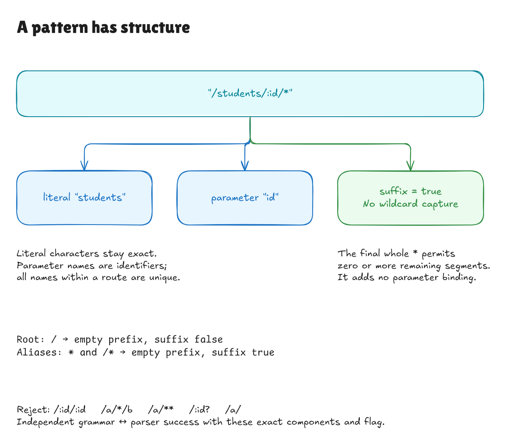

# Proving the route-pattern parser

This records milestone `967f0e5`. The later
[completed text goal](text-boundary-goal.md) composes it through record parsing,
builds, registration, and lookup; the boundaries below describe this pattern step.

The pattern parser now has a proof against the existing restricted grammar.
Together with the earlier path and method proofs, this covers the three
individual text languages used by the adapter. Proving how their results are
assembled into route and request records is the next milestone.

The supported language is unchanged:

```text
name      = an ASCII letter or underscore, then letters, digits, or underscores
component = a nonempty literal segment | ":" name
pattern   = "/" | "*" | "/*"
          | "/" component ("/" component)* ["/*"]
```

Literal segments use ASCII letters, digits, underscores, and hyphens. Parameter
names must be unique within one pattern. Nothing is trimmed, decoded, or
reinterpreted as a literal when its parameter/wildcard syntax is unsupported.

## What the parser must preserve

Consider `/students/:id/*`. Its meaning is two components—literal `students`
and parameter `id`—plus a suffix flag set to true. The final wildcard is not a
third parameter or a captured value. It tells the existing matcher that any
remaining path segments are permitted after that prefix.

| Text | Required parsed meaning |
| --- | --- |
| `/` | No components; suffix false. It is the exact root. |
| `*`, `/*` | No components; suffix true. These are aliases. |
| `/students/:id` | Literal `students`, parameter `id`; suffix false. |
| `/students/:id/*` | The same prefix; suffix true. |
| `/:id/:ID` | Two distinct, case-sensitive parameter names. |
| `/:id/:id` | Reject the repeated name. |
| `/a/*/b`, `/a/*/*` | Reject a nonterminal or repeated wildcard. |
| `/:id?`, `/a*`, `/a/`, `/a//b` | Reject unsupported syntax and empty components. |

Soundness proves that a successful result has exactly the components, names,
order, and suffix flag described by the grammar. Returning the right prefix but
forgetting its wildcard would still change matching behavior, so the flag is
part of the theorem.

Completeness proves that every grammar-valid pattern succeeds with that exact
meaning. It constructs a typed result from the grammar alone. Rejection is also
characterized exactly: the strings outside the grammar produce `invalid_route`.



[Full-size image](../diagrams/pattern-parser-contract.png) ·
[Editable source](../diagrams/pattern-parser-contract.excalidraw) ·
[Excalidraw canvas](https://app.excalidraw.com/s/8wot9n3ajqf/643vRjehZQi)

## Keeping the grammar independent

[Pattern/Spec.lean](../../HonoLean/Adapter/Pattern/Spec.lean) describes identifier
characters with propositions and reuses the independent literal-segment
alphabet. `ComponentText` distinguishes a literal spelling from a colon-prefixed
parameter name. `Pieces` is a grammar for whole components: an empty exact
sequence, a final wildcard, or a component followed by another sequence.

`Spelling` adds the exact leading slash and slash-separated text, plus the bare
`*` alias. `Denotes` adds unique parameter names. None of these definitions calls
the parser, splitter, or Boolean name-validity check.

[Pattern/Correctness.lean](../../HonoLean/Adapter/Pattern/Correctness.lean) connects
those independent character rules to the executable checks. Allowed component
spellings are nonempty and contain no slash, so standard split/rejoin laws
recover their boundaries exactly. The sequence argument then proves that the
only permitted wildcard is the terminal whole component.

The headline theorem, `PatternText.parsePattern_iff`, says:

```text
parsePattern text = success parsed
    if and only if
the grammar assigns text exactly parsed.path and parsed.suffix
```

`complete` constructs the successful result from a grammar witness;
`accepts_iff` states language equivalence without requiring a preconstructed
typed result. `error_kind` and `rejects_iff` cover the rejection category and
exact rejected language.

## The small implementation change

The pattern logic was extracted from `parseRoute` into `parsePattern`, returning
a `ParsedPattern` with its components, suffix flag, and checked name validity.
The route parser uses those fields and keeps its existing method-selector and
handler behavior.

The component-list helper now follows a short recursive rule: empty means an
exact end, a sole remaining `*` means a wildcard end, and every other step must
parse one literal or parameter before continuing. This replaces the previous
last-element/drop-last decomposition with the same accepted language. The slash
splitter uses the standard character API so its proved inverse laws apply.

The matching trie and its correctness theorem are unchanged. This milestone
does not prove route method selection, record assembly, JSON decoding/encoding,
or the full adapter lookup operation. Those surrounding boundaries retain their
tests until their own proofs are added. Existing benchmark samples remain
historical records.

## Checking it locally

```sh
lake build
lake exe adapter-tests
python3 tests/adapter_cli.py
lake env leanchecker --fresh HonoLean
```

The root imports the pattern proof and examples. Main acceptance and rejection
axiom guards permit only Lean's ordinary `propext`, `Classical.choice`, and
`Quot.sound` foundations. No custom axioms, unfinished proofs, native proof
shortcuts, or dependencies were added.

Kernel examples include an explicit independent-grammar witness for
`/students/:id/*`, exact root/wildcard shapes, and rejected boundary cases.
Direct compiled checks exercise seven accepted decompositions and eighteen
rejections. The existing JSON suite continues to check the full v1 corpus,
including failed registrations. These finite checks exercise execution; the
theorem supplies the universal parser statement.

Independent review checked 1,384 pattern registrations against a separate
regular-expression model: 348 accepted and 1,036 rejected. It checked 179 exact
ordered lookup/capture expectations and 25 invalid initial builds, including
all ASCII characters, Unicode/control boundaries, wildcard aliases, duplicate
names, reserved-looking parameter keys, and a 40-parameter pattern.

Three changes were tried in temporary copies: flipping the suffix flag,
allowing a wildcard before the end, and renaming a parameter. Each changed
adapter and the independent grammar compiled, but the proof failed. An unchanged
control passed. The pinned Hono comparison still reported 467 agreements and
the one exact documented D1 difference over 468 lookups, with no unexpected
differences.
