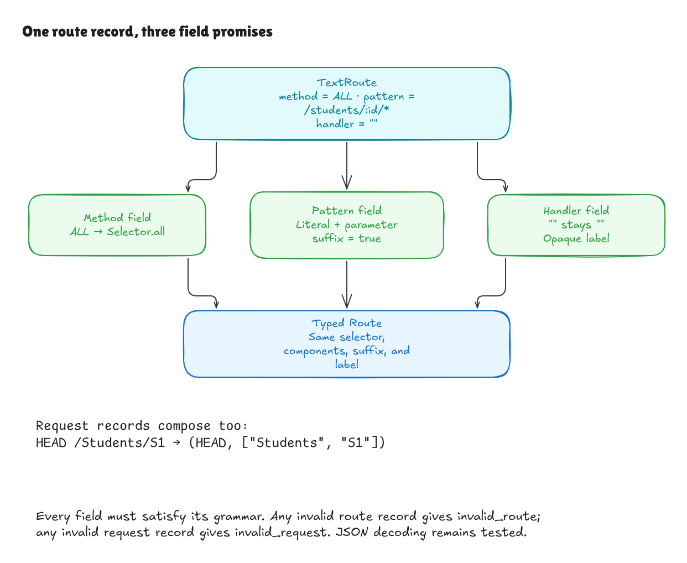

# From proved fields to proved route and request records

This records milestone `fcde775`. The later
[completed text goal](text-boundary-goal.md) extends these record contracts
through construction, registration histories, and lookup.

The earlier proofs established method, request-path, and route-pattern parsing
one field at a time. This milestone connects those contracts to the actual
`parseRoute` and `parseRequest` functions. The production code is unchanged.

For a route, successful parsing now guarantees all three facts together:

- The method spelling selects exactly one supported method, or `ALL` selects
  every supported method.
- The pattern has its exact literal/parameter components and terminal-wildcard
  flag, with unique parameter names.
- The handler label equals the original string, including an empty label,
  Unicode characters, quotes, or newlines.

For a request, success guarantees the exact supported method name and exact
path segments together. The route-only word `ALL` remains invalid as a request
method. Completeness establishes that every record satisfying these independent
field grammars succeeds; no preconstructed typed route or request is required.



[Full-size image](../diagrams/record-parser-contract.png) ·
[Editable Excalidraw source](../diagrams/record-parser-contract.excalidraw) ·
[Excalidraw canvas](https://app.excalidraw.com/s/8wot9n3ajqf/1FbPg72LQfj)

## Why composition needs a proof

Correct field parsers alone do not guarantee correct assembly. A surrounding
function could parse the right pattern and then drop its suffix flag, replace
the handler label, or choose the wrong method selector. These record theorems
rule out those assembly errors.

Consider this route:

```text
method:  ALL
pattern: /students/:id/*
handler: read
```

The result must contain the all-method selector, literal `students`, parameter
`id`, a true suffix flag, and exactly the label `read`. The special selector is
kept separate from request-method parsing: a request with method `ALL` is
rejected, while `HEAD /Students/S1` keeps both the name `HEAD` and the path's
capitalization.

A field failure also needs to propagate through the combined parser. An
invalid method or pattern produces `invalid_route` when parsing a route. An
invalid method or path produces `invalid_request` when parsing a request.
Neither parser can turn a failed field into a successful default record.

## How the proof is organized

[Record/Spec.lean](../../HonoLean/Adapter/Record/Spec.lean) defines record meaning by
combining the existing independent grammars. `SelectorDenotes` distinguishes
`ALL` from an exact method. `RouteDenotes` adds the pattern and exact label;
`RequestDenotes` combines the method and path. The text-only `RouteSpelling` and
`RequestSpelling` predicates describe the accepted domains without calling a
parser or requiring a typed result.

[Record/Correctness.lean](../../HonoLean/Adapter/Record/Correctness.lean) proves:

```text
parseRoute input = success route
    if and only if RouteDenotes input route

parseRequest input = success request
    if and only if RequestDenotes input request
```

The proof follows the field results through the actual assembly code. Its
small internal sequencing lemma says that a sequence succeeds exactly when
each operation succeeds and supplies the value used by the next operation.
Existing method, pattern, and path theorems then establish the record contracts.
Lean treats alternative proofs of the same validity fact as equivalent, so the
meaning concerns the data rather than how validity evidence was obtained.

`route_accepts_iff` and `request_accepts_iff` characterize acceptance using only
the written grammars. The rejection theorems characterize exactly the records
outside those grammars and prove their error categories. `handler_preserved`
exposes the label guarantee directly.

## Checking and remaining scope

The modules and examples build with warnings as errors. Axiom guards on the
acceptance, exact-result, and rejection theorems allow only Lean's ordinary
`propext`, `Classical.choice`, and `Quot.sound` foundations. The examples check
real record parsing, including `ALL`, named suffixes, opaque labels, root, case
preservation, malformed patterns, and categorized failures.

This milestone proves the two individual text-record parsers. Ordered table
construction, incremental registration, and lookup composition are the next
steps in the [five-milestone goal](text-boundary-goal.md). JSON decoding/encoding,
the CLI, Hono's TypeScript, and a surrounding HTTP application remain outside
these record proofs. The existing matching and typed-registration proofs retain
their original guarantees.

Independent review changed three behaviors in temporary copies: discarding the
handler label, turning route `ALL` into exact `GET`, and reversing request path
segments. Each changed adapter and the independent record specification still
compiled, but the correctness proof failed; the unchanged control passed.
Direct native checks also preserve an opaque Unicode/newline handler label,
the `ALL` selector, and `HEAD /Students/S1` exactly. Fresh kernel replay of the
record examples passed.
