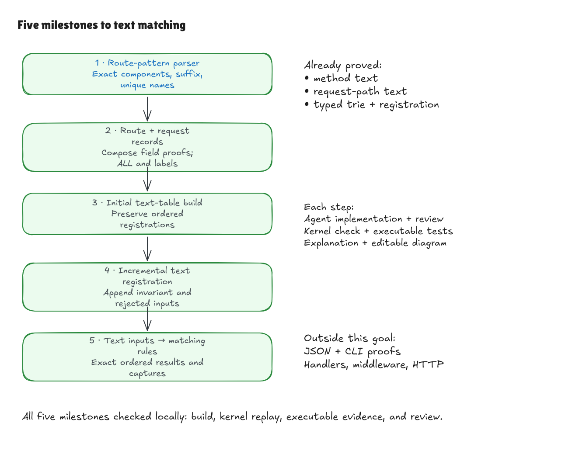

# Five milestones to the text boundary

This completed goal starts after the method-parser milestone at `8952ce1`.
It counts the requested route-pattern parser as milestone 1 and keeps the next
four steps focused on composing small contracts around the existing router.
Each step received an implementation agent, independent review, appropriate
checks, a plain-English walkthrough, editable Excalidraw diagrams, and a local commit.

| Milestone | Required result | Status |
| --- | --- | --- |
| 1. Route-pattern parsing | Recognize exactly the independent grammar, returning exact literal/parameter components, terminal-wildcard flag, and unique parameter names; reject unsupported patterns as `invalid_route`. | Complete at `967f0e5`: [walkthrough](pattern-parser-walkthrough.md) |
| 2. Route and request records | Compose field proofs, including route-only `ALL`, unchanged opaque handler labels, and method/path request parsing. | Complete at `fcde775`: [walkthrough](record-parser-walkthrough.md) |
| 3. Initial text-table build | Connect an ordered list of text routes to the typed route table and router representation; characterize invalid builds without a partial router. | Complete at `2663551`: [walkthrough](text-build-walkthrough.md) |
| 4. Incremental text registration | Preserve the represented ordered route table and next ordinal on successful appends; characterize rejected registrations and continued use of the prior router. | Complete at `28071ba`: [walkthrough](text-registration-walkthrough.md) |
| 5. Text inputs to matches | Compose parsing, construction/registration, and lookup with the independent matching rules, returning exactly the ordered registrations and captures. | Complete in this final milestone: [walkthrough](text-lookup-walkthrough.md) |

The restricted grammar in [SPEC.md](../../SPEC.md) stays unchanged. These proofs
do not establish correctness of JSON decoding/encoding, the CLI, Hono's
TypeScript, handlers, middleware, or an HTTP server. Existing finite adapter and
pinned-Hono tests remain useful executable evidence. The checked-in benchmark
samples remain historical records, not new measurements of these extensions.

All five rows have checked proof obligations and maintained proof-boundary
documentation. Publication and remote CI are outside this local goal.

## Completion evidence

The final claim starts with text records containing Lean strings and ends with
the complete ordered match list. `LookupText.build_lookup_iff` proves initial
construction/lookup against independent text meanings and matching rules;
`registrations_build_correct` supplies the same universal equivalence after any
finite valid/invalid append history, plus the correct final ordinal.

The full warnings-as-errors build and fresh root kernel replay passed. Main
axiom guards permit only ordinary Lean foundations. There are no unfinished
proofs, custom axioms, native proof shortcuts, or new dependencies. The existing
matching trie and typed registration core were unchanged.

Fifteen deliberate faults were checked in temporary copies, three per milestone.
Each faulty adapter and independent specification compiled, while its proof
failed. Unchanged controls passed. Faults covered wrong pattern flags/names,
nonterminal wildcards, changed selectors/labels/paths, reversed or truncated
tables, invalid-build success, wrong registration state/ordinals, empty lookup
results, reversed result order, and discarded captures.

Native verification passed the existing router demo, direct adapter checks,
the JSON corpus (20 scenarios, 52 lookups, 30 rejection fixtures, and 14 failed
registration sequences), comparison-harness tests, and benchmark smoke tests.
Independent finite audits checked 1,384 pattern registration attempts and 179
exact ordered matching expectations, 25 invalid builds, 5,758 request-method
spellings and 271 method registration attempts, and 6,109 request paths.

The pinned Hono comparison still has 467 agreements and one exact documented D1
difference over 468 lookups, with no unexpected differences. The pinned source,
normative corpus, and historical benchmark samples were not changed. These
finite checks complement the universal theorems; they are not their bounds.

[Editable source](../diagrams/text-boundary-goal.excalidraw) ·
[Live Excalidraw scene](https://app.excalidraw.com/s/8wot9n3ajqf/87P4rrDKayM)
