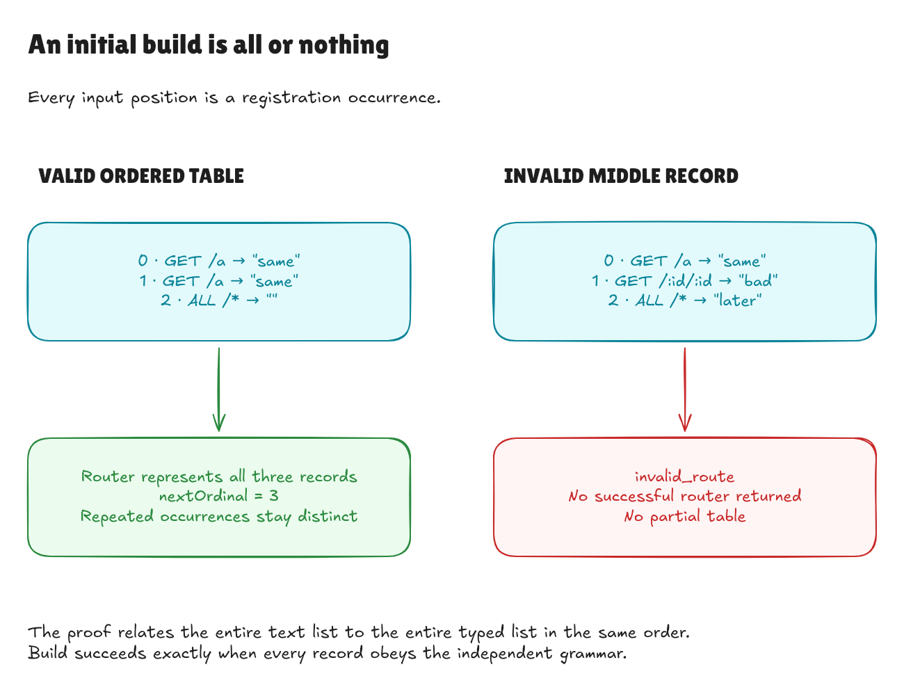

# Proving the initial text-table build

This records milestone `2663551`; the later
[completed text goal](text-boundary-goal.md) composes it with registration and lookup.

The initial builder now connects an ordered list of text routes to the proved
typed router. Earlier proofs described one record at a time. This milestone
proves that the builder keeps every record in its original position and builds
exactly the corresponding router, or rejects the table as a whole.

The implementation is unchanged. It first parses the entire list, then builds
the trie only after every route has parsed successfully.



[Editable source](../diagrams/text-build-contract.excalidraw) ·
[Live Excalidraw scene](https://app.excalidraw.com/s/8wot9n3ajqf/5kR8yedSpFc)

Independent review tried reversing the parsed table, dropping a registration,
and turning an invalid table into a successful empty router in temporary
copies. Each changed adapter and the independent table specification compiled,
while the correctness proof failed. An unchanged control passed. The independent
pattern audit also checked 25 invalid initial builds with a malformed middle
record; each returned only `invalid_route`.

## A table is an ordered sequence of occurrences

Suppose the initial text table contains the same route twice, both with an empty
handler label. It still has two registrations: ordinal 0 and ordinal 1. Neither
an empty label nor a duplicate means that an occurrence may be discarded.

[Build/Spec.lean](../../HonoLean/Adapter/Build/Spec.lean) defines `TableDenotes` with
two simple rules: the empty text table corresponds to the empty typed table;
putting corresponding records at the front of corresponding tables preserves
the relation. This pointwise relationship keeps order, length, repeated routes,
and opaque labels. Its definition calls neither parsing nor router construction.

`TableSpelling` says that every text record satisfies the independent record
grammar. It does not require an existing parser result or a typed router.

## What is proved

[Build/Correctness.lean](../../HonoLean/Adapter/Build/Correctness.lean) first proves
that parsing the list succeeds exactly when `TableDenotes` relates the input to
the output list. The builder theorem then says:

```text
build textRoutes = success router
    if and only if
there is an ordered corresponding typed table
and router is exactly Router.build of that table
```

This is stronger than saying the builder returns a valid-looking router. It
specifies which router is returned. It rules out dropping, reordering, or
deduplicating registrations even when all individual routes remain valid.

`represents` connects that result to the existing trie-and-counter invariant.
`nextOrdinal` proves that the next registration number equals the number of
input occurrences. The count follows from the correspondence of the tables;
it is not an assumption about the result.

`complete` constructs a successful router from the grammar alone. Conversely,
`rejects_iff` proves that exactly the tables outside the grammar fail, with
`invalid_route`. An invalid second route rejects the whole initial build. It
does not expose a successful router containing just the valid first route.
This concerns the returned value, not a physical allocation or resource bound.

## Why this composes

Each route-record proof is reused for one list element. The list proof repeats
that argument until it reaches the empty list. Once the whole typed table is
available, the existing `Router.build_represents` theorem establishes the router
invariant. We do not repeat the trie traversal proof or store a second runtime
route table to perform the verification.

The remaining goal milestones address incremental text registration and
text-input lookup. JSON decoding/encoding, CLI behavior, handler execution, and
a surrounding HTTP application remain outside this build proof. Existing
benchmark samples continue to describe their original measured revision.

## Checking it locally

```sh
lake build
lake exe adapter-tests
python3 tests/adapter_cli.py
lake env leanchecker --fresh HonoLean
```

The main build, acceptance, and rejection theorem guards permit only Lean's
ordinary `propext`, `Classical.choice`, and `Quot.sound` foundations. The examples
include an empty build, duplicate occurrences with empty labels, the exact next
ordinal, and rejection of an invalid route in the middle. The theorem applies
to every finite initial table, rather than only these examples.
