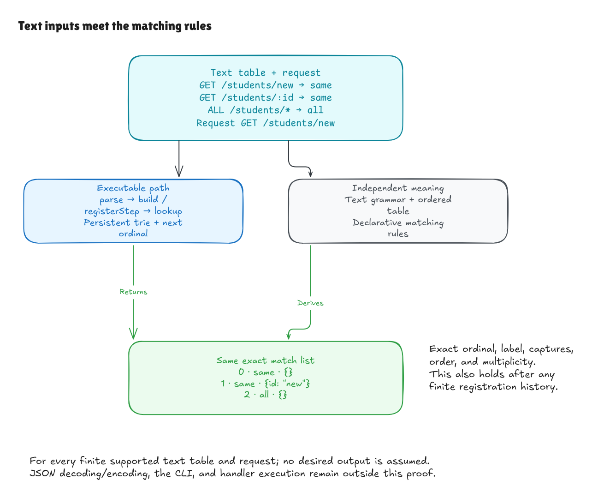

# From text inputs to matching rules

The small parser and registration proofs now compose into one text-level
lookup contract. A successful text build followed by a text lookup returns
exactly the ordered matches described by the independent rules. The same
guarantee holds after any finite sequence of successful and rejected appends.
This milestone changes no production lookup code.

## One request, several correct matches

Consider these registrations, in this order:

| Ordinal | Method | Pattern | Label |
| --- | --- | --- | --- |
| 0 | `GET` | `/students/new` | `same` |
| 1 | `GET` | `/students/:id` | `same` |
| 2 | `ALL` | `/students/*` | `all` |

Looking up `GET /students/new` returns all three occurrences: registration 0
with no capture, registration 1 with `id = "new"`, and registration 2 with no
capture. The shared label does not merge registrations. The literal match does
not suppress the parameter or wildcard. The list remains in registration order.

Now attempt the invalid pattern `/:id/:id`, then append another copy of the
parameter registration. The invalid step keeps the exact old router; the valid
copy becomes registration 3. The updated lookup returns four occurrences, and
the previous router still describes the original three.



[Full-size image](../diagrams/text-lookup-contract.png) ·
[Editable source](../diagrams/text-lookup-contract.excalidraw) ·
[Excalidraw canvas](https://app.excalidraw.com/s/8wot9n3ajqf/1jzLdOqFVs0)

## What the composed proof says

[Lookup/Spec.lean](../../HonoLean/Adapter/Lookup/Spec.lean) defines `Matches` by
combining three existing descriptions:

1. The text table denotes an ordered typed route table.
2. The request text denotes one exact method and path.
3. The core's independent matching rules assign that table and request the
   specified output list.

This definition calls no parser, trie traversal, or adapter lookup. It describes
the desired result using the grammar and matching rules. The runtime router
continues to store its prefix-sharing trie and counter; it does not store or
scan this proof-level table.

[Lookup/Correctness.lean](../../HonoLean/Adapter/Lookup/Correctness.lean) proves:

```text
some router is successfully built from the text table,
and its text lookup succeeds with output
    if and only if
the independent text-level rules assign that table and request output
```

The theorem is `LookupText.build_lookup_iff`. It assumes no expected runtime
result. In the forward direction, it rules out extra matches, missing captures,
changed labels, lost duplicate occurrences, and wrong ordering. In the reverse
direction, every rule-defined complete match list is produced.

`lookup_iff` exposes the reusable representation-based form. `complete` builds
a successful router and lookup from the text grammar alone, demonstrating that
the theorem does not depend on preconstructing already-parsed inputs.

`registrations_build_correct` applies the registration invariant to arbitrary
finite append histories. It produces one final text table described by the
independent history rules, proves the same lookup equivalence for every request
and output, and proves that the final next ordinal equals that table's length.
Rejected records add no occurrence. This establishes the invariant needed by
lookup instead of assuming the desired output.

## A miss and an invalid request differ

A supported request can match no registration. That succeeds with an empty
list. An unsupported request, such as method `ALL` or path `/students/`, fails
with `invalid_request`. `accepts_iff` and `rejects_iff` prove this distinction for
the public text lookup, using the independent request grammar.

## The remaining boundary

The contract starts at `TextRoute` and `TextRequest` records containing Lean
strings, and ends at a list of match values. JSON decoding must still construct
those records correctly; JSON encoding must still serialize the result
correctly. Those transport and CLI boundaries retain their tests. There is no
claim here about handler execution, middleware, an HTTP server, Hono's
TypeScript, or a performance bound.

The proofs cover the stated restricted grammar and matching rules. Those
choices remain subject to human review. Native execution also relies on the
compiler and runtime; Lean's kernel checks the proof terms.

## Checking it locally

```sh
lake build
lake exe adapter-tests
python3 tests/adapter_cli.py
lake env leanchecker --fresh HonoLean
```

The new kernel examples exercise the full public text build/lookup contract,
literal/parameter/wildcard overlap, `ALL`, same-label occurrences, a rejected
append followed by a valid duplicate at the unchanged ordinal, retained old
router behavior, and a valid miss versus invalid input. They use the existing
core correctness theorem and kernel-checked reference evaluation for concrete
results; the production trie still performs lookup.

Main axiom guards allow only Lean's ordinary `propext`, `Classical.choice`, and
`Quot.sound` foundations. No unfinished proofs, custom axioms, native proof
shortcuts, or dependencies were added.

Independent review tried returning an empty match list for every request,
reversing result order, and removing capture values in temporary copies. Each
changed adapter and independent specification compiled, while the composed
proof failed; the unchanged control passed. The final root build and fresh
kernel replay passed alongside the native adapter, comparison, and benchmark
smoke suites. See the [completion evidence](text-boundary-goal.md) for the full
five-milestone audit.
