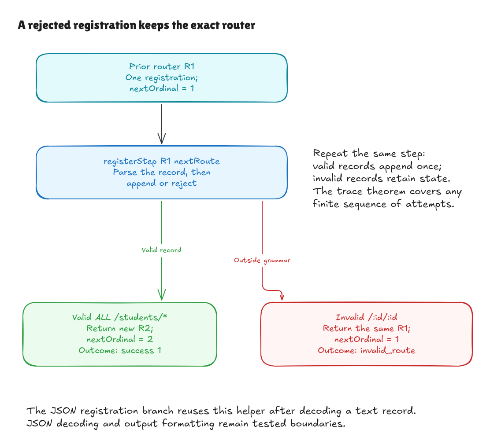

# Proving text registration one step at a time

This records milestone `28071ba`. The final
[text-lookup proof](text-lookup-walkthrough.md) uses this invariant to finish
the five-milestone goal.

The earlier [build proof](text-build-walkthrough.md) connects an initial text
table to a typed router. This milestone carries that connection through later
registration attempts, including rejected ones. The typed trie still inserts
one route at a time; it does not rebuild or retain a hidden scan table.

## A rejected append must leave no hole

Suppose the router represents one registration and its next number is 1.
Attempting to register a route with a duplicate parameter name is an error.
The next valid route must receive number 1, followed by 2 for another valid
append. The rejected attempt cannot consume a number or replace the router.

That behavior now has a concrete small function, `registerStep`, which returns
the next router and an outcome. On success, the outcome is the old next number;
the returned router contains the appended route. On failure, it returns the
**exact input router** and the same error. The JSON registration branch uses
this helper after decoding a text record, preserving its existing protocol.



[Editable source](../diagrams/text-registration-contract.excalidraw) ·
[Live Excalidraw scene](https://app.excalidraw.com/s/8wot9n3ajqf/7PqE79JIp4B)

Independent review tried clearing the router on rejection, reporting the next
ordinal instead of the assigned one, and returning the old router on success.
Each changed adapter and independent registration specification compiled, but
the proof failed; an unchanged control passed. Direct native tests check the
total helper's rejected state/result and the following successful ordinal, in
addition to the existing compiled JSON failure sequences.

This makes the state guarantee explicit. Merely saying that a pure function
does not mutate its argument would not establish which router a caller keeps
after an error. Here the result itself supplies the old router.

## The independent rules

[Registration/Spec.lean](../../HonoLean/Adapter/Registration/Spec.lean) defines the
meaning of a state and a step without calling a parser:

- `StateDenotes` connects an ordered text table to a typed table and the existing
  trie-and-counter representation invariant.
- `StepDenotes` appends a grammar-valid record and returns its registration
  ordinal, or retains the table and returns an `invalid_route` error.
- `TraceDenotes` repeats those rules over any finite list of attempts, retaining
  every successful occurrence in order and skipping rejected records.

An empty handler label remains data. Repeating the same record creates another
registration occurrence; there is no deduplication or replacement rule.

[Registration/Correctness.lean](../../HonoLean/Adapter/Registration/Correctness.lean)
first proves the existing fallible `register` operation agrees with record
parsing followed by the typed insertion operation. The grammar determines
exactly when it succeeds and rejects, and rejection keeps the route error
category.

The remaining proof reuses the typed insertion invariant. A valid text append
adds the corresponding typed route to the end of the model table and increases
the counter once. The total helper's failure branch retains the exact original
router, including its trie and counter. These two cases establish `step_correct`.
Induction over a finite list then establishes `trace_correct`.

## What the main claims say

```text
register succeeds
    iff a route denotes the input record and the result is its typed insertion

registerStep on a rejected record
    returns exactly the previous router and an invalid_route error

repeat registerStep over any finite list
    leaves a router representing exactly the accepted occurrences in order
```

`StateDenotes.nextOrdinal` ties the final counter to that retained table's
length. `register_nextOrdinal` proves that a successful append adds exactly
one. The guarantee has no fixed history length or fixture-size bound.

`register_iff` concerns any router value. Representation preservation and the
trace theorem start from a state satisfying the invariant; the initial build
proof establishes that premise. The forthcoming text-lookup proof can use the
same final-state connection rather than reproving insertion or matching.

## The boundary

The proof covers text registration and a finite sequence of the total helper.
The helper is reused by the actual JSON registration branch, but this milestone
does not prove JSON decoding, serialization, the full JSON operation loop, or
handler execution. Those boundaries retain their existing tests. Native
execution also relies on Lean's compiler and runtime.

The helper is the only new production operation. The matching core, grammar,
registration order, error categories, and JSON response shape stay the same.
Historical benchmark samples have not been replaced.

## Checking it locally

```sh
lake build
lake exe adapter-tests
python3 tests/adapter_cli.py
lake env leanchecker --fresh HonoLean
```

Main success, rejection, step, and trace theorem guards permit only Lean's
ordinary `propext`, `Classical.choice`, and `Quot.sound` foundations. No new
axioms, unfinished proofs, native proof shortcuts, or dependencies were added.

Kernel examples execute a failed registration followed by valid duplicate
appends with empty labels, check the returned ordinals and retained old router,
and derive a final counter from the universal trace theorem. The compiled
adapter checks and full JSON suite also pass, including the existing fourteen
failed-registration sequences. Those finite checks exercise the executable;
the Lean theorem covers arbitrary finite histories of text registration steps.
