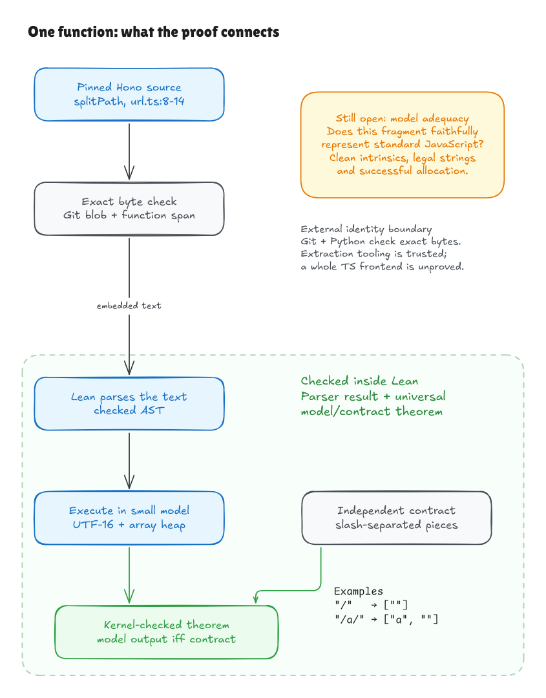

# Experiment: verifying real Hono source

This folder holds the experimental half of the project. It tries to prove
facts about the actual TypeScript in Hono's `TrieRouter`, one small piece at a
time. Each result is conditional on a simplified model of JavaScript. The Lean
code is in `HonoLean/Upstream/`, and the scripts that check the exact source
bytes are in `verification/`. Build it with `lake build HonoLeanUpstream` and
run its checks with `verification/run_checks.sh`.

The text below is the original progress log, kept as written.

Latest checkpoint: [literal positive lookahead](getpattern-lookahead-walkthrough.md)
connects selected actual Hono declarations and its constructor to an independent
nonconsuming matching rule. `abc/tails` can match `abc` while `/tail` is checked
without being consumed. The [diagram](../diagrams/getpattern-lookahead.png)
and [editable source](../diagrams/getpattern-lookahead.excalidraw) explain the
guarantee. Full cache/closure integration of this branch remains open.

The [coverage walkthrough](hono-coverage.md) explains the expanded export
map, public members, source dependencies, upstream-test imports, and dynamic
sites that still need review. This is a structural inventory, not a percentage
of Hono proved correct. The [assumptions and divergence audit](hono-trust-boundary.md)
records the language/host boundaries and preserves the exact D1 discrepancy.

The first [source-connection walkthrough](splitpath-source-bridge.md)
starts from Hono's actual `splitPath` declaration. Lean parses the embedded
text and proves that its execution in a small UTF-16/array model follows an
independent path-partition contract. External tools check the exact source
bytes. General JavaScript model adequacy, full frontend correctness, and whole
package coverage remain open; this is a conditional source-subset result.

The [primitive-step walkthrough](ecma2025-primitive-walkthrough.md) now
backs the compact operations with cursor-based string splitting and explicit
array copy/delete proofs, plus an [ECMA-262 2025 audit](ecma2025-primitive-audit.md).
Its [array diagram](../diagrams/ecma2025-shift-steps.png) shows why mutation,
copy order and deletion matter. Full language/engine adequacy remains open.

The second [source walkthrough](querystrings-source-walkthrough.md)
verifies `getQueryStrings` in the shared model, with an independent first-marker
contract, signed search/slice proofs and parsed source-mutation counterexamples.
The [query diagram](../diagrams/querystrings-contract.png) explains its raw
UTF-16 offset-8 rule. The same source/frontend and native interpretation limits
remain explicit.

The [object walkthrough](object-source-walkthrough.md) adds the parsed
`createNullObject` allocation contract and a descriptor-driven local proof of
the D1 mechanism. Its [diagram](../diagrams/d1-object-mechanism.png) explains
own properties versus inherited behavior. The [routing audit](routing-object-audit.md)
maps router/preset behavior candidates and preserves additional isolated native
findings; full routing source proofs remain open.

The [parameter-assignment walkthrough](param-assignment-walkthrough.md)
checks the actual two-line selection/write fragment inside TrieRouter's Node.
It proves value precedence and preservation of earlier output captures under
explicit local-state premises. Its [diagram](../diagrams/param-assignment-contract.png)
explains why `false`, `0` and `""` survive `??`. The surrounding loop and whole
router source proof remain open.

The [chosen-handler block walkthrough](param-loop-walkthrough.md) extends
that source proof through allocation, handler-array append and the complete key
loop. A prefix invariant establishes each next key's absence and preserves
earlier captures. The [diagram](../diagrams/param-loop-contract.png) explains
identity and aliasing. Unique keys and the selected-handler entry remain local
premises. The producer step below derives uniqueness under its declared scope;
whole routing remains open.

The [Set-producer walkthrough](key-set-walkthrough.md) connects Hono's
actual creation/add/spread operations to unique keys in first-occurrence order.
The [diagram](../diagrams/key-set-producer.png) explains fresh snapshot arrays
and their handoff to the loop. Supplied add events, normal iterator behavior and
caller transport remain explicit boundaries. A pinned cache-sharing probe also
preserves mutable `getPattern` tuple behavior as an open obligation.

The [handler-record walkthrough](handler-record-walkthrough.md) follows those
keys into the actual object argument in `Node.insert`. It proves fresh records,
own data fields, handler identity, copied keys and the incremented score, then
derives more capture-loop entry facts. The [diagram](../diagrams/handler-record.png)
shows the construction order. Private push, selection, transport, shared module
state and full runtime interpretation remain open; finite engine and prototype
boundary probes are preserved.

The [private-push walkthrough](methods-push-walkthrough.md) checks the complete
`curNode.#methods.push(...)` call. Private identity and method preparation lead
to the actual appended map, handler record and separate key snapshot. Its
[diagram](../diagrams/methods-push.png) shows that order. At that checkpoint,
later search allocation and method/ALL selection remained open, and the consumer
example used a preallocated collector. Class initialization remains open.

The [search-entry walkthrough](search-entry-walkthrough.md) replaces that
example's preallocated collector and staged handler choice with actual later
allocation, private row loading and lazy method/ALL selection. The
[diagram](../diagrams/search-entry.png) shows the skipped fallback branch.
Type assertions add no runtime shape check. The composed exact-method hit keeps
activation handoffs, outer loops, call sites and traversal explicit.

The [methods-loop walkthrough](methods-loop-walkthrough.md) connects the
actual surrounding loop and handler guard. It proves ordered visits, falsy skips
and capture steps under explicit prefix-wide read/record conditions. Its
[diagram](../diagrams/methods-loop.png) explains why repeated collector entries
can share the same handler and its latest params. Class/caller connections,
general registration-derived readiness and whole routing remain open.

The [initial-state walkthrough](methods-loop-initial-walkthrough.md) derives
that prefix readiness from one protected structural layout. It also connects
actual singleton registration and the later collector to the full loop without
assuming its selected handler or future validity. The
[diagram](../diagrams/methods-loop-initial.png) separates protected reads from
mutable params. The history result below extends its singleton bridge;
class/caller connections and whole routing remain open.

The [registration-history walkthrough](registration-history-walkthrough.md)
extends the exact private-push fragment across arbitrary finite request lists
at one supplied Node owner, then derives the later loop's layout and execution.
Its [diagram](../diagrams/registration-history.png) shows why equal user handlers
still get distinct internal records. Actual insertion traversal/event production,
class/call/module linkage and native adequacy remain open.

The [Node initialization walkthrough](node-initialization-walkthrough.md)
derives the initial `#methods` data slot, empty array and zero order from the actual
module preamble and five private data fields, then composes registration
histories and the capture loop. Its [diagram](../diagrams/node-initialization.png)
shows fresh per-instance arrays/children and shared initial params. Complete
class/private-method installation, live module cells, actual calls and traversal
remain open.

The [private-call walkthrough](private-call-walkthrough.md) connects the
complete private helper declaration to two actual call entries. Parsed argument
positions now derive the capture loop's bindings, including the omitted fifth
argument and the reversed params objects at the five-argument call. Its
[diagram](../diagrams/private-call.png) shows evaluation order and caller-scope
restoration. Method installation, live cells, surrounding traversal and native
adequacy remain open; this is an explicit top-level call-rule extension.

The [private-element installation walkthrough](class-installation-walkthrough.md)
derives that method closure and read handle from the parsed private declarations.
One definition shares its method value across instances; each instance installs
it before initializing fresh data. The handle survives source registration and
supports the actual capture call. Its [diagram](../diagrams/class-installation.png)
shows the join. These selected private elements leave full class/public-method
evaluation, live module cells, traversal and native adequacy open.

The [private-write walkthrough](private-write-walkthrough.md) connects
search's reset/propagation/continuation assignments to tagged DATA/METHOD storage.
It proves writable DATA updates, method rejection after right-side evaluation,
and a propagation-to-call handoff without injecting the params slot. Its
[diagram](../diagrams/private-write.png) explains why a DATA field containing
a function stays writable. Complete traversal, private accessors and native
language/host adequacy remain open.

The [literal-child branch walkthrough](literal-branch-walkthrough.md)
follows the actual child lookup, parameter propagation, final/nonfinal split
and optional wildcard-before-direct calls in one contiguous source window.
It explains how the first call's effects establish the second call's entry
conditions and why collector entries retain live handler records. Its
[diagram](../diagrams/literal-branch.png) shows the four paths. Outer traversal,
pattern branches, sorting and full native adequacy remain open.

The [iteration-setup walkthrough](iteration-setup-walkthrough.md) derives
the part, final-part flag, fresh queue and current node from actual source
declarations. The queue's fresh identity establishes collector separation and
preserves the initial helper layout. Its
[diagram](../diagrams/iteration-setup.png) marks the separate index activations;
the omitted loop headers and complete traversal remain open.

The [search-startup walkthrough](search-setup-walkthrough.md) connects the
actual `splitPath(path)` call to that data handoff. It keeps the returned array
and heap state, proves the four startup arrays are fresh, and derives the
singleton node queue and params reset from source 87–97. Its
[diagram](../diagrams/search-setup.png) distinguishes this producer connection
from the still-open loop headers, traversal and native module/language adequacy.

The [loop-entry walkthrough](loop-entry-walkthrough.md) then derives the
first indices from actual headers99/104. An empty parts array skips the body;
otherwise source produces i=0, j=0 and saved inner length 1 before reading the
receiver at 105. Its [diagram](../diagrams/loop-entry.png) marks the remaining
body boundary. Separate update laws distinguish saved bounds from current
array-read readiness; full loop progression/traversal remains open.

The [first-literal composition walkthrough](first-literal-walkthrough.md)
connects those steps to the complete first literal branch for arbitrary admitted
initial states. Initial registered rows and key facts yield the helper layout
only after source creates its collector; self-child reset and shared wildcard
targets are allowed. Its [diagram](../diagrams/first-literal.png) shows the four
nonempty outcomes. The complete inner body and later traversal remain open.

The [queue-advance walkthrough](queue-advance-walkthrough.md) verifies
source 209–210: shift a scheduled group, concatenate current array contents or
reuse the temporary queue, and update the existing `curNodes` binding. Its
[diagram](../diagrams/queue-advance.png) explains shared-array identities and
why an empty shifted array still allocates. Sparse queue producers and complete
loop/body reachability remain open.

The [sparse-scheduling walkthrough](queue-schedule-walkthrough.md) now
checks source 177–178 with actual missing own indices. It proves lazy group
creation/reuse and child append, then connects sparse 209–210 consumption to the
earlier read-value contract. Its [diagram](../diagrams/queue-schedule.png)
keeps own holes distinct from observed `undefined`. Regexp/count production,
enclosing control flow and full native adequacy remain open.

[Editable Excalidraw source](../diagrams/splitpath-source-bridge.excalidraw) ·
[Live scene](https://app.excalidraw.com/s/8wot9n3ajqf/3GFp5RXZ8D3) ·
[Conditional proof registry](../../verification/proofs.json)

The [slash-count walkthrough](component-count-walkthrough.md) starts with
the actual matched UTF-16 text and derives `componentCount` from the original
regexp/optional/nullish expression. It composes source 176–178 with sparse
scheduling and a first-hole consumer specialization. The
[diagram](../diagrams/component-count.png) explains the always-tracked match
accumulator and the [audit](component-count-audit.md) states its projection
and native-test boundary. Earlier match production, complete loops and native
adequacy remain open.

The [child-enumeration walkthrough](child-enumeration-walkthrough.md)
connects the containing source 174–180 loop: no enumerable child name skips the
body, while an entered iteration writes params and schedules once before break.
The [diagram](../diagrams/child-enumeration.png) explains key/value distinctions
and scope restoration. Its [audit](child-enumeration-audit.md) records the
null-prototype domain, all-key-order argument and canonical visible-graph tests.
General enumeration and containing search/native adequacy remain open.

The [path-offset walkthrough](part-offsets-walkthrough.md) explains the
actual source at lines 146–154: build segment starts once, then reuse that
array to slice the remaining path. It proves the loop's prefix-length invariant
and correct suffixes for source-split paths under an explicit size bound.
The [diagram](../diagrams/part-offsets.png) also shows why an empty or wrong
cache is reused without repair. The [audit](part-offsets-audit.md) states
the arithmetic, source-activation and native-interpretation limits.

The [guarded-capture walkthrough](capture-guard-walkthrough.md) follows the
actual `Object.hasOwn` check and capture assignment at lines 158–160. Existing
own properties skip every match read; inherited descriptors determine whether
assignment creates data, does nothing or rejects. The
[diagram](../diagrams/capture-guard.png) explains the local `__proto__` no-op
and its distinction from final handler output. The
[audit](capture-guard-audit.md) keeps match production, unsupported setters
and full search/native adequacy explicit.

The [params-initializer walkthrough](params-init-walkthrough.md) retains
both branches of Hono's actual line 123. It explains fresh identity, shallow
own-data copying and why spread defines `__proto__` data rather than invoking
a setter. The [diagram](../diagrams/params-init.png) shows the allocation and
copy steps. The [audit](params-init-audit.md) states the data-only, key-order
and native-observation boundaries and the capture/private-write composition.

The [capture-to-collector walkthrough](capture-collect-walkthrough.md)
connects the local maps to the actual guard and line 161 private call. Its
[diagram](../diagrams/capture-collect.png) shows parent fourth, local params
fifth, fresh null-prototype output and live handler aliases. The conditional
source-model proof derives the helper's inputs from earlier source results;
the [audit](capture-collect-audit.md) explains the constructor-function
observation and remaining match-production/traversal/native boundaries. The
[next-frontier plan](regex-exec-plan.md) separates current-callee invocation
from genuine regex matching; its native probes are explicitly unproved evidence.

The [current-exec walkthrough](exec-call-walkthrough.md) follows actual
line156: save the current method and receiver, run its parsed ordinary body and
bind the computed result to m. Its [diagram](../diagrams/exec-call.png) and
[audit](exec-call-audit.md) distinguish six universally proved body shapes,
broader finite effect checks and that checkpoint’s ordinary-method boundary. Both
initializer arms now compose in the actual order 123→156→capture guard.

The [builtin-exec walkthrough](builtin-exec-walkthrough.md) adds a genuine
small regex parser, compiler and instruction machine. The proof derives the
match from an independent language contract, then connects the digit case in
actual order 123→builtin 156→capture/collector158–161. Its
[diagram](../diagrams/builtin-exec.png) and [audit](builtin-exec-audit.md)
explain callable identity, branded internal programs, retained lastIndex and the
five-property match projection. Constructor/cache/tuple provenance, full regex,
containing search and native adequacy remain open.

The [matcher-construction walkthrough](pattern-construct-walkthrough.md)
starts with Hono’s actual terminal tuple expression at url.ts68 and derives
its fresh tuple, regex object and compiled record from initial string inputs.
The [diagram](../diagrams/pattern-construct.png) and
[audit](pattern-construct-audit.md) explain evaluation order and how the
produced matcher reaches the existing interval-language proof. Cache selection,
label recognition and native adequacy remain open; tuple destructuring is
connected in the following milestone.

The [destructuring plan and native boundary](pattern-binding-plan.md) preserve
`ENGINE-ELISION-1`, a pinned Bun/Node difference for a custom iterator’s skipped
value getter. Its exact native records and minimal reproducer are separate
from the checked constructor profile and the unchanged D1 comparison.

The [actual binding walkthrough](pattern-binding-walkthrough.md) connects
Hono’s constructed tuple to its actual iterator-based destructuring and then,
for digits, actual exec. The [diagram](../diagrams/pattern-binding.png) and
[audit](pattern-binding-audit.md) show why skipping a value and closing an
iterator differ, and separate visible native observations from model-only
protocol cells. Cache/tree/query production and native adequacy remain open.
The original [label-match plan](label-match-plan.md) records the obligations
for deriving constructor inputs from Hono's actual `label.match(...)` source.

The [label-match walkthrough](label-match-walkthrough.md) now connects that
actual source to an independent label language and a real capturing machine.
It derives the capture array and composes construction, binding and digit exec.
The [diagram](../diagrams/label-match.png) and
[audit](label-match-audit.md) explain raw body captures, undefined versus
missing indices, current getter/method identities and the retained Bun/Node
flags difference. The retained [cache plan](getpattern-cache-plan.md)
records the next bridge from that checkpoint.

The [cache walkthrough](getpattern-cache-walkthrough.md) now connects the
actual post-wildcard body to warm DATA hits, plain cold stores, misses and cache
initialization. Checked histories retain one heap and cache across calls: raw
key collisions return the first stored tuple. The
[diagram](../diagrams/getpattern-cache.png) and
[audit](getpattern-cache-audit.md) explain the second property read, strict
assignment and reference identity. That checkpoint left cold terminal
construction with a closed witness and finite comparisons; the
[retained plan](getpattern-terminal-cache-plan.md) records that gap.

The [terminal-cache walkthrough](getpattern-terminal-cache-walkthrough.md)
composes capture production, real constructor execution, strict storage and the
second cache read for the safe range grammar. All four typed terminal-next forms
are covered, including arbitrary suffixes. Actual initialization and two calls
retain the same heap, cache, tuple and regex. The
[diagram](../diagrams/getpattern-terminal-cache.png) and
[audit](getpattern-terminal-cache-audit.md) separate the source-model proof
from stored-regex query comparisons. The
[wildcard/function plan](getpattern-function-plan.md) states the next source
boundary; lookahead, general regexes, module/native adequacy and full Hono
coverage remain open.

The [wildcard/body walkthrough](getpattern-body-walkthrough.md) now covers
Hono's complete body: `*` returns immediately and preserves the entire model
state, while other values delegate to the retained cache code, including its
errors. Existing normal-profile contracts and same-state reuse lift through
that guard. The actual arrow's parameters, types, comments and body are parsed.
The [diagram](../diagrams/getpattern-body.png) and
[audit](getpattern-body-audit.md) keep
[then-open invocation boundary](getpattern-invocation-plan.md) explicit.

The [closure walkthrough](getpattern-invocation-walkthrough.md) now connects
the actual cache and exported arrow setup to live lexical cells, a callable
function object and fresh arguments on each call. Independent wildcard, miss,
plain, warm and safe terminal-range contracts include caller/storage frames.
Two calls use the same exported closure and cache; constructor-change and raw
cache-key collision witnesses retain the pinned behavior. The
[diagram](../diagrams/getpattern-invocation.png),
[editable source](../diagrams/getpattern-invocation.excalidraw) and
[audit](getpattern-invocation-audit.md) explain the conditional model claim.
General callbacks, partial error state, TypeScript/module/native adequacy,
[lookahead](getpattern-lookahead-plan.md) and full Hono remain open.

