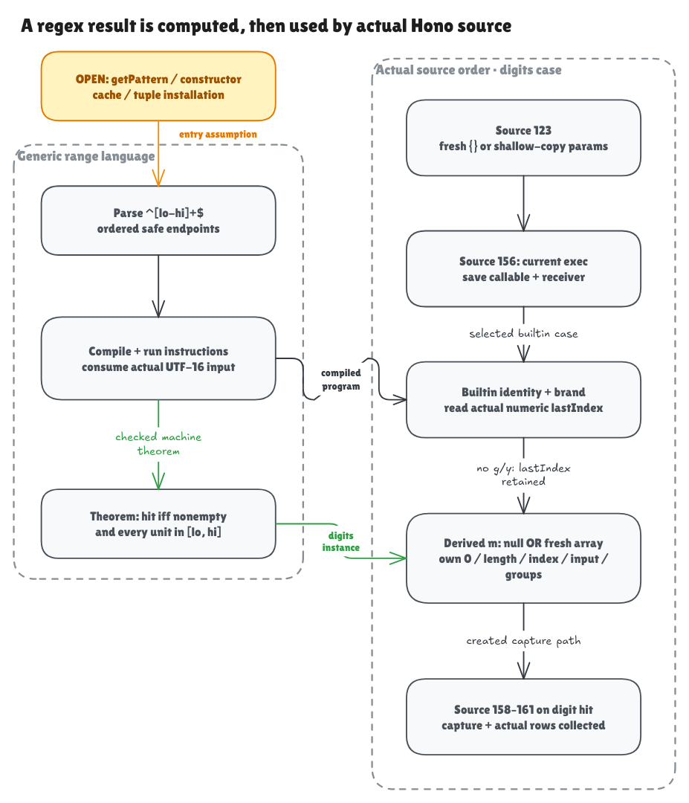

# Computing a real regex result

The earlier current-exec milestone could run an ordinary JavaScript method
body. This milestone adds a genuine builtin matcher for a small regex language,
then connects its result to the actual Hono source. The full Hono verification
goal remains open.

The [editable diagram](../diagrams/builtin-exec.excalidraw) is committed. Its private
[working scene](https://app.excalidraw.com/s/8wot9n3ajqf/7IqsCL9ZF8o) is optional;
GitHub readers can use the files without an Excalidraw account.

## The pattern becomes a program

Start with `^[0-9]+$`. The caret requires the beginning, `[0-9]` consumes a
digit, `+` requires at least one and permits more, and the dollar requires the
end. The implementation parses those actual UTF-16 characters into syntax,
compiles the syntax into instructions, and runs the instructions on the input.
It does not recognize one magic string and return an assumed digit predicate.

The independent specification says: the input is nonempty and every code unit
is between 48 and 57. The proof connects this simple statement to the machine's
execution for every input length. It also proves that the supplied execution
budget is sufficient; running out of budget is a separate result, never a miss.

The generic parser and machine handle `^[lo-hi]+$` with ordered ASCII digit or
letter endpoints. The interval can include punctuation: `[A-z]` includes
`[`, backslash, `]`, `^`, `_` and backtick. The concrete Hono source theorem
specializes this generic machinery to the digit pattern. The finite wider-range
comparisons do not broaden that concrete theorem.

## Calling the builtin still follows JavaScript's call order

Hono's actual line 156 is `const m = matcher.exec(restPathString)`.
The model first saves the receiver and its current method, then evaluates the
argument and calls that saved function with the original receiver.

A builtin function is recognized by its identity. Calling the same builtin
under the name `borrowed` still invokes it. Replacing `exec` with an ordinary
method runs that method instead. A noncallable property does not trigger a
builtin fallback. These distinctions preserve the previous milestone's
ordinary method behavior.

The builtin checks that its receiver has the internal RegExp record, uses the
record's compiled program, and reads the actual ordinary `lastIndex` property.
A public `source` property cannot change that internal program. In this
no-flags slice, an exact safe-integer `lastIndex` is converted and then the
match starts at zero; the property is retained on both success and failure.
Readonly and nonextensible fixtures exercise this behavior. Other coercions,
flags and proxy behavior remain outside the formal domain and have separate
native observations.

## What a successful result contains

For `"12"`, the builtin produces one fresh array containing `"12"`. The
observable result has index 0, length 1, `index: 0`, `input: "12"`, and its own
`groups: undefined` property. A miss returns null and allocates no match array.
This is the single-exec result, rather than a global-match accumulator.

The result observer exposes five own-property descriptors. Its length and
index 0 come from the current heap, so later ordinary array effects cannot leave
stale cached contents. This is a defined observation projection; it is not a
proof of every native Array operation, prototype or property enumeration.

## The result reaches Hono's capture collector

The source composition now follows selected statements in their actual order:

1. Line 123 either shallow-copies parent params or creates a fresh params map.
2. Line 156 computes `m` with the builtin matcher.
3. The actual line 157 test observes that computed value.
4. On the proved digit-hit/created-capture path, the actual lines 158–161 store
   the capture and call the collector with its real method rows and maps.

The proof derives the fresh match array, capture value and collector layout
from initial facts. They are not supplied as already-correct outputs. Both
initializer branches are retained. This connects selected source activations;
it does not execute the omitted statements between them or establish the whole
line 157 body, containing loop or `Node.search` theorem.

The key theorem is
`NodeRegExpExec.source_init_builtin_created_collect_satisfies` in
[Composition.lean](../../HonoLean/Upstream/NodeRegExpExec/Composition.lean).
The local hit/miss contract is `source_exec_satisfies` in
[Correctness.lean](../../HonoLean/Upstream/NodeRegExpExec/Correctness.lean).

## What the checks add, and what remains

The finite suite checks all 1,953 ordered safe-endpoint pairs with six inputs
each: 11,718 parser/compiler/machine cases against an independent interval
oracle. Another 758 fixtures compare complete bounded observations from Lean,
the oracle, Bun 1.4.0 and Node 22.22.2. Four admitted source mutations must change
the result; a borrowed-builtin alias must preserve it. Unsupported grammar and
old callable-table admission are recorded separately from native failures.
Actual pinned `getPattern` and `TrieRouter` probes add 18 matcher queries and 15
router queries, including punctuation, repeats and final-newline misses.

Tests can expose mistakes in the model, wrapper or interpretation. They do not
prove those tools equivalent to native JavaScript. The initial compiled record
is checked by this small parser/compiler, but Hono's actual constructor,
cache, tuple and installation must still be connected to it. General regex
syntax, flags, captures, lookaround, backreferences, Unicode, coercions, errors,
the remaining search traversal and native/frontend adequacy remain obligations
of the full goal. See the [audit](builtin-exec-audit.md) for precise boundaries.

The [next constructor/tuple plan](regexp-constructor-plan.md) identifies the
actual source expression that will begin closing matcher-creation provenance.
