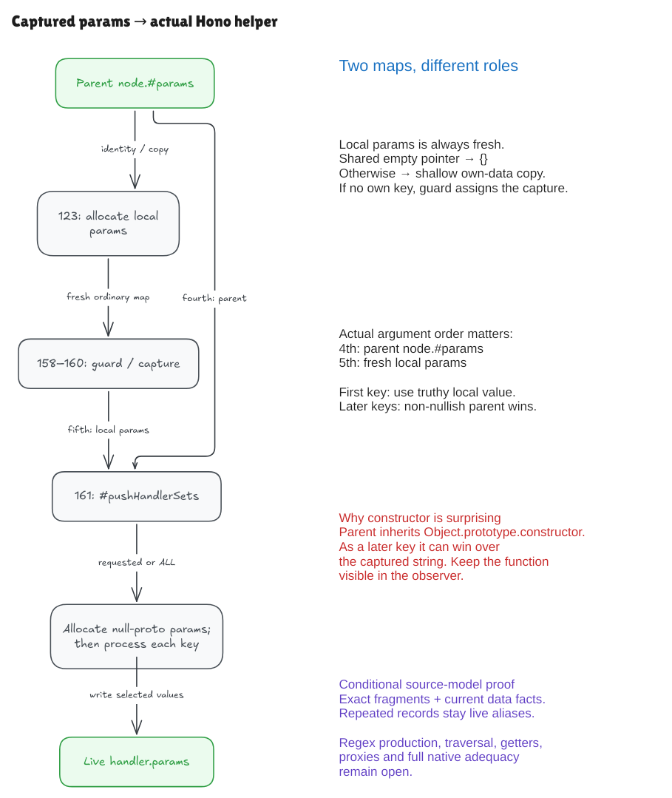

# From a captured parameter to a handler

The previous milestones proved how Hono makes a fresh local parameter object
and how its own-property guard attempts a capture assignment. This milestone connects those
objects to the actual handler-collection call at line 161 of the pinned source.
The [audit](capture-collect-audit.md) records the precise conditional boundary.



[Editable Excalidraw source](../diagrams/capture-collect.excalidraw) ·
[Live scene](https://app.excalidraw.com/s/8wot9n3ajqf/17rILjQIN0M)

## Two maps reach the helper

Hono first evaluates the complete line 123:

```ts
const params = node.#params === emptyParams ? {} : { ...node.#params }
```

`node.#params` remains the parent map. `params` is a new ordinary object.
Pointer equality decides whether to start empty or shallow-copy the parent's
own enumerable fields. A shallow copy preserves references stored as values;
it does not recursively copy everything reachable from them. An existing-own
skip can follow the copied arm; a newly empty `{}` has no own field to skip.

The guard at lines 158–160 preserves an already-owned parameter. Otherwise it
assigns the supplied match's first string. That match is still an explicit
input here: this milestone does not prove that a regular expression produced it.
The selected activation prepares name/m bindings early; their real later
declarations, iteration scopes and intervening code remain a separate obligation.

The next actual line is:

```ts
this.#pushHandlerSets(handlerSets, child, method, node.#params, params)
```

The fourth argument is the parent; the fifth is the fresh local map. An earlier
proved call at a different source location reverses those two arguments. Reusing
that call's theorem unchanged would prove the wrong program. The new parser
equation retains this call's real order.

## A contract for a call starts before the call

The helper needs a collector, method rows, handler records and key arrays.
Its initial structural facts describe those existing objects, their allowed
prototype links, available capacity and the helper's captured imports. These
facts allow a nonempty collector and repeated references to the same handler.
They do not presume the future local map or the helper's eventual output.

The proof derives the new map's fresh identity and reads from the initializer
and guard. It then binds the helper's real formal arguments and obtains the
body invariant needed by the existing loop proof. A separate storage fact ties
the rows to the child's actual private `#methods` field.

This is composition: earlier source results establish the next operation's
requirements. An assumption saying “the next operation already works” would
leave that important connection unproved.

## The helper's selection rule is asymmetric

For each selected requested-method or ALL handler, the helper allocates a fresh
null-prototype output map and processes its possible keys in order:

1. A truthy value from the local map wins for the first key.
2. Otherwise, a non-nullish parent value wins.
3. If the parent is null or undefined, the local value is used.

Falsy and nullish are different. `false`, zero and the empty string can survive
the parent fallback. Inherited values also count as reads. The output map's
null prototype does not prevent an inherited value from an input map being
copied into it.

Repeated collector entries can point to one mutable handler record. Resetting
that record's `params` field changes what every such alias observes. The proof
keeps this live-reference behavior; it does not pretend each collector entry
contains an independent immutable snapshot.

## A surprising pinned observation

With the raw TrieRouter route `/:id/:constructor{[0-9]+}` and request
`/alpha/12`, the parent ordinary map inherits
`Object.prototype.constructor`. `constructor` is the second key, so the helper
can choose the actual `Object` function instead of the local string `"12"`.
Changing the parameter order provides a positive control.

An ordinary `JSON.stringify` hides function-valued object fields. Our observer
explicitly tags the constructor function and separately demonstrates that
omission. This preserves the discrepancy rather than silently reporting a
missing field or treating it as the captured string. It does not change the
restricted spec's historical D1 allowlist.

## What the evidence means

The kernel equations concern exact parsed source fragments in the declared
Lean semantics. Native fixture runs and complete pinned-router queries are
separate finite evidence. The fixture wrappers, TypeScript erasure and native
engines are unverified.

The model's intrinsic-prototype projection represents `constructor` and the
legacy `__proto__` behavior used here. Other inherited native methods, general
getters, proxies, symbols, full regular-expression production, source traversal
and whole-runtime adequacy remain open. Native-only probes make several of
those exclusions observable instead of silently treating them as absent.

To reproduce the finite suite after building the Lean modules, install the
existing pinned verification dependency and run:

```sh
npm ci --prefix verification --ignore-scripts
python3 verification/capture-collect/tests.py --hono ../hono
```

The scripts require Bun 1.4.0, Node 22.22.2 and the clean pinned checkout. An
existing TypeScript 6.0.3 installation can be selected with `HONO_TYPESCRIPT`.
The build and source checks remain separate from the unverified erasure used
only by native fixture tests.
