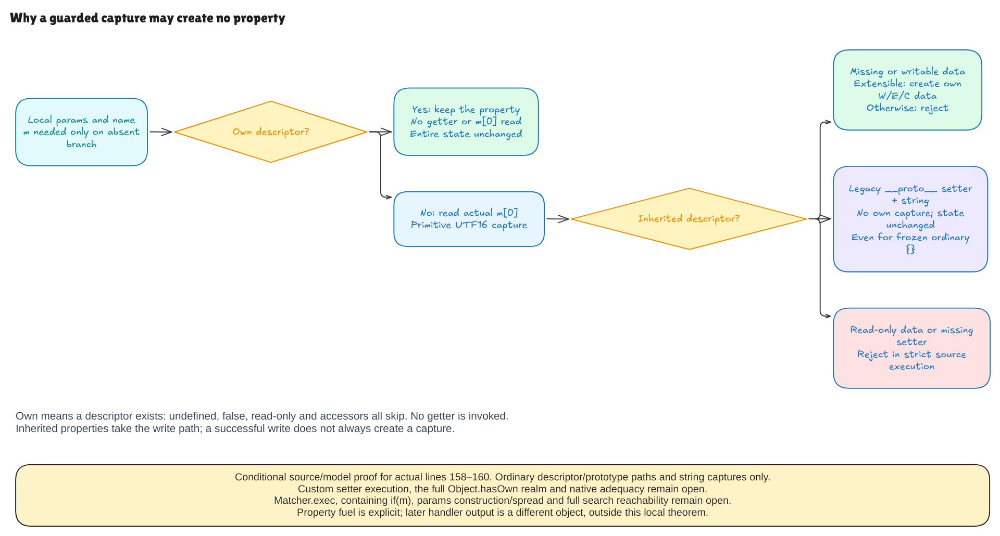

# Guarded captures: ownership before assignment

This milestone verifies the actual three-line block at lines 158–160 of pinned
Hono's TrieRouter search, in the declared source model:

```js
if (!Object.hasOwn(params, name)) {
  params[name] = m[0]
}
```

The question is whether this **local `params` object owns the property**, not
whether reading the property gives a useful value. These are different tests.

| Initial local object | What the selected block does |
| --- | --- |
| Own `id: undefined`, `false`, or `0` | Keeps it; never reads `m[0]` |
| Own accessor or read-only property | Keeps it; never invokes its getter |
| Inherited writable `id` | Creates a new own string capture if extensible |
| Missing `id` on a nonextensible object | Rejects the write |
| Inherited read-only data or missing setter | Rejects the write |
| Ordinary `{}`, name `__proto__`, string capture | Invokes the legacy setter; creates no own capture |

That last row is a successful no-op. The inherited legacy setter ignores a
string argument. It does so even for a frozen ordinary object. A null-prototype
object takes a different path: there is no inherited setter, so an extensible
object receives a new own data property.

## What makes the proof useful

The own-property theorem needs no match-array binding or writable-property
assumption. An own accessor can be present even when calling it would fail:
the block does not call it. Tests include a completely absent `m` binding and
getters that would throw if evaluated.

On the absent-property branch, the theorem starts from an actual allocated
match array whose first cell contains a string. It follows a finite path of
initial object descriptors and prototype links. Those facts determine whether
the write creates data, does nothing, or rejects. The proof does not assume a
successful write, completed heap or desired capture.

The source parser retains the original condition, call, indexed assignment and
array read. The only shared evaluator addition is the ordinary-object/string-key
specialization of `Object.hasOwn`; assignment and prototype behavior use the
existing object model. A separate outcome records an unsupported custom setter.
That outcome is a model gap, not a claim that arbitrary native setters reject.

Creation changes exactly the target ordinary-object cell and gives the new
property writable, enumerable and configurable flags. Other properties,
prototype links, arrays, bindings, private fields, functions, Sets and `this`
are preserved. Skipping and the legacy string-setter case preserve the entire
state. Failed runs do not claim exception identity or transactional rollback.

## Local capture and returned output are different objects

The selected block runs before Hono builds its final handler parameter object.
For `__proto__`, the local ordinary object still inherits `Object.prototype`.
The later helper can read that inherited value and copy it into a different,
null-prototype output object. That final object can own a `__proto__` property
whose value is the prototype object rather than the matched string.

Six finite whole-router probes exercise actual pinned regexp routes for `id`,
`constructor` and `__proto__`, with a matching and a nonmatching path each.
They retain this existing D1 behavior. The local no-op theorem does not prove
the later helper/search composition or turn these observations into a complete
returned-parameter theorem.

## Preparation and remaining boundaries

The examples include an inhabited source-prepared application. Actual selected
Node class/registration preparation and a parsed ordinary-object fixture run
before the capture theorem is applied. The supplied match array remains an
input boundary: `matcher.exec` has not been proved. The fixture is not a proof
of the complete conditional/spread declaration at line 123, Node.insert
traversal, or reachability through the containing `if (m)` and search loops.

Prototype traversal has a model budget of 32 objects. Native interpretation
requires legal ordinary objects, standard intrinsic/legacy-setter behavior,
primitive UTF-16 keys and successful resources. General proxies, coercions,
boxing, arbitrary setter execution and native/frontend adequacy remain open.

The checks cover 672 own-descriptor contexts, 1,012 absent/prototype contexts,
37 Node cases and six explicit Object-binding controls. Of the absent contexts,
128 use a particular custom setter that throws: these test model refusal and
finite rejection agreement, not universal custom-setter behavior. Six admitted
source faults, parser/source-identity controls and native-only boundary probes
provide separate evidence alongside the proofs.



[Editable Excalidraw source](../diagrams/capture-guard.excalidraw) ·
[Live scene](https://app.excalidraw.com/s/8wot9n3ajqf/9w3VjKFA0tb) ·
[Source and contract audit](capture-guard-audit.md)

Start with [the source AST](../../HonoLean/Upstream/NodeCaptureGuard/Source.lean)
and [the contracts](../../HonoLean/Upstream/NodeCaptureGuard/Contract.lean).
The [full-Hono goal](hono-verification-goal.md) remains active.
