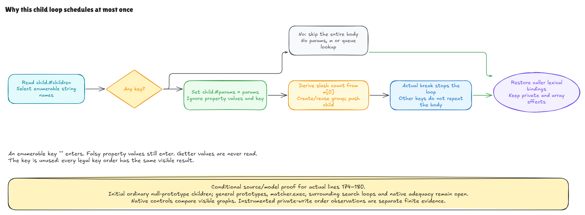

# Why the child loop schedules at most once

This checkpoint connects the complete selected child-enumeration block in
pinned Hono to an independent contract. It remains a conditional source/model
proof; full JavaScript/native interpretation and containing search behavior
are open.

The previous checkpoint proved the count and scheduling lines. It started
after the decision to enter their containing loop. We now execute the actual
loop header, params write, count, registration and `break` together:

```js
for (const _ in child.#children) {
  child.#params = params
  const componentCount = m[0].match(/\//g)?.length ?? 0
  const targetCurNodes = (curNodesQueue[componentCount] ||= [])
  targetCurNodes.push(child)
  break
}
```

If there is no enumerable child name, every body operation is skipped. If
there is one, the code updates the child's params, derives the slash count,
and schedules the child. The actual `break` stops the loop immediately. Ten
enumerable children therefore cause one registration, just as one does.

## Names, flags and values

A property has both a name and a descriptor. The descriptor's `enumerable`
flag determines whether this loop visits its name. Its stored value is not
read. An enumerable property whose value is `false`, `0` or `undefined` still
enters the body. A nonenumerable property does not. An enumerable empty-string
name also enters; the loop does not test whether the chosen name is truthy.

For this source-shaped slice, the initial children object is ordinary and has
a null prototype, matching the shape created by the earlier field initializer.
The proof derives its enumerable names from actual descriptors. It does not
take a desired `hasChildren` boolean as an input. The general language also
has inherited enumeration and shadowing; those remain outside this selected
normal domain. The reference is
[ECMA-262 2025 enumeration](https://tc39.es/ecma262/2025/multipage/ecmascript-language-statements-and-declarations.html#sec-enumerate-object-properties).

The chosen name goes into `_`, which the body never reads. The proof therefore
allows every permutation of the independently specified enumerable names and
shows that they all reach the same result. This does not claim that JavaScript
uses the model's descriptor-store order, or that native key order is arbitrary.
It proves that native ordering is irrelevant to this particular body.

## The two important contracts

The empty contract requires the actual `child` binding, private brand/children
field, allocated ordinary children object and its descriptor facts. It needs
no valid `m`, `params`, writable params field or pending queue: skipped code
cannot demand those inputs. The entire modeled state remains unchanged.

The entered contract adds the initial facts needed by the body. It proves the
private DATA write through the shared assignment evaluator, then reuses the
previous count-and-schedule proof on the resulting state. It derives all
intermediate readiness from those initial facts. Aliases are retained rather
than copied away: params can point to the children object or arrays, and the
matched-string array can also be the pending queue when the initial target
conditions permit it.

The loop consumes its own break. Its temporary `_`, `componentCount` and
`targetCurNodes` bindings disappear on return, while private and array effects
survive. The model keeps an explicit ambient object/private/function/Set/this
frame and an authoritative sparse-array store; it computes their shared view
instead of reconstructing a Node context from a default observer.

An additional example starts with the parsed pinned preamble, class fields and
private method, constructs an instance, and runs this loop with params pointing
to the actual children object. Its tree-map entry and matched text are explicit
provided inputs; this does not yet prove insertion or matcher.exec reachability.
The params slot itself comes from class initialization.

## What the executable checks observe

Native controls execute the exact317-byte source block in an unverified private
class wrapper. They compare visible arrays, shared identities, final private
values, ordinary descriptors and outer lexical canaries. All initial arrays
are retained roots; new reachable arrays receive deterministic graph IDs.
Unreachable match accumulators and iterator internals are omitted. These graph
IDs are not native allocation counts or the full model heap addresses.

Separately instrumented clones record match calls and params at match entry.
They check that the params write occurred first. Getter-value calls remain
zero. The model's regexp trace checks actual new cells against execution
metadata; its displayed match strings are derived from that metadata, not a
new sensor for intermediate accumulator cells. The earlier count proof and
conformance suite cover those cells separately.

Removing `break` is an admitted source fault: the interpreter really executes
the body for every key, and repeated pushes expose the mistake. A native-only
reordered-write fault has the same final visible state but the wrong params
at match entry, demonstrating why final-state checks alone miss ordering.



[Editable source](../diagrams/child-enumeration.excalidraw) ·
[Live scene](https://app.excalidraw.com/s/8wot9n3ajqf/4JxRaJEN6cI) ·
[Source and contract audit](child-enumeration-audit.md)

The source modules are in
[NodeChildEnumeration](../../HonoLean/Upstream/NodeChildEnumeration/Source.lean).
The earlier `matcher.exec`, surrounding branches/loops, complete insertion and
class/module reachability, other routers and the rest of the fixed runtime
catalog remain in the [active goal](hono-verification-goal.md).
