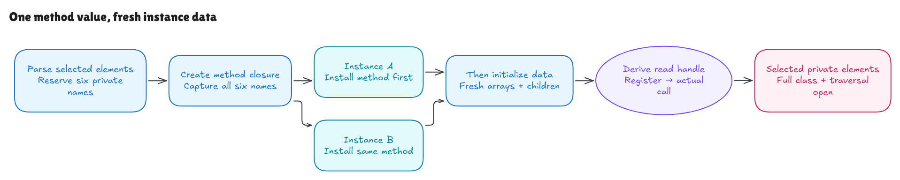

# Where the private method comes from

The [call milestone](private-call-walkthrough.md) proved two actual calls using
a supplied source-bound method closure and private read handle. This milestone
derives those values while initializing Node's selected private elements.

The source is Hono revision
`5ca49b0720755c585c9a9835f0a479ceea36fb52`,
[`node.ts`](https://github.com/honojs/hono/blob/5ca49b0720755c585c9a9835f0a479ceea36fb52/src/router/trie-router/node.ts#L17).
The module preamble at lines 17–18, five data declarations at 21–26 and private
method at 64–84 are parsed separately. The containing class is provenance;
public `insert` and `search`, complete class evaluation and constructor behavior
remain further obligations. The [source record](../../verification/class-installation/source.json)
keeps those boundaries and exact bytes/hashes visible.



[Editable diagram](../diagrams/class-installation.excalidraw) ·
[Live scene](https://app.excalidraw.com/s/8wot9n3ajqf/4doLPic1Ye7)

## One definition, multiple instances

The selected private declarations provide six names: methods, children,
patterns, pattern, params and pushHandlerSets. The model reserves their private
identities together, in that declaration order. It creates a method closure
from the parsed method body, captured lexical environment and complete six-name
map, then appends it to the method table.

Instances of that definition share the method value. They still have separate
methods/patterns arrays and children objects, an installed undefined pattern
slot, and params initially pointing to the module's shared emptyParams object.
A separately evaluated definition receives different names and a different
method handle. Copying an ordinary prototype does not copy private brands.

The identity world and method table are threaded through definitions, including
definitions created before any instances. The initial fresh-name seed considers
both old State names/slots and names captured by existing method-table closures.
That second source matters: a class without instances can already have reserved
names. External unrepresented definitions and classes without represented
methods still require the explicit persistent-world protocol.

Function handles also stay separate from the existing expression-only helper
table. The class factory derives each handle from the retained table prefix;
it does not receive a chosen final method value as an input.

## Source order differs from installation order

Although the method declaration appears after the fields, instance
initialization installs the private method read handle first. Only then does it
evaluate and add the five data fields in their original order.

This distinction is observable. A native initializer can see a private method
whose declaration comes later. A duplicate method stamp rejects before running
the data initializer again; the probe's initializer count stays at one. The
earlier data-only duplicate stamp ran its initializer before failing its add.

The model's ordered operations and generic examples check that distinction.
The admitted Hono field initializers themselves need only array allocation, the
closed null-object helper and the shared emptyParams value. General field
`this`, mutable closures and native partial failure traces remain outside this
selected-source proof.

## Joining the existing proofs

The [generic runtime](../../HonoLean/Upstream/SourceSubset/PrivateClass.lean)
allocates the owner, installs method handles, executes ordered fields and
restores caller scope. The concrete proof frames the installed method slot
through all five field initializers. Its independent endpoint extends the old
field allocation/frame contract with the method read observation.

That endpoint yields both the initial registration Seed and the callable
private handle. Neither is a premise supplying the desired initialized result.
Registration preserves the installed handle while adding fresh internal handler
records and key arrays. The actual collector and selected call can then use
that derived handle and closure with the existing capture contract.

The [initialization proof](../../HonoLean/Upstream/NodeClass/Correctness.lean)
derives the independent instance contract, Seed and Callable. The
[history bridge](../../HonoLean/Upstream/NodeClass/History.lean) preserves the handle
through arbitrary supplied registration histories, derives the protected layout
from its old context and executes the actual five-argument call.

The [nonempty examples](../../HonoLean/Upstream/NodeClass/Examples.lean) initialize
two instances, execute GET/ALL/POST registrations and prove both the independent
call contract and concrete captures. The receiver and registered node are
different objects. A separate direct parsed pipeline executes each source step;
neither example receives a staged initialized handle as its starting answer.

Caller parameter objects and their handoff, query/read context, helper/import
bindings and realm/prototype conditions remain explicit inputs. Registration
events still come from the supplied trace; insertion traversal and the actual
search path that reaches these calls remain open. Frozen lexical captures do
not establish general live module-cell semantics.

## Checks and remaining boundary

```sh
lake build
lake env leanchecker --fresh HonoLean
python3 verification/class-installation/tests.py --hono /path/to/pinned/hono
```

The finite runner compares initialization and registration/call sequences
against exact-source native wrappers, parsed Lean execution and independent
allocation/identity/positional-capture rules. It includes definitions without
instances, prior identities/table prefixes, shared method values, isolated data,
cross-definition brand checks, duplicate keys, Unicode code units and long
histories. Source faults and metadata controls check sensitivity.

Eight groups check 341 exhaustive and 131 seeded/long class contexts, plus 686
exhaustive and 260 seeded/long initialized registration/call contexts: 1,418
total. Nine source faults and four type-metadata controls exercise the joined
pipeline, including an explicit return despite a void annotation.

The query runner explicitly stages the supplied caller parameter cells; it does
not claim to execute the surrounding search writes. Its independent oracle also
preserves nullish fallback: in the four-argument call an old null becomes
undefined because the fifth argument is absent.

Native probes check installation order and rejection of private-method writes.
The later [private-write milestone](private-write-walkthrough.md) refines the
store with DATA/METHOD tags and proves their supported write rules. Native
private accessors and unified function objects,
full class/public-method/default-constructor/newTarget behavior, module linking,
live cells, traversal and complete language adequacy remain open. Bun 1.4.0 and
all 315 pinned source/package blobs are guarded; TypeScript transpilation remains
explicitly unverified. See the [independent audit](class-installation-audit.md).
