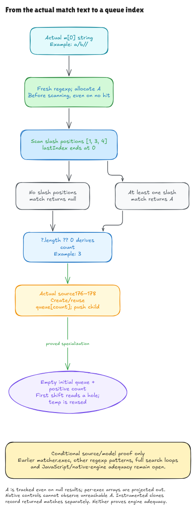

# From match text to the pending queue

This checkpoint verifies the selected slash-count expression and its immediate
scheduling continuation in the pinned Hono source. It is a conditional
source/model proof, with JavaScript/native-engine adequacy still open.

The earlier queue milestone began with a supplied numeric `componentCount`.
This one starts earlier: an actual modeled array `m` has its matched primitive
UTF-16 string at own index 0. The code derives the count from that string.
The earlier `matcher.exec` operation that produced `m` remains an input boundary.

The actual source 176–178 is:

```js
const componentCount = m[0].match(/\//g)?.length ?? 0
const targetCurNodes = (curNodesQueue[componentCount] ||= [])
targetCurNodes.push(child)
```

For `a/b//`, the slash positions are `[1, 3, 4]`, so the count is 3. The
scheduler creates or reuses queue slot 3 and appends `child`. Starting from an
empty queue, slots 0, 1 and 2 are holes, not own properties containing
`undefined`. A subsequent first shift therefore reads `undefined` and the
consumer reuses `tempNodes`.

## What the proof connects

An independent contract enumerates the input's positions and selects precisely
those containing the slash code unit. A separate executable scanner walks the
string. Lean proves that the scanner produces all and only those positions, in
order, and that their number cannot exceed the input length.

The source expression retains a real regexp literal, `.match`, optional
`.length`, and `?? 0` in its parsed syntax tree. It is not replaced by a
precomputed count. The evaluator reads the receiver before allocating the
literal, executes the scan, obtains an array or `null`, then evaluates the
optional access and fallback. The source theorem connects this execution to
the independently specified count.

The contiguous three-line theorem then feeds that derived value into the old
scheduler theorem. Its premises describe the initial heap and bindings; they
do not supply the computed count, a future queue, or successful intermediate
execution. An input-string length bound derives the legal queue-index bound.
The positive-count, empty-queue specialization also establishes the next
consumer's entry facts rather than taking them as assumptions. Its conclusion
exposes the consumer contract and final `curNodes = tempNodes` and
`shifted = undefined` bindings.

## Why allocation matters

Global match creates its accumulator array before the first `exec`, even when
the eventual return is `null`. The model tracks that accumulator on every
invocation. Thus a newly created scheduling group follows that tracked array
in the projected store, including the no-slash case. The global regexp has a
fresh cell and ends with `lastIndex` equal to zero. These choices follow the
[ECMA-262 2025 global-match algorithm](https://tc39.es/ecma262/2025/multipage/text-processing.html#sec-regexp.prototype-%symbol.match%).

This is an explicit projection, not an accounting of every native allocation.
Per-success internal exec arrays and unrelated native regexp properties are
outside the tracked array store. Native tests cannot observe the unreachable
accumulator on a `null` result. Their graph snapshots therefore mark its
abstract slot opaque. A separate instrumented execution records the returned
matches, positions, and `lastIndex` observations. Uninstrumented controls run
the actual source with standard methods and check its visible count and queue.

## How to read the files

- [Source](../../HonoLean/Upstream/NodeComponentCount/Source.lean) checks the exact
  parse and three-line reassembly.
- [Contract](../../HonoLean/Upstream/NodeComponentCount/Contract.lean) states the
  initial input facts and independent count/state relation.
- [Correctness](../../HonoLean/Upstream/NodeComponentCount/Correctness.lean) connects
  source evaluation to that relation.
- [Composition](../../HonoLean/Upstream/NodeComponentCount/Composition.lean) carries
  the result into scheduling and the first-hole consumer.
- [Examples](../../HonoLean/Upstream/NodeComponentCount/Examples.lean) instantiates
  the proofs and checks concrete alias, zero-count and raw UTF-16 cases.
- [UnitRegExp](../../HonoLean/Upstream/ECMA2025/UnitRegExp.lean) contains the generic
  scanner and independent position contract.
- [Audit](component-count-audit.md) records the source and interpretation limits.



[Editable source](../diagrams/component-count.excalidraw) ·
[Live Excalidraw scene](https://app.excalidraw.com/s/8wot9n3ajqf/6y3cmJPfWhz)

## What remains open

This covers a global, non-Unicode, nonempty single-code-unit atom, which is the
regexp used by this particular expression. It does not verify general route
regexps, captures, zero-width matches, custom `exec`, or arbitrary receivers.
Primitive strings, standard frozen methods, ordinary array behavior and
successful resources are explicit interpretation premises. Native boundary
probes show why removing the primitive/frozen-method premises changes results.

Source 175, the earlier match-producing regexp, child enumeration, intervening
control flow, complete search loops, sorting and final mapping remain open.
All full routing behavior units and the full pinned runtime goal remain open.
The [goal](hono-verification-goal.md) still requires every published runtime
entry and the language/host/source-connection obligations to be accounted for.
