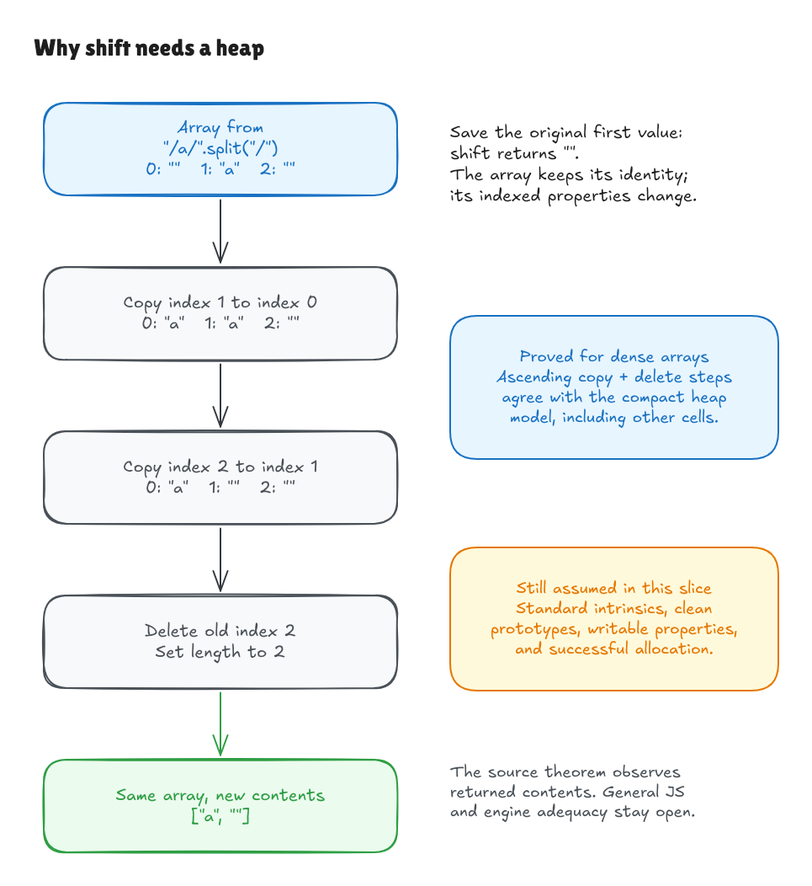

# From compact primitives to explicit steps

The first [source prototype](splitpath-source-bridge.md) proved the parsed Hono
`splitPath` function against a path-partition contract. This milestone strengthens
the primitive foundation underneath that result. It keeps the same upstream
pin, restricted teaching spec and known comparison discrepancy.

## What changed

The compact interpreter used a list split and list tail to describe string
splitting and array shifting. We now have separately written executable models
with more detail:

- [StringSplit.lean](../../HonoLean/Upstream/ECMA2025/StringSplit.lean) searches for
  the first separator from a cursor, extracts a substring, appends it, and
  stops when output capacity is consumed. Its executable definitions never
  call `List.splitOn`; the proof establishes agreement with that operation.
- [DenseArray.lean](../../HonoLean/Upstream/ECMA2025/DenseArray.lean) represents
  indexed own properties and length. Shifting copies properties in ascending
  order, deletes the old last property and updates length. Its proof derives
  the list-tail result from those steps.
- [PrimitiveBridge.lean](../../HonoLean/Upstream/ECMA2025/PrimitiveBridge.lean)
  connects execution of the actual parsed source to the composed step model's
  returned contents. It also proves that the default split result has a legal
  array length.

The [independent ECMA-262 2025 audit](ecma2025-primitive-audit.md) maps the
specialized operations to the exact year-pinned reference and records what is
still assumed. This is a formal equivalence between the written models, with a
reference review. It is not a proof from an established full ECMAScript semantics
or a proof that a JavaScript engine implements that semantics.

## Why the details matter

Consider `splitPath('/a/')`. Splitting produces `["", "a", ""]`. Removing the
initial empty field changes the contents of that array to `["a", ""]`.

In the detailed array description, positions are properties. Position zero gets
position one's value, position one gets position two's value, position two is
deleted, and length becomes two. The original first value is what `shift`
returns. Other variables pointing to the same heap address continue to point
there; other heap cells retain their contents.



[Editable source](../diagrams/ecma2025-shift-steps.excalidraw) ·
[Live scene](https://app.excalidraw.com/s/8wot9n3ajqf/ilTWQKlaky)

Copy order is observable. A deliberately reversed implementation turns
`["a", "b", "c"]` into `["c", "c"]`. Kernel-checked examples expose that fault.
Another example detects a stale old-last property that a contents-only
observation would miss. The string examples refute implementations that discard
empty fields or append one field beyond the limit.

## The argument in plain English

The string proof maintains a cursor and accumulated-output invariant: the
already accumulated fields followed by the remaining permitted split fields
describe the whole result. Search finds the first actual separator, so each
step consumes the correct field. A separate length proof bounds the allocation.

The array proof tracks every indexed own property, including absence beyond the
array's end. After the copy loop, each destination has the original next
value. Deletion and the length update establish the complete dense-array
representation. Heap lemmas account for addresses, environment bindings,
allocation and unaffected cells. They do not claim a general aliasing theorem
for arbitrary JavaScript programs.

Finally, `parsed_source_refines_steps` proves that running the parsed pinned
declaration gives the same contents as the detailed path. `steps_contract_iff`
connects those contents to the independent partition contract. The existing
source theorem and the detailed models meet through proved equations; neither
model's agreement is assumed.

## Checks and limits

```sh
lake build
lake env leanchecker --fresh HonoLean
python3 verification/ecma2025/tests.py --hono /path/to/pinned/hono
```

Native evidence checks 4,165 original Hono/step-model/oracle path inputs,
1,080 input/separator/limit combinations and 909 dense-array cases. Arrays are
observed for values, missing reads, empty-string comparisons, length and deletion
of the old last property. Numeric UTF-16 transport preserves lone surrogates.

Only default-limit cases invoke the actual Hono function. Other limits and
separators exercise the normalized primitive specialization; they do not add
arguments to Hono's API. Native agreement is finite evidence. Universal
equivalence is established separately by Lean proofs, using only the guarded
ordinary foundations.

Native interpretation still requires a primitive input satisfying `LegalString`,
normalized limits, appropriate standard method/hook lookup, ordinary dense
writable/configurable properties, and successful allocation. Descriptors,
prototype traversal, coercions and abrupt completions are not implemented by
the indexed-store model. The external source extractor and the general frontend
remain separate trust obligations. Returned identity/freshness is not added to
the source theorem's observable contract by the supporting heap lemmas.

The next step is to strengthen the exact-source/frontend and interpretation
boundary and carry these primitives into subsequent pinned source slices.
Coverage of routers, dispatch, middleware, request/context, built-ins and the
remaining published runtimes is still required by the full goal.
