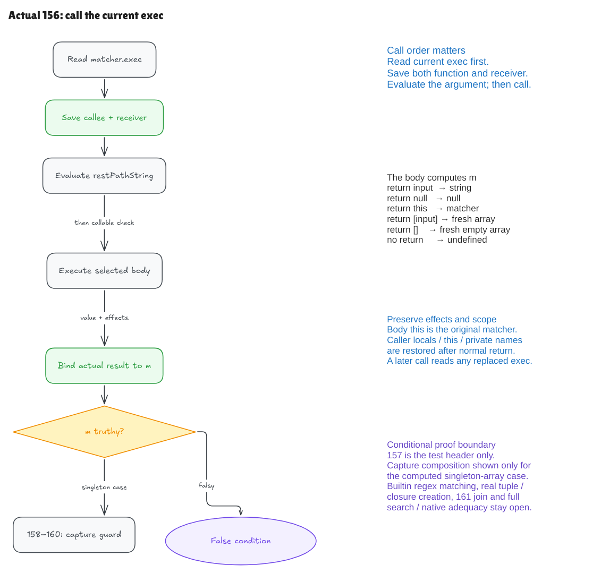

# A method name does not decide what runs

The actual line 156 in pinned Hono is:

```js
const m = matcher.exec(restPathString)
```

This milestone connects that source declaration to execution of the **current
ordinary source method**. It computes `m` by running the selected body. The
builtin regular-expression matcher is the next milestone; the distinction is
part of the guarantee, not a detail hidden inside an assumption.



[Editable Excalidraw source](../diagrams/exec-call.excalidraw) ·
[Live scene](https://app.excalidraw.com/s/8wot9n3ajqf/50taty2Enxu)

## Read the current property first

Calling something named `exec` does not automatically mean “run a regular
expression.” The matcher may inherit its method, or a caller may have replaced
the method between requests. The current property determines the callee.

The model follows the direct-call order: evaluate the receiver, read and save
its current method, evaluate the argument, then call that saved value. The body
receives the original matcher as `this`. A null base fails before arguments;
a noncallable saved value is rejected after argument evaluation. This follows
the [ECMA2025 direct-call rules](https://tc39.es/ecma262/2025/multipage/ecmascript-language-expressions.html#sec-evaluatecall).

The new parser accepts genuine ordinary method source, for example:

```js
exec(input) { return [input] }
```

It retains a real parameter and dynamic receiver. Its admitted source subset
does not include arrows, callback dispatch, generators, `super`, arbitrary
captured-variable writes or native closure creation.

## The return value comes from the body

The concrete universal contract covers six small body shapes:

| Body | Actual result |
| --- | --- |
| `return input` | The supplied string |
| `return null` | Null |
| `return this` | The original matcher |
| `return [input]` | A fresh singleton array |
| `return []` | A fresh empty array |
| No return | Undefined |

The proof executes each body for every input string and permitted initial
state. It does not receive a desired match array as an input. The generic
call layer also retains effects and arbitrary actual return values through an
explicit body-execution relation; that relation is an operational description,
not a regex specification.

Function-local bindings and private-name scope are restored to the caller
after a normal return. Heap and private-field effects remain. The finite suite
checks fourteen additional bodies, including assignments, private reads and
writes, pushes, captured values and errors. Those tests are broader executable
evidence than the six-shape universal result contract.

## Use the result in the right source order

The original line 157 is the header `if (m) {`. Its exact tokens and variable
test are checked separately; the complete containing body is still open.
An empty string and null are falsy. Both singleton and empty arrays are truthy.
An empty array being truthy does not establish that its first element is a
captured string.

For the singleton body, the proof derives a fresh array whose own index 0 holds
the input string. That result establishes the existing capture guard's inputs.
The composition runs actual 123 initializer, then actual 156 call, then actual
158–160 guard, for both initializer arms. It supplies no early computed-match binding and
does not reorder execution through the earlier prepared-match theorem.

Nine concrete examples show these domains are inhabited. They include inherited
methods, UTF16 and empty strings, parsed method/property preparation and a real
property replacement between selected activations. Each repeated `const m`
belongs to a fresh selected entry, not a redeclaration in one block. Initial
private-owner graphs and native closure/table creation are explicit boundaries.

## What remains open

The result of a builtin regex must still be computed from a checked regex
representation and input. We retain that obligation in the
[next-frontier plan](regex-exec-plan.md), along with constructor/cache/tuple
provenance, mutable callees and full syntax. The new computed-match heap append
must also be joined to line 161's collector contract. Full 157 body, surrounding
traversal and general frontend/native adequacy remain open.

Getters, proxies, bound functions, boxing, mutation of exec during an argument
and partial effects before a throw have separate native-only probes. The
admitted argument grammar does not execute a same-object exec assignment during
an argument. The error model exposes rejection without a partial state, so it
makes no rollback promise.

The finite fixture runs the exact51-byte source and plain JavaScript methods on
Bun1.4.0 and Node22.22.2, with no TypeScript erasure. Its wrapper, tagged JSON
transport and observer remain unverified. It observes existing objects and at
most one visible fresh returned dense array, not arbitrary unreachable
allocations or native property order.

After building, run:

```sh
python3 verification/exec-call/tests.py --hono ../hono
```

See the [audit](exec-call-audit.md) for source identity, declarations and checks.

A separate refusal control uses `exec(input) { return this.other() }`.
The projected method parser rejects this nested call; both native engines
return null. This records a frontend refusal, not a native failure or a new
comparison exception. The six-body universal theorem does not include this
body; nested block dispatch remains an explicit full-goal obligation.
