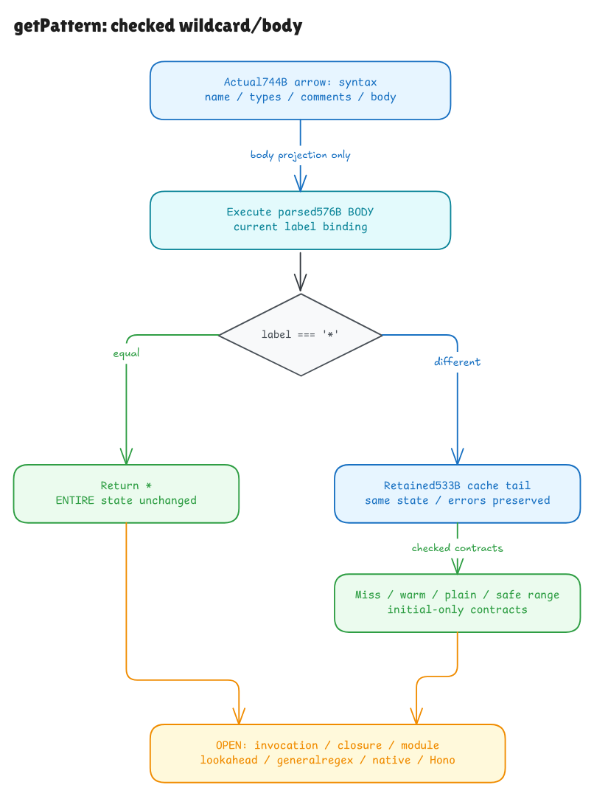

# The wildcard returns before the machinery matters

This checkpoint connects Hono's complete576-byte body to a checked wildcard
contract and the earlier cache contracts. The744-byte exported arrow is also
parsed with its types, optional parameter, comments and entire body retained.
Focused witnesses, the integrated build, fresh kernel replay and declaration/
axiom audit pass. Creating and invoking the closure is the next boundary.

[Editable source](../diagrams/getpattern-body.excalidraw) ·
[Private working scene](https://app.excalidraw.com/s/8wot9n3ajqf/9GaHfOop1bM)

## A stronger claim than the returned value

Hono begins with `if (label === '*') return '*'`. The wildcard theorem needs
only one fact: the current label binding is the primitive string `*`.

The result is `*`, and the ENTIRE model state is unchanged. That includes
arrays, objects, caller bindings, private stores, functions, regex metadata and
traces. It does not need an allocated String prototype, a usable cache, next,
or a callable constructor. Those operations are skipped by the actual guard.
Even an empty model heap or a dangling cache binding satisfies this body claim.
Those are model examples; native engines always have their own allocated realm.

This is useful because an early return must remain early when later work would
fail. Native controls poison matching, cache access, constructor access and next
coercion. The result stays `*` and the read/effect trace stays empty.

## Everything else reaches the real cache code

For a current value unequal to `*`, the new prefix delegates to the original
complete533-byte cache body on the same state. It adds one interpreter step and
preserves every model outcome, including errors. No successful result is an
assumption of this relation.

The earlier independent warm, plain and safe-range terminal contracts therefore
lift to the complete body. Their label language starts with `:`, so the proof
derives that they cannot be the literal wildcard. The miss case needs an
explicit `label ≠ '*'` condition: `*` missed the old parameter matcher, but
the complete body returns `*` before reaching it.

Actual cache initialization followed by two complete body executions still
carries the same entire heap and cache forward. The Init/Terminal/Warm contracts
and the first tuple/regex identity survive that composition. General regexes
and reached lookahead remain separate obligations.

## Reading an arrow is not calling it

The new declaration parser reads `export const`, the function name, typed
parameters, optional marker, return union, arrow and full body. It retains the
raw inner source, including Hono's leading comments. The body is parsed through
the existing expression/statement parser; no branch is replaced by an invented
empty body.

Its declared trivia profile permits ASCII whitespace and leading ASCII `//`
comments terminated by CR/LF. Block/trailing comments, an unterminated comment
containing the apparent closing brace, and Unicode line-separator cases refuse
explicitly. These are frontend limits, not claims that native TypeScript rejects
every refused source. Actual Hono falls inside the admitted profile.

Executing the parsed body's projection assumes an entry environment with its
label/next/cache/constructor bindings. A real invocation must derive those
bindings from arguments and lexical cells. It must create one closure around
the actual initialized cache, resolve current global bindings at the right time,
and restore the caller on return or throw. The
[next plan](getpattern-invocation-plan.md) describes that work.

## Evidence and limits

The suite compares384contexts/histories against an independent wildcard/no-effect
rule and the frozen cache history contract, including wildcard interleavings.
Four source faults change the guard, its operator, its return or remove it.
Twelve declaration cases check metadata, raw comments/body and refusal frontiers.
Two unready model worlds exercise skipped readiness. Native-only records include
poisoned effects and an actual pinned Bun module call; TypeScript loading,
invocation, module and native-language adequacy are not proved by those records.

The new full body's cold lookahead control still gives native success beside a
model grammar refusal. It is kept outside agreement counts and the D1 allowance.
The [audit](getpattern-body-audit.md) records the exact gates and scope. The
entire published Hono runtime remains the active goal.
