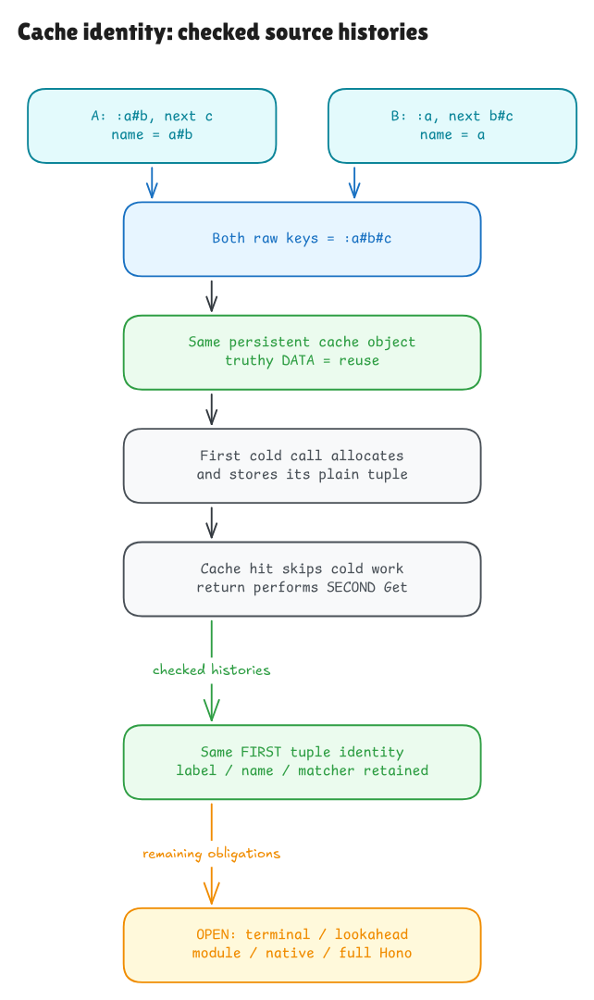

# A cache changes identity and behavior

This checkpoint connects Hono's actual cache control to checked source-model
contracts for warm hits, plain parameters, misses and initialization. It also
checks persistent collision histories. This is one part of the active full-Hono
goal; native language adequacy and the remaining runtime catalog stay open.

The label proof computed Hono's `match` array. The next bridge consumes it in the
actual cache control. We retain the complete post-wildcard body, not a collection
of headers with invented branch bodies. That includes the real lookahead branch,
which remains an explicit unsupported execution path for now.

[Editable source](../diagrams/getpattern-cache.excalidraw) ·
[Private working scene](https://app.excalidraw.com/s/8wot9n3ajqf/1RnECnclUI0)

## What the cache actually does

Hono constructs a key with `${label}#${next}`. There is no escaping. It reads the
current property and tests its truthiness. A truthy value skips all cold work;
it does not need to be a valid Pattern tuple. An empty array is truthy. Zero,
false, null, undefined and an empty string are falsy and take the store path.

For a plain parameter such as `:id`, the cold path allocates
`[label, match[1], true]`. It uses ordinary strict assignment, including current
writability, inherited descriptors and extensibility. Finally, the return
statement reads the current property AGAIN. It does not simply return a saved
first-read value or the right-hand tuple.

Those steps matter even for something that looks like a simple map:

| Initial cache state | Result in the admitted DATA profile |
| --- | --- |
| Truthy own/inherited value | Return that value; skip cold reads and construction |
| Falsy writable own value | Replace its value while preserving descriptor flags |
| Missing/inherited writable value | Create an own W/E/C field if the receiver is extensible |
| Read-only resolved DATA, or a non-extensible receiver needing a NEW own field | Executable rejection controls; error-state adequacy remains open |

The independent contract describes these initial descriptors and resulting
values/frames. It never assumes a completed Get, successful Set, desired capture
array or returned tuple. The full source derives its match from actual source 60.
A separate warm theorem for the exact inner440-byte block needs no match or
constructor binding at all, because those cold expressions are skipped.

## Why first-wins can be surprising

Two distinct input pairs have the same raw key:

| Label | Next | Computed key |
| --- | --- | --- |
| `:a#b` | `c` | `:a#b#c` |
| `:a` | `b#c` | `:a#b#c` |

Whichever cold call runs first supplies the tuple returned by the later call.
Both the object identity and the earlier label/name survive. Undefined and the
string `undefined` also share a suffix, even though they can choose different
cold regex branches.

Histories carry the entire updated model heap and metadata forward and reuse
the SAME cache reference. The source 50 `{}` declaration creates that cache once.
Empty own storage alone does not prove a miss: its Object.prototype chain may
contain inherited values. Initialization composition therefore derives the
relevant path from facts about the BEFORE root object.

## Boundaries that the checks preserve

The symbolic normal-input cache contracts use strings or undefined for next.
Other primitive conversions have separate executable controls. General object
coercion, custom getters/setters, proxies and full module/closure/native semantics
remain open. A getter can return different values on the two reads; a setter can
retain the tuple and then throw. The native probes record those effects rather
than interpreting an Except error as rollback.

The main comparison runs the exact complete533-byte body or440-byte block with
an explicit caller-owned cache. It compares visible cache descriptors and exposed
reference identity, including values exposed through the cache but not returned.
It does not invent native identities/counts for temporary regex literals or
capture arrays. Actual typed52-byte initialization is modeled and checked
separately; native main does not pretend to execute that TypeScript declaration.

Warm hits, plain cold stores and computed misses have symbolic contracts. Safe
terminal construction is currently a kernel execution witness and finite
comparison profile, not a universal whole-cache terminal theorem. Reached cold
lookahead remains a model refusal even when native execution succeeds. The
earlier wildcard guard is outside this post-wildcard body: the generic miss
claim does not say full getPattern returns null for `*`.

The finite suite compares 3,478 contexts or histories against an independent
oracle and the pinned source in Bun and Node. Its six source mutations check
that wrong tuple contents, keys, branch decisions and returned objects are
observable. Six additional controls per engine record custom getters, setters,
coercion, array caches and the legacy prototype setter as native-only evidence.
Passing these cases supports the model; it does not turn them into a universal
native proof. The [audit](getpattern-cache-audit.md) records the exact gates.

The frozen native collision preflight remains historical native-only evidence;
its null formal-theorem fields do not replace the new conditional source-model
claims. Full getPattern, installation, traversal, query preparation and the
entire runtime catalog remain required work in the active goal.

The [next source plan](getpattern-terminal-cache-plan.md) closes the universal
cold terminal branch before extending actual wildcard/function control and the
more demanding lookahead branch.
