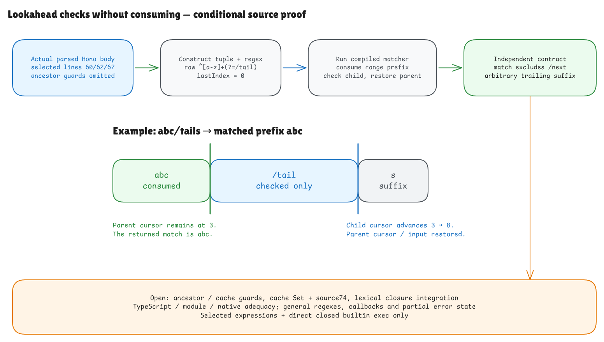

# Checking ahead without consuming text

This checkpoint proves a small, real piece of pinned Hono's `getPattern`:
the selected label declaration at line 60, raw cache-key declaration at line 62,
and positive-lookahead tuple at line 67. It connects those actual parsed nodes
to a new matcher and an independent matching rule. This remains a conditional
source-model result; the whole Hono runtime is still open.



[Editable source](../diagrams/getpattern-lookahead.excalidraw) ·
[Live Excalidraw scene](https://app.excalidraw.com/s/8wot9n3ajqf/5Dp3fgq197Q) ·
[Evidence and trust audit](getpattern-lookahead-audit.md)

## The behavior to understand

For label `:id{[a-z]+}` and next segment `tail`, Hono constructs:

```text
^[a-z]+(?=/tail)
```

The first part consumes one or more characters in the interval `a` through `z`.
The assertion `(?=/tail)` checks the following text, then leaves the match end
where it was before that check. For `abc/tails`, the returned match is `abc`.
The slash and `tail` do not belong to it. The final `s` is allowed: this source
branch adds neither `$` nor an ending segment boundary.

| Input | Result |
| --- | --- |
| `abc/tail` | `abc` |
| `abc/tails` | `abc` |
| `abc/tail/rest` | `abc` |
| `abc/tai` | no match |
| `/tail` | no match: the consumed prefix must be nonempty |
| `abcX/tail` | no match: `X` is outside `a-z` |

## The rule is independent of the program

We describe a successful input as three pieces:

```text
input = nonempty range prefix ++ "/" ++ next ++ arbitrary suffix
returned match = range prefix
```

This rule does not call the parser, compiler, interpreter, or regex executor.
The proof establishes that executing the compiled matcher succeeds exactly
when that decomposition exists, with index 0 and the correct consumed length.
It also establishes rejection when the decomposition does not exist.

The admitted constructor grammar is deliberately small: ordered ASCII
alphanumeric range endpoints and a nonempty ASCII alphanumeric `next`.
Characters between two endpoints may include punctuation: `0-z`, for example,
contains more than letters and digits. Slash has code 47, below every admitted
lower endpoint, so the range can never swallow the delimiter. This fact makes
the decomposition unique and avoids pretending we have proved general regex
backtracking. Arbitrary UTF-16 units, including line terminators and unpaired
surrogates, remain allowed in the trailing suffix.

## Why the new matcher is meaningful

The compiler emits a real positive-assertion instruction containing a child
literal program. The parent consumes the range prefix. The child advances its
own cursor while checking slash and `next`; success resumes the parent with
the parent's original cursor and input. For `abc/tails`, the child advances
from 3 to 8, while the returned match still ends at 3. The child's internal start
field is a continuation detail, not a claim about a native regex capture span.

The constructor uses the shared ordinary-object heap and current constructor
identity. It allocates the regex object, parses and compiles the actual raw
constructor string, then initializes ordinary `lastIndex` to 0. A distinct tagged
record stores the new assertion bytecode, so existing range records keep their
original meaning. The explicit model coherence check scans tagged metadata;
that representation check is not work attributed to Hono or a complexity claim.

Execution reads the current numeric `lastIndex`. This nonglobal regex starts at 0
and preserves that property, including a nonzero value or an unwritable data
descriptor. A successful call allocates the match array and metadata; a miss
returns null and leaves the modeled state unchanged. The theorem also preserves
existing objects and arrays.

## How this reaches the actual Hono source

An external identity check verifies the clean pinned revision, all 315 selected
Git blobs, the exact source fragments, and the retained576-byte function body.
Lean's existing parser consumes that complete body. A structural projection
selects the real declarations and tuple; it does not manufacture a replacement
AST from the intended answer.

The public source theorem starts before line 60, with the original label, `next`,
realm and current constructor facts. It derives the captures, derives the raw
key, and constructs the actual three-slot tuple. No premise supplies a future
capture array, cache value, compiled matcher, or successful execution.

The lookahead tuple is `[cacheKey, name, regex]`. That first slot differs from
the terminal branch's `[label, name, regex]`; the proof preserves the distinction.
The raw constructor string contains `/`, while native `RegExp.source` displays
`\/`. The display helper is an explicit observation projection, not a proof of
the full native property getter.

## What waits until we resume

Selecting nodes does not execute their ancestor conditions or prove that the
complete function reaches line 67. The new theorem executes the selected
declarations and tuple, then directly invokes the closed builtin on the produced
matcher. It does not yet connect this new record type through the full cache
guards, cache Set, line 74's return, exported lexical closure, or the router's
later `.exec` method call. Earlier terminal-cache and closure theorems remain
unchanged; they do not automatically extend to this new branch.

That integration is the next checkpoint. General regex syntax, callbacks,
state after errors, TypeScript erasure, module loading, full native language
adequacy and the rest of Hono remain required by the original goal. Passing the
finite comparisons supplies evidence about these fixtures, not a universal
native-engine theorem. The goal is paused after this checkpoint at your request.
