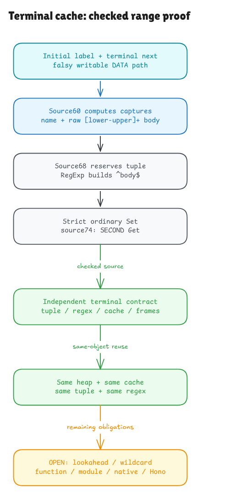

# From a raw label to a cached regex

This checkpoint proves terminal insertion and same-object reuse for the admitted
safe range grammar. Focused witnesses, the integrated build, fresh kernel replay
and actual declaration/axiom audit pass. Whole-Hono and native JavaScript
adequacy remain open.

The previous cache checkpoint handled plain parameters and warm hits. A label
such as `:id{[0-9]+}` adds a constructor on the cold path. We now derive that
construction inside the actual complete533-byte cache body, instead of testing
only one closed execution or jumping directly to a handwritten expected tuple.

[Editable source](../diagrams/getpattern-terminal-cache.excalidraw) ·
[Private working scene](https://app.excalidraw.com/s/8wot9n3ajqf/6wg4KglUqnD)

## What the new contract says

Start with a valid nonempty parameter name, a safe ordered character range,
initial standard constructor/realm facts, and a falsy writable DATA cache path.
There is no supplied match array, regex, successful assignment or returned tuple.

1. Actual source 60 computes the name and raw body captures from the label.
2. The actual condition chooses source 68 when next is absent, empty, begins
   with `:`, or begins with `*`. Prefix suffixes may contain arbitrary UTF16.
3. The tuple is reserved before its elements are evaluated. The source reads
   label/name, saves the current RegExp constructor, builds `^body$`, and runs
   the existing real range parser/compiler and constructor semantics.
4. Strict ordinary assignment writes the fresh tuple through the saved cache
   reference. Source 74 performs a second property read and returns that tuple.

The output contract fixes the actual tuple contents and cache descriptor,
the fresh regex object, lastIndex0, empty flags and stored compiled program.
Its language accepts exactly nonempty strings whose UTF16 units lie inside
the interval. The source/model proof is general over all admitted endpoints,
names and terminal-next inputs; finite comparisons are separate evidence.
For example, `[A-z]+` also accepts punctuation between `Z` and `a`, including
`[` and `_`. The inclusive interval contract accounts for those characters.

The proof also says what survives: every old array and unrelated object,
caller locals, functions, private stores, sets, this, iterator state and old
regex/label metadata. Aliases to the cache see its intended mutation.
Replacing an existing writable field preserves its attributes and works on a
non-extensible cache. A new own field needs an extensible receiver.

## Why reuse needs a separate argument

A second call must receive the first call's actual updated state. A new empty
cache would miss the point of verification. The composed proof carries the
same heap, cache, tuple and regex forward, computes the second call's captures,
then derives a warm hit from the stored field. It retains the independent
initialization, terminal and warm contracts.

There is a subtle alias boundary: a single call may use an old object as its
cache, even an intrinsic prototype when the input facts allow it. Proving a
second standard-realm call also needs to preserve that realm. General reuse
therefore states initial separation from the String/RegExp prototypes. Actual
source 50 allocation derives this separation from freshness; it is not an
assumption that future lookup or the second call succeeds.

## How the comparisons help

The new tests reuse the complete pinned source and compare its visible tuple,
cache descriptors, raw names and reference identity against the model and an
independent label/key/descriptor history oracle. They cover every 1,953 ordered
safe endpoint pair across all four terminal-next forms, followed by a warm call.
Additional descriptor/name profiles exercise writable/read-only fields and
extensibility. Supported source mutations change the terminal label, name or
matcher and must change the observed result.

A separate probe reads the ACTUAL compiled record from the cached model regex,
runs that VM on19query strings per profile, and compares native execution of
the actual stored regex in Bun and Node. It includes interval interiors,
boundaries, mixed invalid strings, line terminators, NUL and lone surrogates.
It does not execute Node.search156's source or prove native VM adequacy.
Caller/prior-regex/array/intrinsic snapshots and model metadata sensors support
the frame checks; hidden native metadata and physical allocations stay outside
the observer's reach.

The existing undefined/stringundefined collision also matters here: an absent
next can construct a terminal regex, then the string `undefined` hits that same
key and reuses it. Reversing the history reaches actual 67 lookahead. Native
execution succeeds there while this model explicitly refuses its grammar.
That refusal remains visible rather than being counted as agreement.

## What remains

This still covers the post-wildcard body, not complete getPattern function or
module activation. The earlier `*` guard, function entry, closure/cache lifetime,
lookahead and general regex/coercion/accessor/native behavior remain required
work. The safe range grammar is a genuine proved subset, not all JavaScript
regular expressions. The full published Hono runtime catalog remains active.
