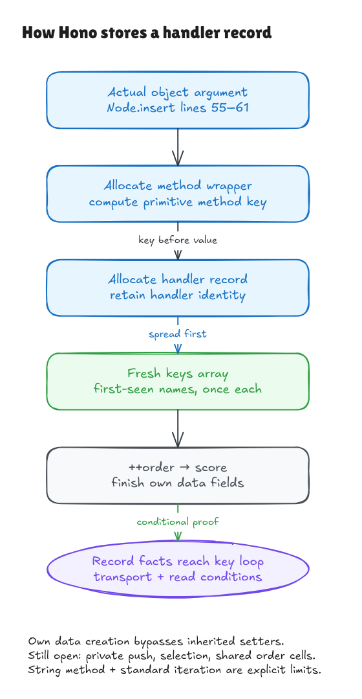

# From parameter names to an actual handler record

The previous [Set milestone](key-set-walkthrough.md) proved that supplied string
events produce unique names in first-occurrence order. This milestone follows
those names into the actual object argument created at the end of pinned
Hono's `Node.insert`:

```ts
{
  [method]: {
    handler,
    possibleKeys: [...possibleKeys],
    score: ++order,
  },
}
```

The [source record](../../verification/handler-record/source.json) identifies the
exact expression window in lines 55–61. The surrounding private receiver,
`.push` lookup and call are excluded. Their code remains in the provenance
record, with no whole-insertion theorem claimed.



[Editable source](../diagrams/handler-record.excalidraw) ·
[Live Excalidraw scene](https://app.excalidraw.com/s/8wot9n3ajqf/1PKNIBdDSPH)

## What the contract says

For method `GET`, handler `h`, keys `[id, name]` and old counter `7`, the result
is a fresh wrapper whose own `GET` field points to a fresh record:

```text
wrapper.GET ──→ record
                 handler ──→ the original h
                 possibleKeys ──→ a fresh [id, name] array
                 score = 8

counter afterward = 8
```

The handler is retained by identity; it is not cloned or executed. The keys are
copied into a fresh array. The Set remains unchanged. Earlier object and array
cells, function definitions and other lexical bindings retain their contents.
The independent contract gives the exact own data descriptors and complete
modeled endpoint without calling the source evaluator.

Both records have an ordinary prototype. Their own data properties are
writable, enumerable and configurable. The wrapper has exactly one **own**
method field; the inner record has exactly three own fields and no own `params`
field. This is not a statement that their prototype chains contain no other
properties. The model's own-store ordering is not a native enumeration-order
theorem.

The record proof copies the supplied Set data exactly. The earlier producer
theorem supplies its uniqueness and first-occurrence meaning. These are
separate obligations, so the record proof cannot quietly remove duplicates or
sort keys to make later results easier.

## Why the construction details matter

Object construction uses own data-property creation, rather than ordinary
assignment through the prototype chain. Consequently the computed method
`"__proto__"` becomes an own field pointing to the handler record. It does not
invoke the inherited legacy prototype setter or change the wrapper's prototype.
An inherited `possibleKeys` setter is also bypassed when that field is created.

Noncomputed `__proto__: value` is different JavaScript syntax: it can initialize
the prototype. The parser rejects that form until it has a model. Computed and
shorthand forms remain ordinary data fields.

Evaluation order is part of the argument. The wrapper is allocated before its
key/value expressions; the nested record is allocated next; its `handler` is
read, spread completes, then `++order` updates the counter and supplies its new
value. If iteration throws, that increment has not happened. A later failed
push can occur after it has happened. The expression theorem begins after any
surrounding callee lookup effects; it does not prove that lookup or call.

## What the loop connection now derives

The [bridge](../../HonoLean/Upstream/HandlerRecord/LoopBridge.lean) obtains the
handler cell, `possibleKeys` descriptor, copied array contents and absent own
`params` field from the executed construction. It obtains uniqueness from the
earlier producer contract. Its remaining `ConsumerDomain` does not assume
those derived facts.

A [nonempty witness](../../HonoLean/Upstream/HandlerRecord/Examples.lean) executes
the typed Set creation, two duplicate `id` adds, this actual object expression,
and the capture-loop theorem. Caller scaffolding only binds the selected
record; it does not manufacture its handler/key fields.

There is one important prototype condition. The later statement
`handlerSet.params = createNullObject()` is ordinary assignment. Even though
the record initially has no own `params`, an inherited setter or read-only
property can change or reject that assignment. The bridge explicitly requires
an absent or writable inherited data descriptor for this key. A native probe
with an inherited setter reaches a TypeError in the actual capture block after
the handler has already been appended. Own absence alone is insufficient.

Actual private-method storage, method selection, unchanged-cell transport,
event/string production, traversal and stable parameter reads remain separate
surrounding-source obligations.
The subsequent [private-push milestone](methods-push-walkthrough.md) closes the
normal modeled registration call and its stored map/record/key cells. Actual
class initialization, later search allocation and method selection remain open;
its immediate consumer bridge has an explicit preallocated-collector domain.

## Numbers, shared state and an engine finding

The modeled increment uses mathematical integers. Native interpretation needs
both the old counter and the new score to be safe integers, plus a writable
lexical binding. Hono's `order` is a shared module `let`; a single expression
update does not verify module-cell persistence across instances or calls.
Repeated wrapper evaluations in the tests explicitly thread that state.
The existing block/loop runners restore whole value environments, and the
closed-function model uses frozen captures. They do not establish general
outer-variable mutation or `const` restrictions. This theorem evaluates the
expression directly; accepting a larger program in the parser does not prove
that program's mutable lexical scopes match native JavaScript.

A native boundary probe starts at `Number.MAX_SAFE_INTEGER` and observes two
successive scores of `9007199254740992`. The integer theorem must not be advertised
as an unbounded native uniqueness or strict-increase theorem. Full Number
semantics remain an obligation for whole-Hono verification.

The [guarded coercion probe](../../verification/handler-record/coercion-probe.mjs)
also preserves a finite engine difference outside the admitted primitive-string
method domain:

| Object-valued computed key | Bun 1.4.0 | Node 22.22.2 |
| --- | --- | --- |
| Minimal key/value side effects | value, then key coercion | key coercion, then value |
| Actual object argument with custom iterator | iteration, then key coercion | key coercion, then iteration |

The [2025 standard](https://tc39.es/ecma262/2025/multipage/ecmascript-language-expressions.html#sec-object-initializer-runtime-semantics-evaluation)
places computed-key conversion before value evaluation. The model retains that
order and rejects unsupported object-key conversion. Primitive-string methods
have no such coercion callback; this probe neither expands their proof domain
nor adds a Hono comparison exception. Broader engine adequacy remains open.

## Evidence and remaining boundary

```sh
lake build
lake env leanchecker --fresh HonoLean
HONO_NODE=/path/to/node22.22.2 python3 verification/handler-record/tests.py --hono /path/to/pinned/hono
```

Six test groups check 597 exhaustive/generated contexts plus 38 empty/long and
handler-kind contexts, each evaluated twice; five parsed source mutations;
source artifact and hidden-checkout edits; and the native boundary probes.
The same observations are compared against the actual expression, Lean
execution and an independent structural oracle. This expression uses ordinary
JavaScript, so this harness does not need a TypeScript erasure pass.

Native interpretation still requires a valid existing intrinsic prototype
(represented at object address 0), admissible identities, standard stable Set
iteration, legal UTF-16 strings/dense-array sizes and sufficient resources.
The literal uses that intrinsic prototype, independently of a caller variable
named `Object`. General frontend, native engine, heap, coercion, exception and
module adequacy remain open. The [independent audit](handler-record-audit.md)
reviews this conditional result; it does not close whole-insertion or package
coverage.
