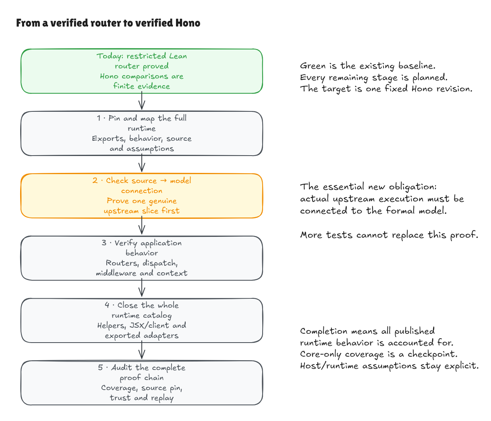

# Long-running goal: formal verification of Hono

## Objective

Make hono-lean a formal verification of the runtime behavior of a pinned Hono
revision. Connect the actual upstream implementation to independent Lean
contracts, prove those contracts, and account for the entire published runtime
API and the internal code on which it depends. Build a verified Lean
implementation alongside that argument where it helps expose, execute, and
explain the semantics.

The final claim must say exactly which source revision, behaviors, input domains,
language/host models, and assumptions it covers. A verified reimplementation plus
passing comparisons is an important intermediate result. It does not by itself
prove the original Hono implementation correct.

Work toward the complete runtime surface. Finishing the default application core
is a major checkpoint, not permission to mark this whole goal complete while
other published runtime APIs remain unaccounted for.

See the [experiment overview](README.md) for the
current checkpoint. The generated structural inventory and the conditional
source-subset prototype have separate evidence states; neither closes this
whole-runtime goal.

[Editable Excalidraw source](../diagrams/hono-verification-program.excalidraw) ·
[Live scene](https://app.excalidraw.com/s/8wot9n3ajqf/8TxFx75TVS1)

## Target and starting point

The initial target is `honojs/hono` at
`5ca49b0720755c585c9a9835f0a479ceea36fb52`. The local package declares version
`4.13.13`; the commit hash is the authority, not a moving package version or
current website. [verification/target.json](../../verification/target.json) records
the target and initial inventory counts. Preserve the existing comparison pin
and historical benchmark artifacts.

The first scan finds 77 package export-map entries, including a wildcard and
type-only entries, and 189 candidate TypeScript/TSX source files under `src`
after excluding test filenames. These are starting inventory counts, not proof
coverage. The first milestone must resolve exports and classify the candidates.

At the starting commit, `b8fa18d`, the project already proves a restricted
Lean text-router contract through parsing, construction, successful/rejected
registration histories, and ordered match lists. Its finite Hono comparison has
one documented D1 discrepancy. No existing theorem proves upstream Hono's
TypeScript equivalent for every input. Preserve that distinction in every
progress report and public claim.

Keep [SPEC.md](../../SPEC.md) as the completed restricted contract and teaching
baseline. Add versioned Hono-compatibility specifications and models separately.
Reuse existing results when their domains and meanings agree; do not silently
change the baseline into a different API or erase its historical evidence.

## What must be covered

The coverage denominator is the pinned root package's published runtime exports,
including wildcard expansion, their public constructors/methods/options and
lifecycle behavior, and all reachable internal implementation dependencies.

Cover the default `Hono` application, alternative presets, all exported routers,
registration and composition APIs, request/context/response behavior, middleware
composition, built-in middleware, utilities and helpers, validation, streaming,
client/RPC runtime, HTML/JSX/DOM runtimes, and runtime adapters exported by this
package. Group them into small coherent milestones rather than one giant proof.

Inventory erased TypeScript declarations separately. Do not imply that runtime
proofs establish TypeScript type-system soundness, compiler correctness, or every
type-level API guarantee. Track any claimed type-level properties as their own
obligations. Documentation, tests, build tooling, and separate ecosystem packages
are classified explicitly; omission from the runtime theorem must be explained.

External browsers, servers, databases, operating systems, cryptographic
implementations, and third-party/user middleware are not automatically verified.
Specify their interfaces and assumptions. Prove Hono's use of those interfaces.
Treat user handlers parametrically, including their possible returns, throws,
and effects; do not assume arbitrary handler code is correct or reduce all
handlers to successful string labels.

## Three separate proof obligations

For each behavior, establish the following chain:

1. **An independent contract.** Describe the allowed inputs and observable
   behavior without defining the desired answer as whatever either implementation
   happens to return. Include errors, mutations, ordering, and lifecycle effects.
2. **A Lean model and implementation proof.** Prove the executable Lean behavior
   follows that contract. Check nonempty domains, exact outputs, rejection, and
   state invariants rather than only successful examples.
3. **An upstream source connection.** Mechanically relate execution of the pinned
   Hono source, or an explicitly identified emitted artifact, to the model and
   its observable behavior. A handwritten transcription or finite test corpus
   cannot substitute for this theorem.

The source connection may use a reviewed executable JavaScript semantics with a
checked source translation, translation validation, or another proof-producing
method. Investigate feasibility before committing to a toolchain. Bind the
verified program representation to the exact source/artifact and hashes. State
what parser, type erasure, transpilation, bundling, and semantics are trusted or
checked. Do not smuggle an unverified translator or a source-equivalence axiom
into the assumptions and call the connection proved.

The language model must account for the features actually used: mutable heaps
and aliasing, own/inherited properties and prototypes, JavaScript strings and
UTF-16 behavior, coercion/truthiness, exceptions, regular expressions, functions
and closures, and asynchronous promises/control flow. Add features incrementally.
Unsupported constructs are visible proof gaps, not implicit exclusions.

Give host APIs explicit models where required: URL, Request, Response, Headers,
body consumption and streaming, cancellation, clocks, randomness, cryptographic
primitives, filesystem/network effects, and platform-specific adapter services.
Host assumptions must not assume the Hono property under investigation. Review
their adequacy, especially around observable order, failures, and concurrency.

Finite comparisons, fuzzing, upstream tests, and benchmarks remain valuable
independent evidence. Record their status separately from model proofs and
source-connected proofs. Differential agreement never closes a universal proof
obligation by itself.

## Milestone sequence

| Stage | Concrete work and exit condition |
| --- | --- |
| 1. Scope and coverage ledger | Expand the pinned export map, inventory public behavior and reachable source symbols, map upstream tests, classify type-only/host/external boundaries, and record every proof gap. Add the assumptions and divergence ledgers. |
| 2. Source-connection feasibility | Establish one small genuine source-connected theorem, starting with a candidate such as `splitPath` in `src/utils/url.ts`. Model the actual string/array operations and all supported inputs; keep empty/trailing segments and non-ASCII cases visible. Document the supported language subset and how source identity is checked. If the approach cannot establish a real connection, record the gap and revise it rather than relabel tests as proofs. |
| 3. Faithful routing contracts | Specify actual Hono route syntax and behavior, including optional/regexp parameters, decoding/path handling, method rules, parameter objects, registration order, and rejection/lifecycle behavior. Separate raw routers from app dispatch. Classify D1 and other discrepancies with exact reproducers. |
| 4. All router implementations | Extend the Lean semantics and prove the applicable contracts and source connections for TrieRouter, RegExpRouter, SmartRouter, LinearRouter, PatternRouter, and exported presets. Cover selection, fallback, matcher finalization, unsupported paths, result representations, and post-match registration behavior. Do not force all implementations to have identical domains. |
| 5. Handler and response semantics | Replace label-only execution models with explicit handler effects, response/status/header/body state, errors, finalization, and observable traces. Establish small useful contracts before composing them. |
| 6. Middleware composition | Prove before/after ordering, `next()` progression, short-circuiting, repeated-next rejection, synchronous/async outcomes, error handling and not-found behavior against pinned `compose.ts`, with a source connection. Include erroneous and adversarial handler behavior within the declared model. |
| 7. Application dispatch | Verify `HonoBase` and default `Hono` routing/dispatch, including HEAD handling, single-handler fast paths, multi-handler composition, registration/chaining/grouping/base paths, mounting, error/not-found hooks, and options. Connect request processing to response observations. |
| 8. Request and context | Cover parameter/query/header/cookie/body access, decoding and malformed inputs, validation data, context variables, environment/execution context, response construction, mutation/finalization, and request isolation. Reconcile exact Web API assumptions. |
| 9. End-to-end application core | Compose source-connected routing, dispatch, handler effects, middleware, request/context and response contracts into application-level trace/refinement theorems. Exercise real Request/Response adapters with tests; keep unproved host transport separate. This is the verified-core checkpoint, not whole-package completion. |
| 10. Built-in middleware and helpers | Close the catalog for built-in middleware, authentication/token helpers, validation, content/URL/cookie helpers, streaming, caching, proxying, factories, testing/dev helpers, and static generation. Each feature gets its own functional contracts, assumptions, source connection and counterexamples where applicable. Do not infer broad security or cryptographic correctness from a functional proof. |
| 11. Remaining published runtimes | Cover client/RPC runtime, HTML/CSS/JSX/rendering/DOM/streaming code, WebSocket support, and every exported runtime adapter and its Hono-owned behavior. Model browser/platform effects explicitly. Close remaining catalog entries rather than redefining them out of scope. |
| 12. Full coverage and release audit | Reconcile every export/symbol/behavior row with source-connected theorems or an explicit non-runtime/external classification; compose package-level claims; replay proofs in a fresh environment; run pinned upstream/conformance/mutation suites; reproduce build instructions; audit assumptions and have independent proof/spec review. Produce a precise final coverage and trust report. |

Stages are dependency-ordered themes, not instructions to build an entire theme
in a single change. Split them into small commits and source-connected vertical
slices. Reorder independent work when useful, but prioritize a credible source
connection early. More Lean framework features alone must not be mistaken for
progress on verifying upstream code.

## Differences already visible at the pin

The current raw-TrieRouter baseline is narrower than the framework. In the
pinned source, default `Hono` constructs a SmartRouter using RegExpRouter and
TrieRouter; app-level HEAD dispatch invokes GET processing and removes the body;
SmartRouter's matching lifecycle restricts subsequent registration. These need
distinct contracts rather than changes hidden inside the existing teaching spec.

Optional/regexp route syntax and middleware execution also expand the domain.
Public routing and middleware documentation provide useful context, but the
pinned implementation, its tests, and independently reviewed intended contracts
must be distinguished when they disagree.

When a property fails on Hono, preserve a minimized source-pinned reproducer and,
where possible, a checked counterexample. Keep actual compatibility behavior and
the desired corrected property separate. Proving a counterexample is a valid
finding; it is not a proof of the failed property. Any verified fix needs an
explicit new target revision/artifact and migration report. Do not normalize away
observable differences, loosen a contract silently, broaden a D1 allowlist, or
delete a failing case to make the dashboard green.

## Coverage and evidence ledger

For each behavior record its public entry point/options, source paths and hashes,
domain, observables, upstream tests, Lean definitions, property theorems,
source-connection theorem, host assumptions, divergences, and next missing step.
Track model proof, source connection, conformance results and contract outcome
separately. A row with no source-connection theorem remains a source-verification
gap even if its Lean tests and model proofs all pass.

Define coverage units before measuring progress. Include runtime methods created
dynamically and private code required by those methods. Do not use a line count,
number of lemmas, passing-test percentage, or shrinking denominator as a proxy
for complete behavioral verification.

## Working loop

Choose the next smallest unresolved obligation from the ledger. Read its pinned
source and tests; state the contract and proof boundary in plain English; produce
a reviewable Lean model/implementation and proof; establish its source link;
then independently review both the contract and argument. Use focused agent
implementation work and independent review as in the earlier milestones, with
clear file ownership when work runs in parallel.

Check meaningful examples, upstream cases, generated differential cases, and
deliberate faults appropriate to the change. Run relevant builds and fresh
kernel replay. Keep warnings as errors and audit headline axiom dependencies.
Do not use unfinished proofs, custom axioms, native proof shortcuts, circular
specifications, empty domains, assumptions of the desired result, or hidden
reference scans as substitutes for the required argument.

For every milestone, save a concise concept-first walkthrough: what changed,
what is proved, why the argument works, which source it covers, and what remains
outside it. Add or update useful editable Excalidraw diagrams, commit their PNG
and source exports, and link them from the README. Keep modules understandable,
avoid speculative frameworks, and retain the earlier teaching path.

Commit coherent reviewed steps locally, maintain the ledger and handoff notes,
and continue within the authorized scope without seeking confirmation for each
routine milestone. At major checkpoints, summarize new guarantees, counterexamples,
coverage gaps, and the next work in plain English. Do not publish, message
upstream maintainers, open public issues/PRs, change account settings, or perform
destructive cleanup without the applicable user authorization. Continue useful
independent work when an external action is unavailable.

## Completion conditions

Mark the long-running goal complete only when:

- The pinned target and expanded runtime coverage denominator are fully recorded.
- Every in-scope runtime behavior and its required internal source have a checked
  connection to the formal semantics, with no pending or merely empirically
  matched source gaps concealed as verified coverage.
- All claimed functional/state/trace contracts are proved and compose into the
  advertised application/package behavior. Refuted intended properties and known
  upstream defects are reported explicitly; no false property is called proved.
- The language subset, source/artifact linkage, host models, user-handler
  assumptions and complete trusted computing base are documented and reviewed.
- Fresh proof replay, build, meaningful native/upstream/conformance/fault checks,
  coverage reconciliation, and an independent specification/proof audit pass.
- The README, examples, walkthroughs, diagrams and final report accurately state
  the covered Hono revision and remaining environmental limits, with reproducible
  instructions and every claimed artifact available.

Neither a successful core milestone nor exhausted time/compute satisfies these
conditions. Report partial verified scope honestly while the program continues.

## Sources and current evidence

- [Pinned Hono constructor](https://github.com/honojs/hono/blob/5ca49b0720755c585c9a9835f0a479ceea36fb52/src/hono.ts),
  [dispatch](https://github.com/honojs/hono/blob/5ca49b0720755c585c9a9835f0a479ceea36fb52/src/hono-base.ts),
  [compose](https://github.com/honojs/hono/blob/5ca49b0720755c585c9a9835f0a479ceea36fb52/src/compose.ts),
  [SmartRouter](https://github.com/honojs/hono/blob/5ca49b0720755c585c9a9835f0a479ceea36fb52/src/router/smart-router/router.ts),
  and [URL utilities](https://github.com/honojs/hono/blob/5ca49b0720755c585c9a9835f0a479ceea36fb52/src/utils/url.ts).
- Current [application](https://hono.dev/docs/api/hono),
  [routing](https://hono.dev/docs/api/routing), and
  [middleware](https://hono.dev/docs/concepts/middleware) documentation are context,
  not a replacement for the fixed target's semantics.
- [Existing proof/evidence checkpoint](../router/text-boundary-goal.md),
  [restricted contract](../../SPEC.md), and
  [pinned comparison settings](../../comparison/baseline.json).
