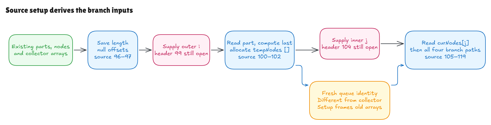

# Deriving the inputs to a search branch

The [literal-child proof](literal-branch-walkthrough.md) used a current node,
path part, last-part flag and temporary queue. This milestone derives those
values from Hono's actual declarations and connects them to all four branch
paths in the declared model.

The target remains Hono revision
`5ca49b0720755c585c9a9835f0a479ceea36fb52`. The
[source record](../../verification/iteration-setup/source.json) binds three windows:

| Source lines | What executes |
| --- | --- |
| 96–97 | Save `parts.length` as `len`; initialize `partOffsets` to null. |
| 100–102 | Read `parts[i]`, compute `i === len - 1`, allocate `tempNodes = []`. |
| 105–119 | Read `curNodes[j]`, then execute the complete literal-child branch. |

The windows run through separate explicit activations. The modeled callers
supply `i` and `j` across omitted loop headers 99 and 104; header progression,
the saved `len2`, guards and reachability still need proofs. The source windows are not joined into a claimed contiguous
piece of Hono's function.



[Editable Excalidraw source](../diagrams/iteration-setup.excalidraw) ·
[Live scene](https://app.excalidraw.com/s/8wot9n3ajqf/XwsDFrzi8G)

## What becomes a conclusion

The initial domain describes dense arrays of UTF-16 string parts and node
references, their current contents, in-range natural indices, legal array
lengths, private reads/storage and the protected handler layout.

It does not provide the resulting `part`, `isLast`, `tempNodes` or `node`
bindings. The source establishes each one. A nonempty source-prepared witness
also proves that these generated bindings are absent initially.

For example, with parts `['first', 'second']` and `i = 1`, the declarations
produce `'second'` and true. With current nodes `[root, parent]` and `j = 1`,
the next source declaration binds `parent`. Changing either index changes the
actual selected entry; the examples check those choices independently.

The [setup contract](../../HonoLean/Upstream/NodeIterationSetup/Contract.lean)
describes the exact bindings and frames. The
[source proof](../../HonoLean/Upstream/NodeIterationSetup/Correctness.lean) derives
them and then applies the existing four-path branch proof. Neither a completed
setup/call nor a later layout/capture output is an entry premise.

## A fresh queue proves separation

Creating `[]` appends a new array cell to the modeled heap. Its identity is the
old heap length, so it differs from every already allocated array. In particular,
the existing handler collector has an older identity.

This discharges the branch's queue/collector separation requirement. The new
queue is empty, so the nonfinal path also has capacity to append one child.
Those facts follow from source allocation rather than a supplied queue.

Allocation preserves every old array cell, ordinary object, private element,
function, Set and runtime-this context. The
[transport proof](../../HonoLean/Upstream/NodeIterationSetup/Transport.lean)
carries the initial handler layout across this append and the new lexical
bindings, establishing helper readiness at the real branch entry.

This old-array frame describes setup. Later helper appends can affect aliases
of the collector. The abstract initial domain permits parts or current-nodes
arrays to alias that collector; it does not imply those arrays remain unchanged
through every later branch. The finite harness allocates them separately and
checks their contents too. The queue itself is fresh in the universal proof.

## Saved lengths and current reads

`len` is saved at line 96. `parts[i]` and `curNodes[j]` are later array reads.
The selected activation protocol changes only index bindings between windows;
the source setup preserves old arrays while allocating the queue. The proof
therefore derives the required read stability for these activations.

It does not cover arbitrary mutations between windows. Native probes show why
that boundary matters: parts can change after length is saved, and a current
node can change despite a saved inner-loop length. Shrinking arrays, getters
and prototype properties need their own semantics and invariants. An out-of-bounds
part read can yield undefined and still address a child named `'undefined'`;
it must not be described as automatic native rejection.

The missing loop proofs must establish the right current bounds and preservation
conditions. A saved `len2` alone does not establish that `curNodes[j]` is still
a node at a later point.

## The last-part calculation is signed

The shared language now has genuine binary subtraction with left-to-right
operand evaluation and the correct precedence for `i === len - 1`.
The independent last-position rule is `i + 1 = parts.length`; the proof connects
that rule to the parsed expression.

An empty length minus one is negative one. Saturating natural-number subtraction
would give the wrong expression. The normal iteration domain requires an
in-range index, so an empty parts array supplies no admitted outer iteration;
the generic arithmetic examples still check the signed zero-length calculation.

Legal ordinary array lengths and their in-range natural counters lie within
the safe-integer range, as does `len - 1`. These checked bounds support the
declared exact-integer interpretation. General native Number behavior,
negative-zero identity, NaN, rounding and coercion remain open. The model rejects
unsupported operand kinds after evaluating both operands.

The lexer keeps adjacent `--` separate from subtraction followed by a spaced
negative literal. Newline subtraction is a continuation, so earlier rejection
fixtures were migrated to an unsupported operator and explicit positive
full-consumption checks were added. The nullable `number[] | null` annotation
is retained metadata; it adds no runtime type guard.

## Evidence and its limits

The full native/model/independent-oracle runner passed 2,991 contexts: 2,592
exhaustive index/branch/registration/alias contexts and 399 seeded, UTF-16,
current-node and retained-reference contexts. Eight supported source faults,
two erased-metadata controls and source/artifact/hidden-checkout guards pass.

The expanded corpus exposed an oracle mistake in the four-argument helper:
null and undefined node values fall back to the omitted params value, producing
own undefined captures. False, zero and empty string survive. The oracle was
corrected and eight focused controls were added to both this suite and the
earlier literal suite. Its current 1,629-case rerun passes; the historical
1,621-case record remains a record of that earlier checkpoint.

Generic checks passed 22 jobs, symbolic setup/composition passed 88 and the
nonempty source-prepared examples passed 103. A coherent existing-root rebuild
passed 361 jobs after the expression change; the final integrated build passed
377. Fresh root kernel replay and independent review passed.

```sh
lake build
lake env leanchecker --fresh HonoLean
python3 verification/iteration-setup/tests.py --hono /path/to/pinned/hono
```

The native runner guards Bun 1.4.0, the exact pin and all 315 source/package blobs.
Typed setup windows pass through unverified TypeScript erasure; the plain entry
window and immutable source-202 seed are inserted afterward. Wrapper construction,
child-map/input scaffolding, hashes and JSON observations remain unverified
evidence tooling. Source faults cannot alter their own canonical input staging.
Failure comparisons observe rejection only, without native exception identity
or partial-state/rollback guarantees.

See the [independent audit](iteration-setup-audit.md). `splitPath` production,
loop-header progression, pattern interleaving, queue transitions, final sorting
and result mapping, complete class/module/live-cell semantics and full native
language/host adequacy remain open in the [goal](hono-verification-goal.md).
