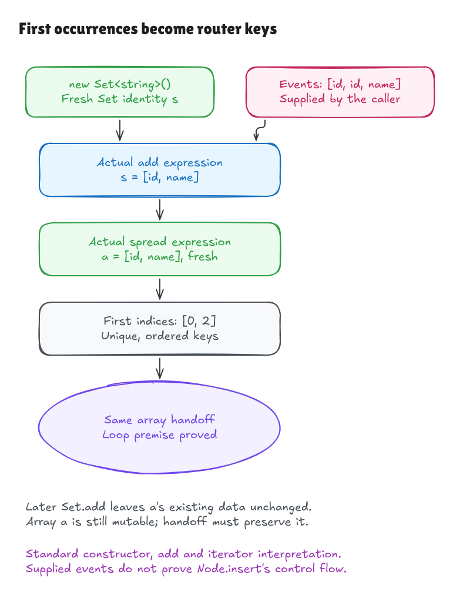

# First occurrences become router keys

The key loop now has a checked producer for its unique-key premise: three actual
operations inside pinned Hono's `Node.insert`:

```ts
const possibleKeys = new Set<string>()
// Inside the parameter branch:
possibleKeys.add(pattern[1])
// Expression used in the handler object's field:
[...possibleKeys]
```

These come from lines 33, 51 and 58. They are separate source fragments, not a
translation of the intervening insertion code. The
[source record](../../verification/key-set/source.json) binds their exact bytes and
containing method to the pin. For line 58, the checked expression excludes the
field label, comma and surrounding handler-object storage.

## The contract in plain English

Suppose successful string-add events arrive in this order:

```text
id, id, constructor, __proto__, constructor
```

The produced array is `[id, constructor, __proto__]`. Every distinct input value
appears exactly once, in the order of its **first** occurrence. The witness
indices here are `[0, 2, 3]`.

The independent contract states three things: no duplicates, exactly the same
membership as the input events, and increasing first-occurrence indices. It does
not define the answer as whatever a Set implementation or deduplication fold
returns. The proof connects executed source operations to those mathematical
conditions for every admitted finite event sequence.



[Editable source](../diagrams/key-set-producer.excalidraw) ·
[Live Excalidraw scene](https://app.excalidraw.com/s/8wot9n3ajqf/8d1ar0ZSkKq)

Strings are exact UTF-16 contents. Empty strings and lone surrogates are valid
keys; composed and decomposed Unicode strings remain different. `__proto__` and
`constructor` have no special meaning as Set values. This does not remove their
different behavior when used as object property names elsewhere.

## Identity and snapshots

Each add returns the same Set identity, including a duplicate add. Spread
allocates a fresh array and copies the current ordered values. Two spreads can
have equal contents while remaining different arrays.

Later Set additions leave an earlier array's data unchanged. That is a frame
property about Set mutation, not a promise that the array is frozen. Code that
obtains the array can still modify it, so the consumer handoff needs an explicit
unchanged-cell fact.

The [indexed primitive model](../../HonoLean/Upstream/ECMA2025/StringSetSteps.lean)
backs the compact operations with an indexed membership scan and iterator steps.
The iterator can see additions made before it finishes; an exhausted iterator
stays exhausted. Materializing the source spread has a stable-data refinement,
rather than pretending every iterator is an immutable snapshot. Deletion,
custom iterators and arbitrary object-valued Set elements are outside this
primitive-string, add-only specialization.

## How this reaches the key-loop proof

The [bridge](../../HonoLean/Upstream/NodeKeySet/LoopBridge.lean) omits both the old
`unique` and `keysFound` assumptions from its remaining consumer fields. It
derives uniqueness from the checked producer's first-occurrence contract and
array contents from the checked spread. Explicit transport links that produced
array cell to the handler's key array. The previous loop theorem then applies.

A [nonempty composition witness](../../HonoLean/Upstream/NodeKeySet/LoopBridgeExamples.lean)
runs two duplicate-id events, materializes one key, transports the array through
clearly marked caller scaffolding, and applies the consumer theorem. It never
assumes the consumer's key list is already duplicate-free.

This is still conditional composition. Actual handler-object storage, method
selection, traversal, string production and lifecycle transport require their
own surrounding-source proofs. The supplied sequence is an input to the event
theorem; it is not an assumed execution trace of the full `insert` method.
The subsequent [handler-record milestone](handler-record-walkthrough.md) proves
construction of the real handler/key fields and derives more consumer-entry
facts. Its argument still keeps private push, selection, unchanged-cell
transport and prototype dispatch explicit.

## A sharing boundary we must preserve

Pinned `getPattern` returns its cached array directly. The TypeScript `readonly`
annotation does not freeze the native array. The new isolated
[probe](../../verification/pattern-cache-probe.ts) observed that changing its name
affects later insertion, and an installed getter is read during insertion and
matching. An earlier router can then retain an own capture key whose value is
undefined; JSON alone would display that object as `{}`.

The [routing worklist](../../verification/routing-behaviors.json) records this as an
open behavior unit. We cannot infer pure immutable pattern reads merely from
the tuple type, nor infer string-only runtime behavior from `Set<string>`.
This is finite native evidence, not a new comparison exception or a full proof
of that cache's behavior.

## Checks and interpretation limits

```sh
lake build
lake env leanchecker --fresh HonoLean
python3 verification/key-set/tests.py --hono /path/to/pinned/hono
python3 verification/routing-tests.py --hono /path/to/pinned/hono
```

Five Set test groups include 725 exhaustive/generated supplied traces, four
empty/long/duplicate examples, two constructor variants, four parsed source
mutations, source freshness failures, and native scope probes. They compare the
actual source operations, Lean execution and an independent first-index oracle.
The typed constructor runs through pinned Bun 1.4.0's TypeScript transpiler;
the report explicitly labels that erasure as unverified evidence.

Native interpretation requires standard constructor/add/iterator lookup,
primitive string reads, admissible identities, resources and legal dense-array
sizes. A custom `Symbol.iterator` can emit duplicates even from a Set with unique
data, and boxed strings remain distinct objects without coercion. Those probes
explain why the restrictions matter. General language/frontend/engine adequacy,
mutable realms, getter effects, iterator errors, unified heaps and complete
insertion/search behavior remain open. The
[independent audit](key-set-audit.md) states the exact boundaries.
