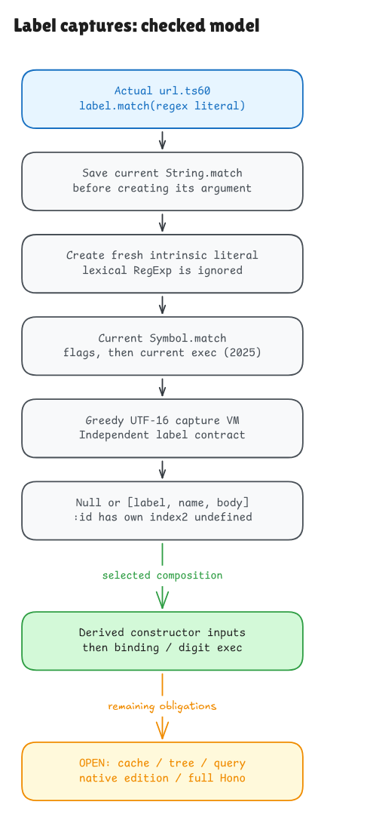

# Deriving Hono's capture array from its label

The actual label-match statement now has a checked source-to-model contract.
It starts with label text, computes capture data and passes that data into the
earlier constructor, binding and digit-exec proofs. The result covers the
declared model and normal realm; complete Hono/native adequacy remains open.

Previously, construction started with a supplied `match` array. The next bridge
computes that array from the actual statement at url.ts60:

```ts
const match = label.match(/^\:([^\{\}]+)(?:\{(.+)\})?$/)
```

The whole declaration is 59 bytes at the fixed Hono revision. Its literal and
call syntax are retained. The model first saves the current String.match method,
creates a fresh intrinsic regex literal, then follows current Symbol.match,
flags and exec operations. A lexical variable named RegExp cannot redirect a
literal; it can affect a later `new RegExp(...)` expression.



[Editable source](../diagrams/label-match.excalidraw) ·
[Private working scene](https://app.excalidraw.com/s/8wot9n3ajqf/AMHm91Bf8cL)

## The contract is about label structure

A valid label starts with a colon, followed by a nonempty name with no braces.
It may end with a braced, nonempty raw body. Name characters can include line
terminators; body characters exclude the four JavaScript line terminators.

| Label | Name | Raw body | Result |
| --- | --- | --- | --- |
| `:id` | `id` | undefined | A three-entry capture array |
| `:id{[0-9]+}` | `id` | `[0-9]+` | A three-entry capture array |
| `:id{a}{b}` | `id` | `a}{b` | Greedy body capture |
| `:id{[}` | `id` | `[` | Valid label recognition; later construction can fail |
| `:id{}` | — | — | null |
| `:{a}` | — | — | null |

Undefined is a real value at an own array index 2. It is neither a missing index
nor null. The array also has the named index, input and groups fields of a
nonglobal regex exec result. No global match accumulator is created.

The independent language contract describes that decomposition without running
the regex interpreter. Separately, a parser retains the actual regex syntax,
a compiler produces consuming tests, capture saves, greedy repetition and
optional branches, and an ordered-candidate machine executes those instructions.
The proof connects the machine's results to the independent decomposition in
both directions, including exact capture spans and uniqueness for every finite
UTF-16 model string. Lone surrogates remain code units; there is no hidden
Unicode normalization. Structural recursion establishes totality; machine
exhaustion is not confused with a failed match. Native memory/time bounds remain
an interpretation boundary.

## Matching and constructing have different jobs

The label matcher recognizes raw body text. It does not decide whether that
text is a valid future regular expression. Keeping inputs such as `:id{[}` is
necessary to preserve that distinction.

The selected composition then specializes to supported safe range bodies. It
reads the actual returned array's name/body to establish constructor inputs,
constructs the tuple, binds name and matcher through the iterator protocol, and
executes the derived matcher. The universal source 156 join specializes to the
digit profile. Finite comparisons also exercise all 1,953 supported ordered
endpoint pairs; those comparisons do not broaden the universal join.

## Which implementation is being modeled

The selected ECMAScript 2025 algorithm reads current flags before current exec.
The standard flags getter reads eight current flag properties in order. Their
values come from actual current descriptors and branded records, rather than
a premise saying "the flags result is empty." A closed accessor-identity
projection connects supported native getter identities to their modeled bodies;
its native identity/coherence interpretation remains open.

An independent probe found `ENGINE-FLAGS-1`: pinned Bun follows the flags path,
while pinned Node reads global directly. A current String.match wrapper that
installs a throwing flags getter on the fresh literal throws on Bun and succeeds
on Node. The exact records and restored-prototype reproducer are preserved as
native-only evidence. Normal default-realm outputs agree; no general native
protocol equality or whole-engine adequacy is claimed. See the selected
[ECMAScript algorithm](https://tc39.es/ecma262/2025/multipage/text-processing.html#sec-regexp.prototype-@@match)
and [reproducer](../../verification/label-match/native-boundary.mjs).

The main native harness leaves standard matching unwrapped. It observes visible
capture arrays, descriptors, constructor regexes, bindings and match results.
The temporary literal's model identity, internal compiled code and protocol
trace remain MODEL ONLY. Source wrappers, JSON/reference transport, realm
embedding and source/frontend/native/host adequacy remain unverified.

The selected chain still omits wildcard and cache branches, child-pattern
installation, intervening search control flow and query production. Those are
required later source connections, not consequences of this matcher proof.

The full build, fresh proof replay and declaration/axiom audits pass. The suite
compares 5,193 label cases and 3,970 selected downstream cases, with source faults
and a retained nullable-quantifier model regression. See the
[audit](label-match-audit.md) for exact evidence and the
[cache plan](getpattern-cache-plan.md) for the next source bridge.
