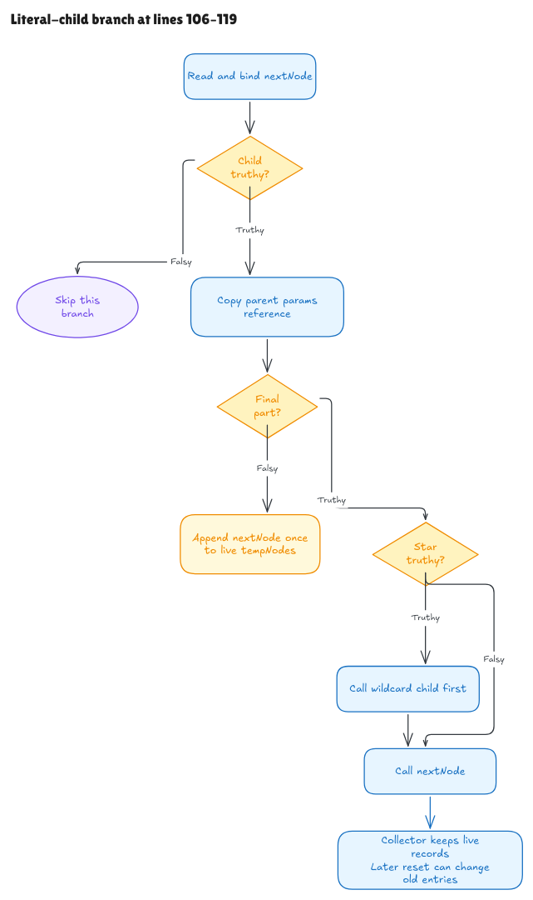

# Following the actual literal-child branch

This milestone connects the declaration and complete literal-child branch at
Hono's `node.ts` lines 106–119. The target remains revision
`5ca49b0720755c585c9a9835f0a479ceea36fb52`. The
[source record](../../verification/literal-branch/source.json) binds the exact
491-byte window, including the comment and both arms of `if (isLast)`.

The conditional source proof, nonempty examples, integrated build and fresh
kernel replay pass. The [audit](literal-branch-audit.md) records their scope,
independent review and remaining native interpretation obligations.



[Editable Excalidraw source](../diagrams/literal-branch.excalidraw) ·
[Live scene](https://app.excalidraw.com/s/8wot9n3ajqf/7pcrdXABb3x)

## Four paths through the same source

The branch reads `node.#children[part]` and binds the result as `nextNode`.
JavaScript truthiness decides the next action. An absent value, null, false,
zero or empty string skips this branch. The success domain for a truthy child
uses an allocated node with the required private fields.

Every such child first receives the parent's params reference. The two nodes
then refer to the same object; the assignment does not clone or clear it.

| Condition | Observable action |
| --- | --- |
| Child is falsy | Keep the heap and queues unchanged. |
| Child is truthy; `isLast` is falsy | Append that child once to the current `tempNodes` array. |
| Child is truthy; `isLast` is truthy; wildcard is falsy | Execute the direct helper call. |
| Child is truthy; `isLast` and wildcard are truthy | Execute the wildcard helper, then the direct helper. |

These are actual conditions from the parsed source. Tests supply various truthy
and falsy values because a TypeScript annotation does not create a runtime test.
Neither the source's `node` selection at line 105 nor the computation of `isLast`
at line 101 is proved by this window.

## Why two calls need a preservation proof

The first helper changes the collector and selected handler records. A proof of
the second helper cannot simply assume that all its prerequisites still hold.

The entry layout describes protected read cells, mutable resettable handler
records, immutable key arrays and sufficient collector capacity for both sets
of rows. Each call's contract ties those rows to the target's actual private
methods array in its current state. The first call's processing trace establishes
what it changed and what it preserved. A rebasing argument then describes the current handler shapes
and derives the second call's layout from that original information.

Fresh capture objects matter here: they have null prototypes. This lets the
proof account for newly allocated cells when checking the later layout's
prototype conditions. The proof must derive those facts from capture execution,
rather than supply a completed later call or its expected result.

Both wildcard reads occur before the wildcard helper starts: one in the guard,
one in its argument list. They remain separate reads in the program. The direct
call later reads the parent's private params again; helper private-state frames
establish that this read remains valid in the stated domain. Native getters or
callbacks can change these observations outside that domain; the audit retains
explicit boundary probes.

## A collector entry stays live

The helper first installs a fresh params object on an internal handler record,
then appends that record's reference. If the wildcard and direct child are the
same node, both calls can append the same record. The later call resets that
record again, so the new params object is visible through the earlier collector
entry too.

The contract therefore describes two sequential calls and their current states.
It does not concatenate frozen capture snapshots. Finite observations check
handler-reference and params-reference equality matrices as well as deep values,
including repeated branch executions with different supplied parent params.

At this point, wildcard records can precede earlier-registered direct records.
The final sorting and returned-pair mapping occur later in search and remain
outside this slice. The native comparison observes the actual intermediate
order without sorting it into the desired answer.

## The execution boundary is explicit

The small control extension reuses the shared expressions and ordinary statement
semantics, and adds nested `if`/`else` and private-call leaves. Private calls use
the current runtime `this`; it may differ from the parent and both target nodes.
The old expression evaluator keeps its existing behavior.

Only fresh root declarations are admitted. Nested declarations and direct
lexical writes reject. The separate line-comment pass preserves quoted slashes
and CR/LF, and rejects unsupported comments, templates and Unicode separators.
This is a restricted frontend with checked parsing of this exact program;
general JavaScript, TypeScript erasure and frontend adequacy remain open.

Lower execution retains the `nextNode` binding. Its native scope continues in
the enclosing loop body after line 119. A separate standalone runner can restore
caller bindings as an explicit observation boundary; that does not describe
where Hono's native block ends.

The entry supplies the ordinary child-map contents and queue cells. The normal
call domain separates the collector from the methods/key arrays and the temporary
queue. Source line 102 creates a fresh queue, but that allocation and its link to
this branch still need composition. Aliased arrays and failures remain explicit
native boundary observations, without a formal partial-failure-state claim.

## Reproduce the evidence

```sh
lake build
lake env leanchecker --fresh HonoLean
python3 verification/literal-branch/tests.py --hono /path/to/pinned/hono
```

The native wrapper guards Bun 1.4.0, the exact revision and all 315 source/package
blobs. It installs parsed-source counterparts of the class fields/method and
registration fragment. A separate canonical line-202 assignment prepares parent
params; branch mutations cannot alter their own input preparation. Child-map
entries remain supplied test scaffolding, not proved `Node.insert` behavior.

Scaffolding is type-erased before inserting the plain-JavaScript branch text.
Wrapper construction, erasure, extraction/hash tools and JSON observations are
unverified evidence tooling. Rejections compare failure only, without proving
exception identity, rollback or intermediate native effects.

The full native/model/independent-oracle runner passed four groups: 1,152
exhaustive path/registration/alias contexts and 469 seeded, truthiness, boundary
and retained-reference contexts. Seven supported source faults, including
reversed call order, change the observations; source/artifact/hidden-checkout
freshness failures reject. These 1,621 bounded observations do not establish
universal native adequacy.

The final focused gates passed 16 jobs for generic controls, 80 for the complete
symbolic branch and 95 for the source-prepared examples. The managed root build
passed all 357 jobs, and fresh root kernel replay passed. Independent review
checked that the terminal contract uses each target's actual stored rows and
that the universal theorem has a nonempty source-prepared domain.

One large fixture initially exhausted proof-process resources. The final proof
reuses checked initialization/registration lemmas to establish its preparation
endpoint once, then proves the initial structural facts on that endpoint.
The actual source executions and contract stay the same; every proof still
passes through the kernel.

Complete outer traversal, pattern branches, temporary capture construction,
sorting/result mapping, class/module/live-cell semantics and language/host
adequacy remain open in the [full-Hono goal](hono-verification-goal.md).
