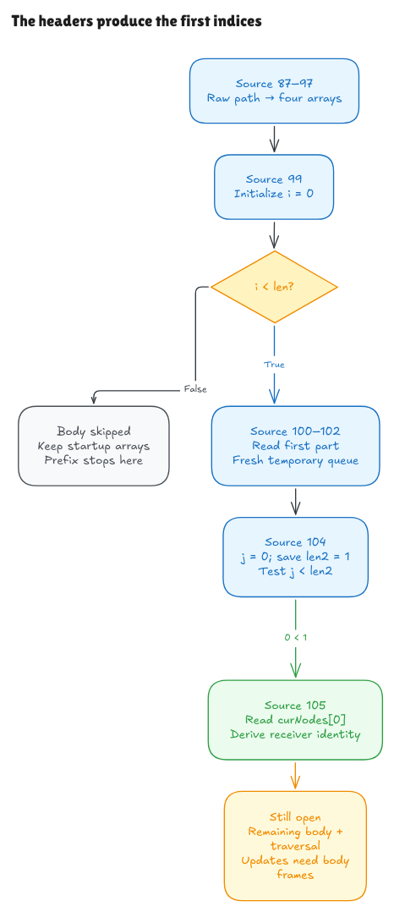

# The loop headers produce the first indices

The preceding startup proof supplied outer and inner indices when connecting
the arrays to later declarations. This milestone reads Hono's actual loop
headers at `node.ts`99 and 104. They initialize and test those indices themselves.
The target remains revision `5ca49b0720755c585c9a9835f0a479ceea36fb52`.

[Editable Excalidraw source](../diagrams/loop-entry.excalidraw) ·
[Live scene](https://app.excalidraw.com/s/8wot9n3ajqf/4eyiyVPpBKi) ·
[Proof and evidence audit](loop-entry-audit.md)

## What the source now supplies

After the actual startup creates its arrays, header 99 creates `i=0` and checks
`i < len`. There are two possible first-entry outcomes:

- An empty parts array gives a false guard. None of the body declarations run,
  so there is no temporary queue or inner header initialization.
- A nonempty parts array gives a true guard. Source 100–102 reads the actual
  first part, computes whether it is the last part, and allocates a fresh empty
  temporary queue. Header 104 then creates `j=0`, saves the current node-array
  length in `len2`, and checks `j < len2`.

Startup made the current-node array exactly `[this]`. Consequently the saved
inner length is 1, the first inner guard is true, and source 105 reads the receiver
from that array. Neither index is an input to this new universal prefix theorem.

An empty input path and a slash are different cases. `splitPath("")` returns an
empty array; `splitPath("/")` returns one empty field. The latter enters the
loop with a genuine empty-string part.

## A saved length is a snapshot

The inner header reads `curNodes.length` once. Every later guard compares the
current numeric `j` with that saved `len2`. It does not read array length again.

For example, start with `[A,B]`. The header saves length 2 and enters at 0. If a
body removes the first array element, the next counter is 1 and the guard still
succeeds, but the current one-element array has nothing at index 1. The numeric
guard is correct; an indexed-read proof still needs a fact about the current
array. Growing the array similarly does not extend the saved bound.

The progress lemmas preserve this distinction. They prove what incrementing the
actual header counter and testing the saved bound do. A separate readiness lemma
requires current array and binding facts before admitting the next path read.
It does not assume that an unproved Hono body preserved those facts.

## Initialization has an order

The inner header declares both `j` and `len2`. Their new scope hides old bindings
before either initializer runs; initialization then proceeds left to right.
This prevents an old caller `len2` from incorrectly satisfying a forward or
self-reference during initialization.

The model reuses the existing binding initializer, expression evaluator and
numeric increment operations. Its header syntax records the initializer list,
condition and increment name. The parser consumes the real opening brace and
then requires end of input. It does not append an empty loop body and treat that
as the original Hono loop.

## Incrementing is a separate operation

Native postfix increment returns the old numeric value while storing the new
one. This source discards the returned value, so the modeled header operation
only needs the state change. It changes the first matching counter binding by
exactly one and preserves other bindings and heap components.

The arithmetic model uses mathematical integers. Canonical counters within the
declared UInt32/safe bounds have explicit operand/result bounds. This does not
prove arbitrary JavaScript coercion, negative-zero identity or floating-point
rounding. A native boundary probe records that increments can stall beyond the
safe range; no universal native progress claim follows from the integer model.

## Where the new argument stops

The universal result follows the selected source prefix through the first
source 105 node declaration. It does not execute the remaining literal branch,
patterns, full inner body, queue update or later outer iterations. A separate
closed example continues into the complete first literal branch using a real
source-prepared registration and stale params reset.

The empty result stops immediately after the false guard, with the modeled
header binding still present. Native loop scope exit and general completion are
separate obligations. The comparison observes arrays and entry flags, so it
does not infer environment/completion equivalence from a native wrapper that
has already left the loop.

For header-progress tests, explicitly controlled fixture bodies grow or shrink
the array before the next update/test. Those fixtures test the header mechanism;
they do not stand in for Hono's omitted body. The [audit](loop-entry-audit.md)
keeps these probes, source-prefix proofs, native observations and remaining
whole-loop obligations separate.
