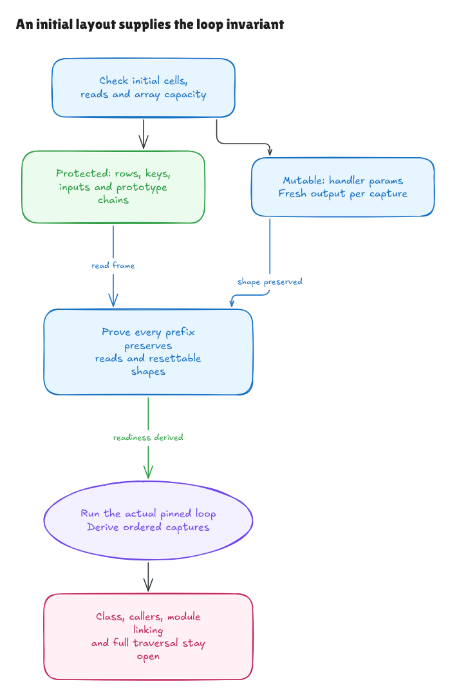

# Proving that the loop stays ready

The [previous loop proof](methods-loop-walkthrough.md) required valid reads and
handler records at every intermediate prefix. This milestone derives those
conditions from one initial structural layout. The actual source loop is still
the pinned [`node.ts:71–83`](https://github.com/honojs/hono/blob/5ca49b0720755c585c9a9835f0a479ceea36fb52/src/router/trie-router/node.ts#L71);
we have strengthened the argument about when its contract applies.

There are two results: a general initial-layout preservation theorem, and a
source composition that derives that layout from one actual registration and
the later collector allocation. The latter covers arbitrary supplied key-event
lists with the required bounds and reads. A universal theorem for arbitrary
source-produced registration histories remains a next step.



[Editable diagram](../diagrams/methods-loop-initial.excalidraw) ·
[Live scene](https://app.excalidraw.com/s/8wot9n3ajqf/5woO56wOO66)

## The concept: an invariant

An invariant is a fact that holds before a loop starts and survives every step.
Here the useful fact is that the next row can still be read, its selected
handler can still be reset, and its key and parameter reads still mean what
they meant initially.

Previously, callers had to supply that fact for all independently described
prefixes. The new proof checks initial structure, proves one-step preservation,
then uses induction to establish the fact for every prefix. It supplies the
older loop theorem's `NormalPrefixes` condition as a derived theorem.

That difference matters. A successful example shows one run. An initial-state
preservation theorem explains why an entire admitted family of runs cannot
lose the conditions needed by a later iteration.

## What the initial layout contains

The [layout](../../HonoLean/Upstream/MethodsLoopInitial/Contract.lean) records:

- Existing method-row reads, handler cells, unique dense key arrays and supported
  initial parameter/node reads.
- Separate collector and key arrays, plus room for the initial collector prefix
  and at most one append per methods-array row.
- Ordinary handler params descriptors that can be reset, and valid helper,
  parameter and module-constant bindings.
- A separation between mutable handler records and protected read cells, with
  their prototype chains closed inside the protected region.

These are facts about initial cells and primitive property reads. The layout
contains no later `Entry`, completed trace, evaluator-success premise or final
capture answer. Initial row choices still need to be justified; the source
registration bridge below derives them from executed object construction.

The protected region includes every initially allocated non-handler object.
This blanket closure is deliberately strong: even an otherwise unused old
object may not inherit from a mutable handler. Row maps, node params and an
object-valued optional-params receiver are separate from every mutable handler.
Their stored values may themselves be aliases; protection concerns the cells
being read, rather than recursively freezing all values.

The layout also supplies the ALL binding even for a direct hit. That is a
convenient stronger entry condition for this theorem. The source still skips
the fallback operand after a truthy direct read, as the earlier branch theorem
proves. No annotation or type assertion validates a selected handler at runtime.

## What survives each capture

The [preservation proof](../../HonoLean/Upstream/MethodsLoopInitial/Invariant.lean)
shows that a capture allocates a fresh null-prototype output, replaces the
selected handler's params, appends the reference and fills that output.
Protected old cells and their read chains stay fixed. Key arrays and the
function table stay fixed.

The handler retains its possible-key field, prototype and extensibility. Its
params field is either the original admitted field or a newly installed
writable own data field. Both cases support the next reset. This includes a
handler selected more than once; repeated references are not deduplicated.

The proof tracks append count separately from visited-row count. Skips append
nothing, so the selected count never exceeds the number of rows visited. The
initial capacity bound therefore establishes space for every reached append.

Finally, it transports initial per-key reads into the post-reset state and
derives the complete current capture-entry facts. The
[correctness theorem](../../HonoLean/Upstream/MethodsLoopInitial/Correctness.lean)
constructs `NormalPrefixes`, then applies the actual parsed-loop proof. The
caller no longer supplies validity separately for future prefixes.

## Connecting actual registration storage

The [source bridge](../../HonoLean/Upstream/MethodsLoopRegistration/Correctness.lean)
executes the already checked full private registration push at lines 55–61,
allocates the actual later collector at line 87, and executes the complete
methods loop. It derives the stored outer map, inner handler, copied key cell,
collector identity/separation, and initial row choice from those source stages.

Its generic theorem starts with an empty private methods array and one
registration. Unique keys follow from the independent supplied-event Set
contract. The request can be an exact registered-method hit, a request falling
back to an own ALL registration, or a genuine miss. Reached inherited lookups
must be accounted for: inequality with the registered method is insufficient
to establish a miss.

The remaining context contains old read/descriptor/prototype facts, helper and
import bindings, and caller arguments. It does not contain a preselected handler,
a preallocated collector, a completed registration execution, a future capture
entry or an assumed initial layout. Search and helper activations remain explicit
handoffs; they are not one invented native lexical block.

## Nonempty families and source witnesses

The [general example](../../HonoLean/Upstream/MethodsLoopInitial/Examples.lean)
proves an initial layout for arbitrary sequences of miss, direct-hit and
own-ALL-fallback rows sharing one ordinary handler with two unique keys. It
allows an arbitrary initial collector prefix within the capacity bound. Its
proof is parameterized by the whole row sequence, rather than evaluating a
single chosen length.

The [registration example](../../HonoLean/Upstream/MethodsLoopRegistration/Examples.lean)
includes actual Set creation and supplied duplicate events `id, name, id`,
actual ALL registration, the later collector and the complete GET loop. The
initial layout is proved from those storage facts. The first captured id comes
from optional params; the second captured value is the node's zero. This
preserves truthiness versus nullishness without staging `handlerSet`.

The events remain supplied by caller scaffolding. The insertion branch and
mutable `getPattern` cache that produce them still need source proofs.

## Checks and limits

```sh
lake build
lake env leanchecker --fresh HonoLean
python3 verification/methods-loop-initial/tests.py --hono /path/to/pinned/hono
```

Five finite groups compare 781 exhaustive actual-registration histories and
259 generated/long histories with repeated queries against the parsed source
model, exact-source Bun wrappers and an independent oracle. They observe fresh
collectors, key snapshots, scores, reference identity, current params across
earlier collectors and exact captured descriptors, including explicit undefined.
Seven supported source faults and a type-name control check sensitivity.

This multi-registration/repeated-query corpus is broader than the universal
singleton source bridge. Passing it does not prove general registration-history
composition. The general layout theorem has arbitrary row count, but actual
Hono source must still be shown to construct that layout across such histories.

The [composition metadata](../../verification/methods-loop-initial/source.json)
and checker validate the existing registration, collector, loop, ALL/helper and
Set source artifacts and Lean embeddings. Native wrappers guard Bun 1.4.0 and
all 315 pinned source/package blobs and record wrapper/emitted hashes.
TypeScript transpilation remains explicitly unverified.

Native scope probes preserve failures outside the normal layout: reserved
inherited method values can reach the body and fail after append; an inherited
params setter can discard the fresh output before the key write fails. Those
are bounded observations of partial effects, not a universal exception-state
proof or a new comparison exception.

The [independent audit](methods-loop-initial-audit.md) records the reviewed
argument. Class/private installation, module/helper linking, actual callers and
intervening search effects, general registration histories, native-language
adequacy, path traversal and complete Hono coverage remain open.
