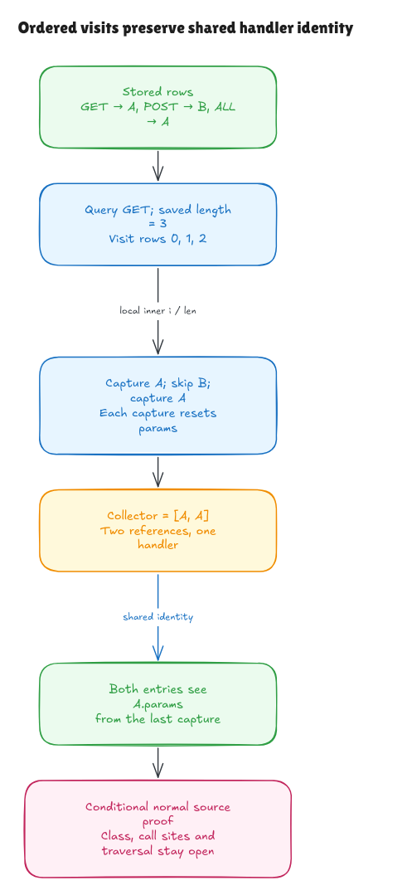

# Visiting every stored method row

The [previous milestone](search-entry-walkthrough.md) proved row loading and
method/ALL selection for one supplied index. This milestone connects the actual
surrounding loop and `if (handlerSet)` guard, including the existing capture
block. The selected source is the contiguous loop at pinned
[`node.ts:71–83`](https://github.com/honojs/hono/blob/5ca49b0720755c585c9a9835f0a479ceea36fb52/src/router/trie-router/node.ts#L71).

The [source record](../../verification/methods-loop/source.json) preserves its
exact bytes, hash, private-name context and containing method. The class
declaration, method signature, search traversal and actual calls into this
helper remain separate obligations.



[Editable diagram](../diagrams/methods-loop.excalidraw) ·
[Live scene](https://app.excalidraw.com/s/8wot9n3ajqf/1uArBpn4VDi)

## The important behavior

The outer loop reads the methods-array length once, then visits indices in
increasing order. Each visit reads the current row and applies the existing
lazy `m[method] || m[METHOD_NAME_ALL]` selection rule. A falsy selected value skips the capture
body entirely. A truthy selected value reaches that body; its type assertion
does not establish that it is a valid handler record.

A missing row is different from a falsy selection. The source must evaluate
`m[method]` before it can test `handlerSet`. If `m` is undefined or null, native
execution throws before reaching the guard. The normal theorem therefore needs
admissible object rows and reads, rather than claiming to skip every empty slot.

Each successful capture allocates a fresh params object, replaces the selected
handler's `params`, appends the same handler reference and fills the new object
using that handler's possible keys. The inner parameter loop has its own `i`
and `len`. Its first-key precedence restarts at zero for each selected handler;
it does not overwrite the outer row index or saved length.

## Two entries can refer to one handler

Suppose the stored rows are `GET → A`, `POST → B` and `ALL → A`, and the
request method is GET. The visits capture A, skip B, then capture A again.
The collector becomes `[A, A]`. It contains references, rather than independent
copies of each handler's params at the time of append.

The second capture replaces `A.params` with a second fresh object. Both collector
entries now expose that second object. The earlier params object still exists
in the modeled heap; its former reference is no longer A's current params.
The proof trace and executable observations preserve that aliasing.

## How the argument grows from one row to all rows

The independent [contract](../../HonoLean/Upstream/MethodsLoop/Contract.lean)
describes a prefix of visited rows. A skip contributes no handler and changes
no heap. A capture contributes one reference and satisfies the earlier
independent reset/append/capture contract. The trace records current structural
entry facts, not a successful execution of the source evaluator.

The [proof](../../HonoLean/Upstream/MethodsLoop/Correctness.lean) shows that execution
extends this trace by one visit. Induction on the number of remaining rows then
reaches the saved length. It establishes the collector's initial prefix followed
by exactly the selected references in visit order. Separate frame lemmas show
that the private slot and methods-array contents stay fixed in this admitted
domain. The caller's modeled lexical environment is restored at the end.

The collector and methods array must be distinct. Otherwise appending to the
collector also changes the methods array. The proof derives array preservation
from this separation and each capture's structural endpoint; it does not assume
that future row execution succeeds.

The nested key-loop proof now accepts extra execution fuel. This lets the same
capture argument run inside a larger loop without changing its result or
assuming a desired endpoint. Fuel is a bound for this evaluator, rather than a
performance claim about Hono.

## The normal-domain boundary

The theorem has an explicit `NormalPrefixes` precondition. It requires valid
current reads and capture-entry facts at every independently described reachable
prefix. This is a strong, trajectory-wide admissibility condition. It has not
yet been derived generally from one initial heap check or from actual route
registration and search traversal.

It contains no evaluator-success premise or desired selected result. The proof
constructs execution and a completed trace. Nevertheless, keeping this condition
explicit matters: replacing a missing invariant-preservation proof with an
unexplained “valid state” label would overstate what has been established.

Independent review found that the first draft's trace allowed capture endpoints
for an unrelated old handler object. That admitted impossible prefixes and
could make the domain too strong to inhabit. Capture steps now carry their
actual structural entry facts. The mathematical domain witness covers a miss
followed by two hits on the same handler with empty key lists. It proves the
condition for every admissible prefix, separately from evaluating a sample.
A second mathematical witness proves one GET miss falling back to an own ALL
handler, with two keys and actual optional-parameter/node reads. Additional
closed parsed executions cover repeated references with two keys and restarted
first-key precedence. These witnesses do not establish general multirow readiness.

The current value/prototype/heap semantics, helper interpretation and private
brand facts retain their earlier limits. Arbitrary native getter effects,
proxies, sparse arrays, mutated intrinsics, partial failure-state traces,
TypeScript/compiler adequacy and general mutable lexical cells remain open.
The modeled restoration of saved environments is used for these local loop
bindings; it does not establish general JavaScript block/closure semantics.

The fallback binding also remains explicit. The earlier initializer theorem
derives the string ALL, but module export/import linking and actual helper
activation/argument transport are not proved by parsing this body.

## Executable checks

```sh
lake build
lake env leanchecker --fresh HonoLean
python3 verification/methods-loop/tests.py --hono /path/to/pinned/hono
```

Five finite test groups cover 1,555 exhaustive mixed-row/repeated-reference
contexts and 387 generated or long capture contexts. They compare the exact
parsed source model, Bun execution of the exact TypeScript loop and an
independent ordered-selection/capture oracle. Checks include collector prefixes,
fresh allocation identities, final alias observations, saved outer bindings,
unchanged keys/methods and restarted inner indices. These controlled map
fixtures use null-terminated prototype chains with explicit inherited data;
they do not silently treat native Object.prototype as empty.

Six supported source faults distinguish starting at the wrong outer index,
discarding the saved length, reading the wrong row, using nullish fallback,
starting the inner loop at one and reversing the first-key condition. A changed
type name preserves runtime behavior. Source/artifact and hidden-checkout edits
are rejected. Bun 1.4.0, the pinned revision and all 315 source/package blobs
are checked; wrapper and emitted hashes are recorded. Transpilation remains
explicitly unverified.

Native boundary probes show why the normal domain matters: appending a row during
a getter does not extend the saved iteration count, replacing a future row is
observed on that later visit, and shrinking the array can throw after an earlier
append. A truthy number reaches the body and fails; it is not validated by `as`.
An aliased collector changes the methods array. Separate actual exported Node
smoke checks preserve ordered GET/ALL results and captures. These observations
are bounded evidence, not whole-Node proofs or new comparison exceptions.

See the [independent audit](methods-loop-audit.md) for the reviewed scope. Actual
class initialization, caller reachability, registration-derived prefix readiness,
temporary captures, path traversal, final sorting and whole-Hono behavior remain
on the full-runtime roadmap.
