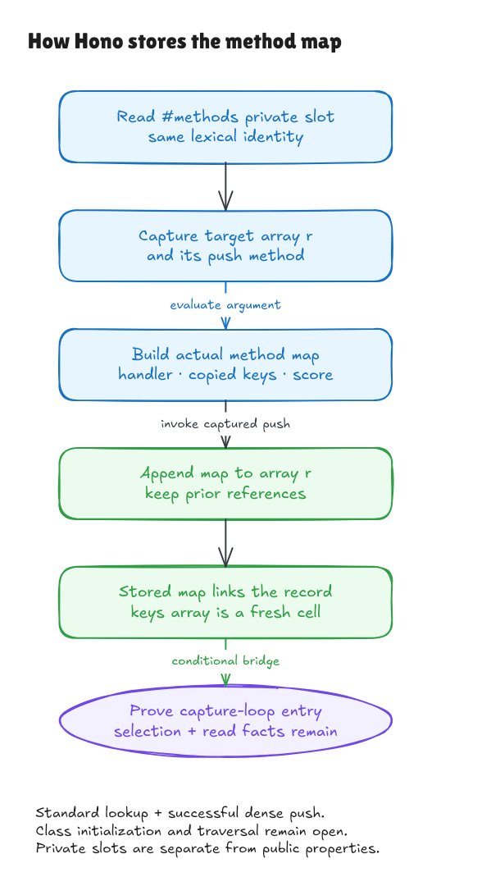

# The actual private methods-array append

The [handler-record milestone](handler-record-walkthrough.md) proved the object
argument. This milestone proves the complete call around it, from pinned
`Node.insert` lines 55–61:

```ts
curNode.#methods.push({
  [method]: {
    handler,
    possibleKeys: [...possibleKeys],
    score: ++order,
  },
})
```

The [source record](../../verification/methods-push/source.json) binds the exact
144-byte window, including its private receiver, member call and trailing LF,
to the pinned Git file. The containing insertion method remains provenance;
its traversal and the class constructor are still outside this theorem.



[Editable source](../diagrams/methods-push.excalidraw) ·
[Live Excalidraw scene](https://app.excalidraw.com/s/8wot9n3ajqf/9zEwSfksO9M)

## What is now proved

Suppose the selected Node's private slot points to array `r`, whose current
contents are `[a, b]`. Successful modeled execution produces:

```text
same array r: [a, b, newMap]
                        │ own method field
                        ▼
                    new handler record
                        │ possibleKeys
                        ▼
                    fresh keys array
```

The expression returns `3`, the new methods-array length. The existing array
prefix retains the same reference values. The private slot still points to
the same array, and other allocated array/object cells, private metadata,
functions and Set data retain their contents. The independent endpoint also
includes the previously proved fresh records, copied handler identity and
single counter update.

The fresh keys array cannot be the old methods array: the latter already has
an allocated cell, while spread allocates at the old array-heap length. The
proof derives that separation from the entry lookup; it does not assume the
desired final append.

Reference preservation does not imply deep immutability. A handler value can
itself refer to `r`, making a cycle through the newly stored record. The
examples cover this alias. Mutating `r` is visible through every alias of it.

The source also parses as a statement with a state-only normal-completion
contract. This observation retains the counter update and omits the expression
value. It is not a theorem that a native expression statement returns undefined,
nor a whole-`Node.insert` return or termination theorem.

## Private names carry identity

`#methods` is resolved in a class's lexical private-name context. An ordinary
property named `"#methods"` is a different property. An object that inherits
from a Node does not inherit its private field, and a Proxy does not automatically
forward the receiver's private brand to its target. Two classes can use the
same private spelling with different identities.

The model therefore has a separate `PrivateStore`: a supplied lexical map
resolves a spelling to an opaque identity, and an owner-specific slot table
contains private data. Private reads never search public own properties or a
prototype chain. The fragment parser requires an explicit private-name context;
the default context rejects this syntax.

Those tables are model inputs, not a verified class-initialization mechanism.
Native interpretation still needs valid unique lexical identities, owner/slot
correspondence and admissible heaps. The current slice supports private data
on ordinary object owners; general private accessors, stamping, exotic receivers,
class evaluation and private closures remain open.

## The call has three distinct phases

First, evaluate the receiver and obtain the `push` member. Second, evaluate the
argument, including spread and the counter update. Third, call the captured
member using the captured array as its receiver.

A missing private brand, nullish methods value or throwing member getter can
fail before argument effects. A successfully read noncallable member is rejected
after argument evaluation. The model's prepared-call step preserves this
distinction for its supported values and descriptors.

Capture keeps the array identity and callee, rather than an old copy of its
contents. A native probe changes `push` and appends a sentinel during argument
iteration. The already captured standard function still runs and reads the
array's current length, appending after the sentinel. Another probe replaces
the owner's private slot during iteration; the captured old array receives
the append. These effectful probes are outside the successful slice's stable
lookup/iteration conditions, but explain why the evaluation order matters.

The normal native interpretation requires a side-effect-free standard `push`
lookup, standard stable Set iteration, writable/extensible dense-array behavior,
legal capacity and resources. Merely obtaining `Array.prototype.push` is
insufficient. An inherited target-index setter can consume the pushed value:
the native probe returns length 1 while own index 0 is absent. A frozen array
can reject the append after the score has already changed. No rollback or
complete exception-state theorem is claimed.

## Storage facts and the remaining lifecycle

The [storage bridge](../../HonoLean/Upstream/NodeMethodsPush/StorageBridge.lean)
derives the appended map's index, its own method-to-handler field, the actual
inner record cell and the key-array cell from parsed execution. It no longer
asks a caller to fabricate those cells or assume their transport through the
registration call.

Its immediate consumer example deliberately uses a **preallocated collector**
and a caller-staged choice of the stored handler. Actual `Node.search` allocates
its collector later, at line 87. That later allocation/frame connection and
the real method/ALL selection must still be proved. The bridge retains the
required helper, parameter-read and inherited-`params` descriptor conditions.
The subsequent [search-entry milestone](search-entry-walkthrough.md) proves the
later collector declaration and actual row/selection declarations in a new
fragment composition. It removes those two staging shortcuts while keeping
activation/call-site transport, intervening code and traversal open.

The nonempty kernel witness executes actual Set creation, two supplied duplicate
`id` adds, the complete private push and the capture-loop theorem. A separate
storage theorem needs no collector premise. Exact registered-method ownership
does not prove that unregistered names miss: the map still has an ordinary
prototype, preserving the earlier reserved-method obligations.

## Evidence and next work

```sh
lake build
lake env leanchecker --fresh HonoLean
python3 verification/methods-push/tests.py --hono /path/to/pinned/hono
```

Five test groups cover 597 exhaustive/generated contexts and 46 edge/alias
contexts, each evaluated through the complete call twice; six parsed source
faults; hidden source/artifact edits; private-brand and call-order boundaries;
and a smoke observation through the actual exported Node class. The harness
uses the exact expression inside a genuine private-field class wrapper. Its
constructor stages the entry condition; it does not verify Hono's constructor.

The [independent audit](methods-push-audit.md) reviews the contract, source
connection, nonempty composition and native boundaries. All 315 pinned
source/package blobs are guarded for native evidence. Class initialization,
actual pattern-event production, later search allocation/selection, persistent
module counter cells, general mutable scopes and native/frontend adequacy
remain open. The earlier counterexamples and comparison allowlist are unchanged.
