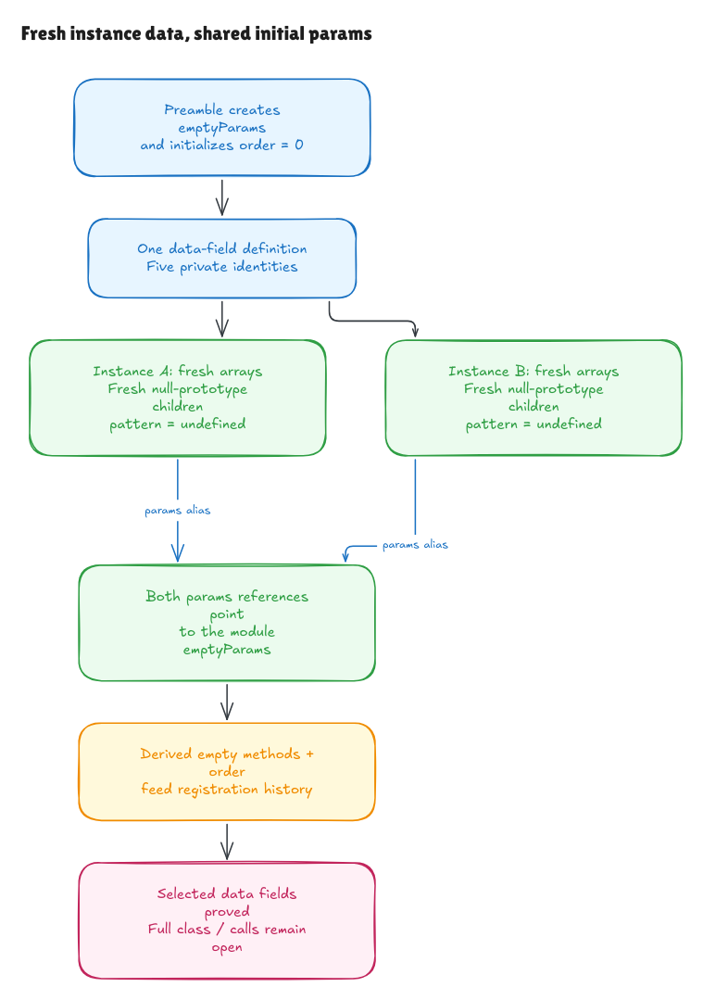

# Where the empty Node state comes from

The [history proof](registration-history-walkthrough.md) started with a supplied
Node owner, `#methods` data slot, empty methods array and current order binding.
This milestone derives those selected initial facts from pinned source:
the module preamble at
[`node.ts:17–18`](https://github.com/honojs/hono/blob/5ca49b0720755c585c9a9835f0a479ceea36fb52/src/router/trie-router/node.ts#L17)
and the five private data-field declarations at lines 21–26.

The [source record](../../verification/node-initialization/source.json) binds exact
bytes and hashes. The containing class is retained as provenance. The proof
covers its selected data fields; complete class evaluation, private-method
installation, constructor/prototype lookup and native module/call linking
remain separate obligations.



[Editable diagram](../diagrams/node-initialization.excalidraw) ·
[Live scene](https://app.excalidraw.com/s/8wot9n3ajqf/GPO0IqEirI)

## Fresh instance storage and one shared value

The preamble executes `createNullObject()` once to create `emptyParams`, then
initializes `order` to zero. Each instance's field list creates:

- A fresh empty methods array.
- A fresh null-prototype children object.
- A second fresh empty patterns array, separate from its methods array.
- An installed pattern field whose value is undefined.
- A params field pointing to the module's existing emptyParams object.

Thus two instances have separate arrays and children maps, while their initial
params references share a value. This is a statement about initialization.
Later search writes and the lifetime of capture objects have their own source
obligations.

An optional annotation does not omit a runtime field. `#pattern?: Pattern |
string` still installs a private slot with undefined. Likewise, generic, array
and union type annotations perform no runtime validation. The parser retains
that metadata, and the declared evaluator erases it; neither proves the
TypeScript compiler or typechecker correct.

## Private identity belongs to a definition

Instances of one data-field definition use the same private identities, but
store their values separately. A different definition gets different identities.
An object with the same ordinary prototype does not acquire those private slots.

The model has an explicit persistent reservation cursor, `PrivateWorld`. An
initial cursor is seeded above all identities already represented in the old
private store. Defining a field list advances it even if no instance is created.
Threading that cursor preserves identities reserved by earlier definitions.
Recreating it from the current active scope would lose reservations for live
definitions that have not yet produced instances.

This protocol covers the selected private data identities. It is not a model
of every native class-definition operation or of Node's additional private
method, `#pushHandlerSets`. In native JavaScript, private methods are installed
before fields. That method installation is outside the selected field block.

## Evaluate first, then add the private field

The generic initializer evaluates one field's expression, then adds that
field's private identity and value. The next field runs afterward. An omitted
initializer produces undefined before the add.

This order matters. Native probes show that reading the current or a later
private field from an initializer throws, while an earlier field can be read.
Duplicate private stamping runs the initializer again before duplicate-add
rejection. Private addition also bypasses ordinary public-property setters and
extensibility: a native stamping probe succeeds on a nonextensible ordinary
object.

Those native examples explain the operation's boundaries. The supported source
field parser conservatively rejects `this`, `super`, private-dependent
expressions and direct lexical writes; the actual five Node initializers need
none of them. Arbitrary native callbacks, mutable helper closures and partial
exception-state traces remain outside this source theorem.

The model also rejects ghost private metadata at the fresh owner address. It
does not silently turn an old unallocated slot into a brand on a new object.
The instance prototype is supplied explicitly and checked to be allocated when
present; actual `newTarget` and constructor prototype lookup are not proved here.

## The checked argument

The [generic runtime](../../HonoLean/Upstream/SourceSubset/PrivateInitialization.lean)
consumes the parsed field declarations. It allocates the owner, evaluates
initializers in the definition's captured value environment, installs fields in
order and restores the caller's environment and active private-name scope.
Allocated objects, arrays and per-instance private values remain in the state.

The [concrete contract](../../HonoLean/Upstream/NodeInitialization/Contract.lean)
independently describes the fresh owner/children cells, two distinct arrays,
five stored private values and old-state frames. It does not define success as
whatever the initializer evaluator returns. The preamble proof derives the
module object and zero counter from its actual declarations.

The source-to-seed bridge activates the source-derived data names for a later
class-method context, then derives the history seed's owner, `#methods` data
identity/slot, empty array and order binding. Actual class-method activation and
module shared-cell linking remain explicit transport boundaries.

[`parsed_fresh_initialization_seed`](../../HonoLean/Upstream/NodeInitialization/Freshness.lean)
also derives identities above all names and slots represented in the old state.
[`parsed_initialized_pipeline`](../../HonoLean/Upstream/NodeInitialization/History.lean)
then connects initialization to arbitrary finite exact private-push histories,
later collector allocation and the complete capture loop. Requests still supply
insertion events; each history operates on the one source-derived owner.
Protected context, query and realm
conditions remain explicit. Actual insertion traversal is a further obligation.

The [checked examples](../../HonoLean/Upstream/NodeInitialization/Examples.lean)
start with nonempty old storage, reserve two definitions before any instances,
and initialize two instances of the same definition. A source registration
changes only the first instance's methods array. A different definition cannot
read its private fields. A three-registration example combines an exact GET
hit, a POST miss and an ALL fallback with a captured key. Parsed source edits
change allocation/alias/private-scope observations, while two type-metadata
controls preserve undefined.

Definitions capture value environments in the current model. This suffices for
the stable admitted helper and emptyParams references used here; it is not
general JavaScript live lexical-cell semantics. Retaining the syntax distinction
between `let` and `const` also does not establish all mutability or TDZ rules.

## Checks and scope

```sh
lake build
lake env leanchecker --fresh HonoLean
python3 verification/node-initialization/tests.py --hono /path/to/pinned/hono
```

Five finite groups compare 341 exhaustive class/instance-count contexts and
131 seeded/long contexts against an independent oracle, parsed Lean execution
and the exact TypeScript field/preamble text inside explicit native wrappers.
They include zero-instance definitions, multiple definitions, prior identity
ranges, shared params, isolated arrays/children, brand matrices and old-storage
frames. Six source faults and two erased-metadata controls test sensitivity.

Native wrappers include the real private helper method as class scaffolding;
its installation is not part of the selected-data-field model. Source and
hidden-checkout edits are rejected. Bun 1.4.0 and all 315 source/package blobs
are guarded, and wrapper/emitted hashes are recorded. TypeScript transpilation
remains explicitly unverified.

The [independent audit](node-initialization-audit.md) records the reviewed
argument and native ordering probes. Full Node class/method semantics, actual
insertion/search traversal, event production, native heap/realm adequacy and
the remaining Hono runtime catalog stay on the full goal.
