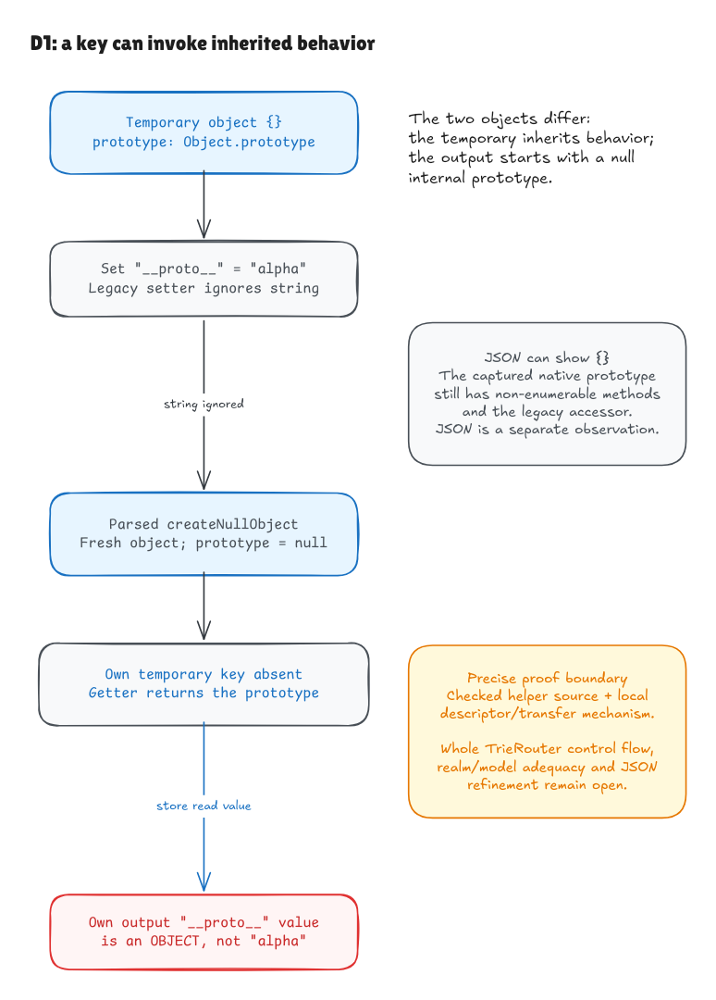

# Objects, allocation and the D1 capture mechanism

This milestone returns to pinned Hono routing. It adds a source-connected
allocation contract, a descriptor/prototype model, a checked local explanation
of D1, and a [routing behavior worklist](../../verification/routing-behaviors.json).
The target, restricted teaching spec and exact comparison exception stay intact.

## What the source proof guarantees

The entire `src/router/utils.ts` module is one declaration:

```ts
export const createNullObject = () => Object.create(null)
```

The shared parser now handles a general zero-argument expression body, including
the actual `null` argument. The [helper theorem](../../HonoLean/Upstream/CreateNullObject/Correctness.lean)
retains the returned object address and complete model state. Under the explicit
standard-Object binding premise, execution allocates one new object with an empty
own-property store, a null internal prototype and extensibility enabled. Existing
object cells, environment bindings and the array heap are preserved.

The contract states those facts independently of the interpreter and allocation
function. It proves successful execution as well as exact output characterization.
Two calls produce different allocated addresses even though their initial contents
agree. Freshness is relative to allocated cells; native interpretation requires a
well-formed state without forged dangling object references.

The model's binding premise covers the name `Object`. The intended native
interpretation also requires the standard `Object.create` property and dispatch.
A mutable global/property environment is not proved correct merely by representing
the constructor with a builtin tag.

## Why property ownership matters

An ordinary temporary object can inherit an accessor named `__proto__`. With the
standard legacy accessor installed, assigning the string `"alpha"` invokes its
setter, which ignores that string. No own key is created. Reading that key later
uses the inherited getter and obtains the temporary object's internal prototype.

A null-prototype output has no such inherited accessor. Assigning the read value
there creates an ordinary own data property. The output now owns the key, but its
value is the prototype object rather than the original string.

| Observation in the local mechanism | Result |
| --- | --- |
| Temporary owns `__proto__` after the string write | False |
| Reading the temporary key | Prototype object reference |
| Output owns `__proto__` after transfer | True |
| Output value | The same prototype object reference |
| `id` / `constructor` capture-name controls | Own string values |



[Editable source](../diagrams/d1-object-mechanism.excalidraw) ·
[Live scene](https://app.excalidraw.com/s/8wot9n3ajqf/7pKTcV4XKOx)

[Objects.lean](../../HonoLean/Upstream/ECMA2025/Objects.lean) models descriptor lookup,
prototype traversal, receiver-aware getter/setter calls, writable data and
extensibility. Setter behavior follows the descriptor, including an alternate-name
example; the model does not hard-code the desired D1 result for one magic key.
The ordinary prototype is a relevant-descriptor projection with an explicit frame.
It is not a claim that the real Object.prototype is an empty object.

The [local transfer theorem](../../HonoLean/Upstream/D1/Mechanism.lean) now executes
the parsed complete allocation/reset/append/key-loop block, invoking the parsed
helper through its lexical function binding. See the
[assignment](param-assignment-walkthrough.md) and
[loop](param-loop-walkthrough.md) milestones. Temporary capture and the chosen
handler/key-array entry remain explicitly modeled. It proves the
string-only capture claim false for this mechanism for every assigned string.

That outer composition is **not a checked translation of the whole TrieRouter**.
Node traversal, guards, chosen-handler entry, Set-produced keys and JSON
observation remain source-link obligations. The divergence ledger therefore keeps
its whole-upstream D1 counterexample theorem field unset, while recording this
separate local evidence.

## More of the routing surface is now visible

The worklist now has 36 candidate behavior units, 100 common test references and
exact per-router skip selectors. It includes PreparedRegExpRouter and its
initialization/serialization exports, as well as the five routers and presets.
Those full routing units still have zero source-connected proofs; the worklist
is an incomplete contract/dependency map rather than a coverage percentage.
The [Set milestone](key-set-walkthrough.md) adds a pinned native observation of
shared mutable `getPattern` cache tuples; its complete stateful contract remains open.

Fifteen isolated native probes also preserve a separate finding. With one GET
route, looking up raw method names `constructor`, `toString` or `__proto__` makes
the pinned TrieRouter change a watched builtin's `params` property and then throw.
The other tested routers return misses for those inputs. Each probe gets a fresh
process so the effects cannot contaminate another case. These observations have
their own work item and add no comparison allowlist entry.

## Checks and remaining boundary

```sh
lake build
lake env leanchecker --fresh HonoLean
python3 verification/nullobject/tests.py --hono /path/to/pinned/hono
python3 verification/routing-tests.py --hono /path/to/pinned/hono
```

The object suite checks six allocation frames, 168 primitive transfer cases, the
actual raw D1 route and two controls, semantic source faults and source identity
failures. The routing suite validates pinned hashes/ranges and reproduces all 15
method observations. Existing string/array source suites remain regression checks.

The [independent audit](routing-object-audit.md) cites the year-pinned language
rules. The legacy accessor is normative optional in ECMA-262 2025; its presence
is an explicit realm premise. General callbacks, proxies, symbols, object/null
prototype mutation, enumeration, precise exception taxonomy, unified native
object/array/function heap semantics, full frontend and engine adequacy remain open.
Structural heap well-formedness alone does not imply acyclic prototype chains;
unsupported cycles can exhaust the model's traversal fuel.

The per-key assignment and complete chosen-handler key loop now have separate
checked contracts. The next source slices are the Set-produced key list,
temporary capture setup and surrounding handler selection/traversal. The full
Hono goal still requires all published runtime behavior and dependency closure.
