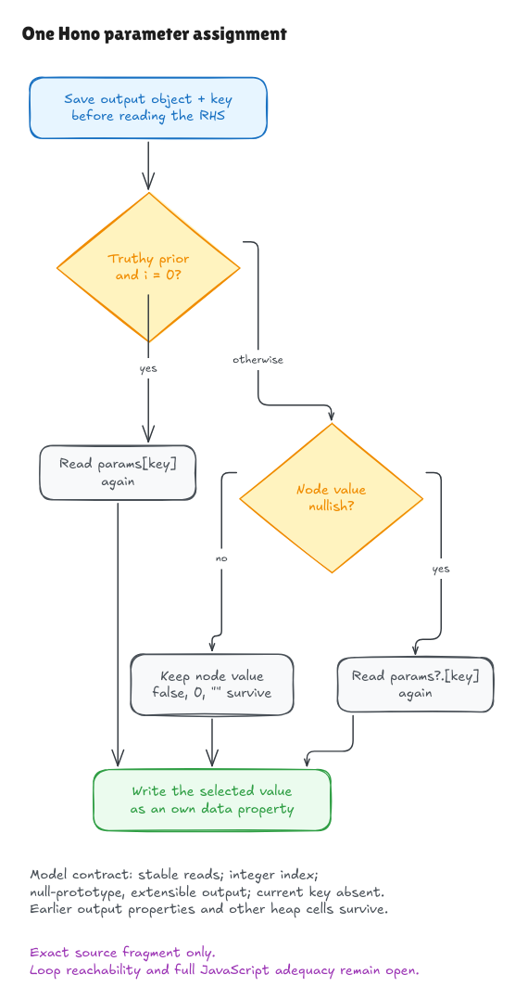

# One actual Hono parameter assignment

This milestone checks the two-line assignment at
[`node.ts:79–80`](https://github.com/honojs/hono/blob/5ca49b0720755c585c9a9835f0a479ceea36fb52/src/router/trie-router/node.ts#L79-L80).
It is the first checked source slice inside TrieRouter's Node implementation.
The surrounding method and router remain unproved.

```ts
handlerSet.params[key] =
  params?.[key] && !i ? params[key] : (nodeParams[key] ?? params?.[key])
```

The [source record](../../verification/param-assignment/source.json) identifies the
whole-file Git blob, SHA-256, exact fragment bytes, and containing method. An
external checker compares them with the clean pinned checkout and the embedded
Lean text. The shared Lean parser then checks that this text has the program
structure used in the proof. The containing method is provenance context only;
it is not parsed by this milestone.

## What the code chooses

Think of `params` as an optional earlier parameter object and `nodeParams` as
another source of values. `i` is the index in the **inner possible-key loop**.
It is not the index of the enclosing method loop.

For stable reads, call the optional earlier value `p`, and the node value `n`:

| Condition | Value written |
| --- | --- |
| `p` is truthy and `i` is zero | `p` |
| Otherwise, `n` is neither null nor undefined | `n` |
| Otherwise | `p` |

Truthy means JavaScript's conditional test. In the modeled domain, an empty
string, zero, false, null and undefined fail that test. Objects and arrays pass,
including empty ones. Missing `params` gives an undefined optional read.

The fallback uses a different question: is the node value **missing**? A node
value of `false`, `0` or `""` survives `??`. Replacing this with a Boolean-style
fallback would change the behavior.

The source also reads `params[key]` again in the winning first branch. The
interpreter retains that second read. Our present contract requires pure,
stable property reads, so both reads agree. A getter that changes its answer is
outside this contract; the source must not be rewritten as though it read once.



[Editable source](../diagrams/param-assignment-contract.excalidraw) ·
[Live Excalidraw scene](https://app.excalidraw.com/s/8wot9n3ajqf/4JF50rF46dE)

## What Lean proves

The independent contract describes the cases above and the exact resulting
state. It does not define the answer as whatever the interpreter returns.
[`parsed_source_correct_framed`](../../HonoLean/Upstream/NodeParamAssignment/Correctness.lean)
connects execution of the parsed source to that contract for every admitted
state, string key, represented value and integer index.

The admitted output object has no prototype, permits new properties, and does
not already contain the current key. It may contain earlier captures. The proof
shows that the assignment creates an own data property with the selected value;
the property is writable, enumerable and configurable. It preserves the earlier
descriptor store, every other object cell, the variable environment and array
heap. This is a storage-preservation claim, not a proof of JavaScript key
enumeration order. An empty-output specialization also proves successful
execution exists, avoiding a statement that is true only when execution succeeds.

The read premises require successful model property reads, even for some reads
that a branch skips. They constrain the local entry state; they do not assume
the selected result or the final write. The next surrounding-loop proof must
establish those premises and the current-key-absent invariant from actual source.

The shared interpreter now saves the assignment's destination before evaluating
its right side. It then writes through that saved reference. Separate checked
examples exercise allocation order, short-circuited key expressions, deferred
write errors and an inherited setter that ignores a write while the assignment
still returns its right-side value.

## How this strengthens the D1 explanation

The [local D1 mechanism](../../HonoLean/Upstream/D1/Mechanism.lean) now runs the
parsed complete setup/key-loop block, invoking `createNullObject` through its
parsed helper definition. See the [loop milestone](param-loop-walkthrough.md).
For a temporary
ordinary object's `__proto__` key, the inherited accessor can yield the prototype
object. That value is non-nullish, so this assignment stores it as an own value
in the output. The checked local result is an object reference, not a string.

Temporary capture setup, chosen-handler/key-list entry, route traversal and final
JSON observation are still modeled or unproved steps. The whole-upstream D1
counterexample theorem remains unset. The original exact comparison fixture and
allowlist are unchanged.

## Evidence and remaining boundary

```sh
lake build
lake env leanchecker --fresh HonoLean
python3 verification/param-assignment/tests.py --hono /path/to/pinned/hono
```

Four test groups compare the actual extracted fragment, Lean execution and an
independent value oracle: 2,496 branch/context cases, 135 populated-output cases,
three real parsed source mutations, and source/artifact identity failures.
The native runner requires Bun 1.4.0 and the exact pin. These are finite checks;
the Lean theorem quantifies over its declared mathematical domain. The
[independent audit](param-assignment-audit.md) reviews contract independence,
evaluation order, branch behavior and the framed proof.

General JavaScript/frontend adequacy, source-extraction trust, mutable native
realms, arbitrary getters/proxies, primitive receiver boxing, property-key
coercion, symbols, full Number semantics and observable state after an exception
remain open. Object lookup has bounded traversal fuel. Unsupported model errors
must not be presented as faithful JavaScript errors. No whole method, router,
module initialization or package claim follows from this fragment alone.

The surrounding key loop now establishes this assignment's local invariants.
The next obligations are the Set-produced key list, temporary capture and
surrounding router control path. The
[full-runtime goal](hono-verification-goal.md) stays active.
