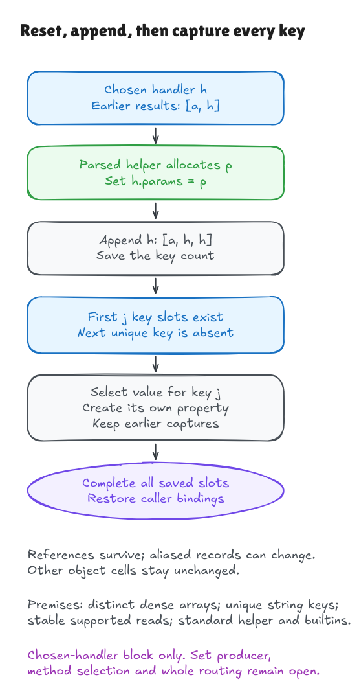

# Reset, append, then fill the output

This slice is the actual chosen-handler block at
[`node.ts:75–81`](https://github.com/honojs/hono/blob/5ca49b0720755c585c9a9835f0a479ceea36fb52/src/router/trie-router/node.ts#L75-L81),
including setup and the entire possible-key loop:

```ts
handlerSet.params = createNullObject()
handlerSets.push(handlerSet)
for (let i = 0, len = handlerSet.possibleKeys.length; i < len; i++) {
  const key = handlerSet.possibleKeys[i]
  handlerSet.params[key] =
    params?.[key] && !i ? params[key] : (nodeParams[key] ?? params?.[key])
}
```

The [earlier assignment proof](param-assignment-walkthrough.md) starts with a
prepared output and a current key. The new contract starts before the output
exists. Allocation and the surrounding loop must establish those earlier proof
premises. The method's handler selection, outer loop and route traversal are
still outside this source slice.

## The invariant to understand

After `j` iterations, the output contains exactly the first `j` key slots, each
with the independently specified selected value. It has no other own properties.
Because the key list is unique, the next key cannot already be present. Writing
it extends this invariant to `j + 1` while keeping the earlier descriptors.

That is a loop invariant: one statement about every intermediate iteration.
An empty output establishes it at zero. The assignment preserves it as the
index advances. At the saved key count it describes the complete output.
The [contract](../../HonoLean/Upstream/NodeParamLoop/Contract.lean) expresses this
as an indexed relation over keys and values, without invoking the interpreter.

The value rule stays the same: a truthy earlier parameter wins at index zero;
otherwise a non-nullish node value wins; otherwise use the optional earlier
value. False, zero and empty strings survive the node's `??` fallback.



[Editable source](../diagrams/param-loop-contract.excalidraw) ·
[Live Excalidraw scene](https://app.excalidraw.com/s/8wot9n3ajqf/4vNcaYoXi8n)

Key uniqueness is an entry premise in this theorem. The subsequent
[Set-producer milestone](key-set-walkthrough.md) derives it from the actual
create/add/spread operations on supplied string events, with an explicit array
handoff. Full insertion traversal, string production and handler storage remain
unproved; this loop does not assume insertion has already been verified.
The later [handler-record milestone](handler-record-walkthrough.md) proves the
actual record's construction and key field. Its bridge derives those entry
facts with explicit transport and inherited-`params` dispatch conditions;
private storage, selection and full traversal remain open.

## Why setup and identity matter

The helper call uses a parsed function definition and its own lexical
environment. A caller variable named `Object` does not replace the helper's
`Object`. The small function model supports this closed helper; general mutable
closures, module linking and arbitrary function calls remain open.

The [setup proof](../../HonoLean/Upstream/NodeParamLoop/Setup.lean) derives allocation,
field reset and append from entry facts about bindings and descriptors. It does
not assume the desired result of these operations. A structural read-frame proof
also ensures that adding the fresh object cannot resolve an old dangling
prototype reference and change an existing lookup.

Appending preserves object **identity**. If the earlier result array is
`[a, h]`, appending this handler gives `[a, h, h]`. Both occurrences of `h` see
its new `params`. Preserving the earlier array prefix does not make the records
it refers to immutable. An old parameter object distinct from the modified
handler cell stays untouched. If it is the handler itself, its aliases see the
field reset too; the contract does not promise deep immutability.

The reads are taken after setup. If `nodeParams` is `h` and the key is `params`,
that read returns the new output. The output can therefore contain a reference
to itself. Taking the read snapshot before the reset would give the wrong value.

The handler-set array and key array are distinct in this contract. Native Hono
appends before reading key-array length; if they alias, that append changes the
loop's domain and may introduce an object key requiring coercion. The current
string-key model does not cover that alias case. Its native observation is
retained in the [independent audit](param-loop-audit.md).

## Scope and execution budget

The loop saves its length once, tests its condition before each iteration, and
increments the actual index after the body. Its `i`, `len` and `key` bindings
do not replace caller bindings after completion.

The interpreter takes an explicit execution budget. A mathematical proof needs
a sufficient budget for every admitted key-list length; a fixed 32-iteration
success condition would not establish the contract. Separate executable cases
exercise zero, 33 and 96 keys, and the shared language examples check that an
undersized budget exhausts visibly. Successful native interpretation also needs
legal array lengths and capacity for the append, standard array operations and
exactly representable indices.

## Evidence and boundary

The [source record](../../verification/param-loop/source.json) binds the exact
fragment and containing method to the pin. The surrounding method is provenance
context, not a parsed or verified method. External Git/extraction/freshness tools
and general frontend/language/engine adequacy remain explicit trust obligations.

The executable suite compares the extracted native block using the actual
imported helper, shared Lean execution, and an independent oracle. It covers
1,960 multikey value/alias contexts, nine scope/length cases, four parsed source
mutants, and generated-artifact/hidden-worktree-edit failures. Caller `Object`
shadowing and earlier references to the same handler are included.

The [source theorem](../../HonoLean/Upstream/NodeParamLoop/Correctness.lean),
`parsed_source_correct`, characterizes execution by that independent endpoint
contract. `parsed_source_satisfies` additionally proves successful execution and
an endpoint exist for every admitted entry. Contract uniqueness follows from the
independent selection cases, not from defining a contract as an interpreter result.

```sh
lake build
lake env leanchecker --fresh HonoLean
python3 verification/param-loop/tests.py --hono /path/to/pinned/hono
```

Pure descriptor reads, an ordinary resettable handler, distinct dense arrays and
unique string keys define the local domain. The entry also states legal key
array length and capacity for the append. The model's normal completion records
state; no native statement-completion-value observation is claimed here.
Arbitrary getters/proxies, general key coercion, exceptional state traces,
unified native heap/function semantics, outer selection and whole routing
remain open. D1's whole-upstream theorem remains unset.
