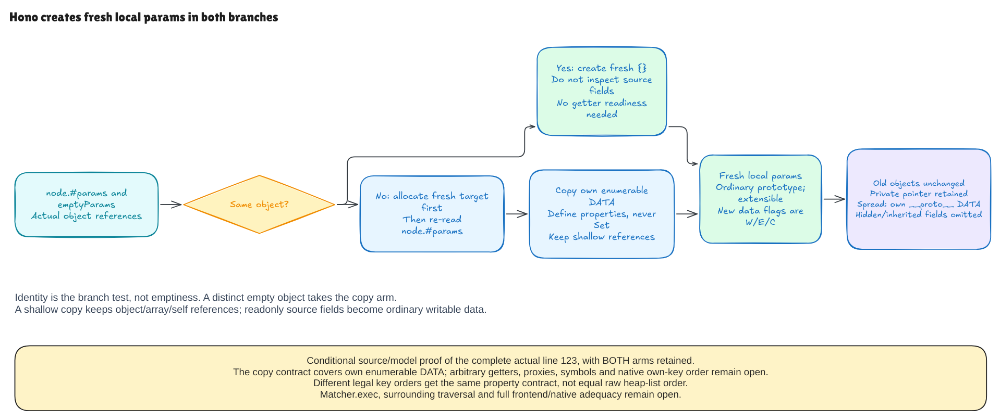

# Fresh params and shallow copying

This milestone covers the complete original line 123 of pinned Hono:

```js
const params = node.#params === emptyParams ? {} : { ...node.#params }
```

Both branches create a new ordinary object. The condition compares object
identity: whether these are the same object, not whether they have the same
fields or are both empty.

| Before-state case | Result |
| --- | --- |
| Private params is the shared `emptyParams` object | Fresh `{}`; existing fields are not inspected |
| Private params is a distinct empty object | Copy branch; still a fresh empty result |
| Own enumerable data field | Same value in a new own data property |
| Inherited or nonenumerable field | Omitted |
| Object, array or self-reference value | Original reference retained |
| Read-only enumerable source data | Writable, enumerable, configurable copy |
| Own enumerable `__proto__` data | Copied as data; result's prototype stays ordinary |

The first branch needs no copy-readiness assumption. It even works when the
shared object has an enumerable getter that would throw: Hono does not inspect
its fields in that branch. The copy theorem instead requires the enumerable
own descriptors to be data. Nonenumerable accessors remain allowed because
they are skipped. General enumerable getters can return values or mutate state;
their execution remains outside this copy proof.

## What shallow means

The output container is new, but its values are not recursively cloned. If a
source field points to an array, the new field points to that same array. A
self-reference points back to the original source object, not the new result.
The proof states these reference identities directly.

Spread defines data properties rather than using assignment's inherited-setter
rules. An own `__proto__` value therefore becomes an own property on the new
object. It does not invoke the legacy setter or change the result's prototype.
This is different from the earlier capture assignment. Copying does not repair
that capture's no-own `__proto__` case; inherited fields are omitted, and D1
remains visible in the pinned whole-router tests.

## Why the proof is more than a copy formula

The syntax tree retains the real private read, identity condition, empty arm
and spread arm. Execution allocates the target before evaluating the spread
source, then reads each selected data value and defines the new property.
The argument derives the second private read from preserved state after
allocation. It does not assume that a completed clone already exists.

The contract says exactly which own descriptors the new object has, including
no extra fields. It proves one fresh source-visible object, the ordinary
prototype, extensibility and shallow values. Every old object, array and private
field remains unchanged within this initializer. The new `params` binding is
retained while older bindings and other modeled state are framed.

The order argument has a deliberate limit. Every complete, duplicate-free
ordering of the modeled own string keys gets the same property-lookup contract.
Different orders may produce different raw storage lists. The proof does not
equate those lists or establish native `Object.keys`/`OwnPropertyKeys` ordering.

## Connecting to the earlier source proofs

Actual startup/reset source supplies the shared pointer case. Further source
activations initialize params, run the capture guard, execute the actual
line-202 private write, bind that child as `node` at a later fragment entry, and
initialize again.
Created captures, existing-own skips and the legacy ignored-string path each
derive the next copy's data readiness from their produced objects. No future
clone or successful write is supplied as an input.

The ignored path is especially useful: its local map can still be empty, but
its fresh identity differs from the shared empty object. The next activation
therefore takes the copy branch. Existing-own skip composition needs no match
array readiness. These are explicitly separate source activations across
unproved intervening control flow, not a complete search execution.

## What the checks observe

The suite exercises 386 shared and 1,411 copy contexts, 54 Node contexts, six
admitted source faults, and eight actual multi-segment TrieRouter scenarios.
It also keeps 16 particular throwing getters as separately labeled model-refusal
controls. Native boundary probes show getters, symbols and proxies succeeding
outside the modeled data/string domain; unsupported does not mean native failure.

O0 denotes the real realm `Object.prototype` in native fixtures. Its model uses
the existing intrinsic descriptor projection. The observer marks that projection
explicitly and separately checks the complete native root descriptors remain
unchanged. It does not pretend those own-key tables are identical. Other object
descriptors and prototype references are compared extensionally; physical engine
allocations and native own-key ordering are not claimed.



[Editable source](../diagrams/params-init.excalidraw) ·
[Live scene](https://app.excalidraw.com/s/8wot9n3ajqf/1RV7B2u9Thf) ·
[Source and contract audit](params-init-audit.md)

See [the source AST](../../HonoLean/Upstream/NodeParamsInit/Source.lean),
[contracts](../../HonoLean/Upstream/NodeParamsInit/Contract.lean) and
[source composition](../../HonoLean/Upstream/NodeParamsInit/Composition.lean).
Regexp execution, traversal, full frontend/native adequacy and the fixed runtime
catalog remain in the [active goal](hono-verification-goal.md).
