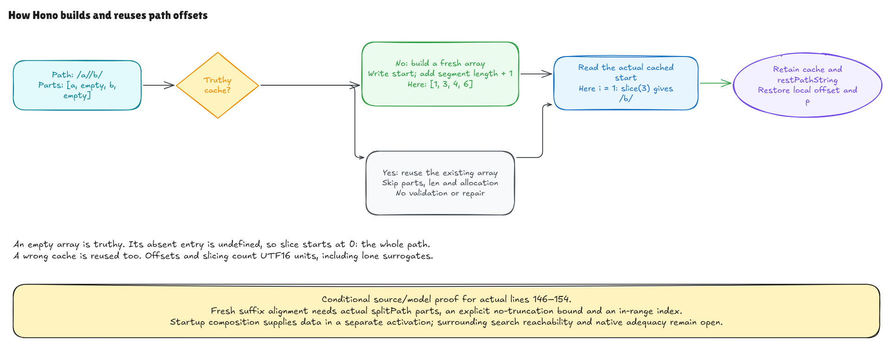

# Building and reusing path offsets

This checkpoint verifies the selected lazy offset block and suffix declaration
in pinned Hono, under an explicit source/model domain. General frontend/native
adequacy and the containing search execution remain open.

Before calling a regexp matcher, Hono needs the remaining path from the current
segment. It stores the starting position of each segment so it can reuse those
positions as matching proceeds. The actual source at lines 146–154 is:

```js
if (!partOffsets) {
  partOffsets = []
  let offset = path[0] === '/' ? 1 : 0
  for (let p = 0; p < len; p++) {
    partOffsets[p] = offset
    offset += parts[p].length + 1
  }
}
const restPathString = path.slice(partOffsets[i])
```

For `/a//b/`, the source splitter yields `["a", "", "b", ""]`:

| Index | Segment | Start | Remaining path |
| --- | --- | --- | --- |
| 0 | `a` | 1 | `a//b/` |
| 1 | `""` | 3 | `/b/` |
| 2 | `b` | 4 | `b/` |
| 3 | `""` | 6 | `""` |

The `+ 1` advances past a slash. Empty segments are preserved, so repeated and
trailing slashes matter. Positions count UTF-16 code units, just as JavaScript
string indexing and length do. Surrogate pairs occupy two units; lone
surrogates remain unchanged.

## A computed table and an existing cache are different cases

On a null cache, the proof executes the real loop. Its invariant says that the
table contains exactly the starts for the segments already visited, its length
equals `p`, and the running offset is the next start. Therefore every indexed
write appends at the current dense length. No future table or completed loop is
an input to the theorem.

The independent table contract uses prefix lengths: start at 1 for an initial
slash, otherwise 0, then add each preceding segment's length plus 1. That formula
does not call the loop evaluator. A separate alignment argument relates those
prefixes to the actual pinned `splitPath` output, then to the path suffix.

The alignment claim requires `path.length < 4294967295`, an explicit
no-truncation bound on the input length.
The splitter uses a UInt32 limit; that limit cannot simply be removed from its
contract. Under the bound and an in-range `i`, the source suffix is the remaining
segments joined by slashes. The proof also bounds the final unused local offset,
which can be `path.length + 1`. The empty path has no in-range outer-loop index.

On a truthy cache, the branch is skipped. It does not read `parts` or `len`, and
does not allocate an offset array. An empty array is truthy: looking up its
absent entry gives `undefined`, and string slice starts at 0. A wrong cache such
as `[2]` is reused too; for `abc/def` it produces `c/def`. The code performs no
validation or repair. The
[slice reference](https://tc39.es/ecma262/2025/multipage/text-processing.html#sec-string.prototype.slice)
describes the start conversion and clamping.

The fresh-to-cached composition uses the table actually produced by the first
execution, keeps its reference, and derives later cached correctness. It does
not assume that an arbitrary preexisting cache contains correct starts.

## State and source connections

The syntax tree retains `+`, `+=`, the real counted-for body, indexed writes,
condition and postfix update. The new entry specializes addition to integral
numbers with exact native operands/results; general concatenation, coercion,
rounding and negative-zero identity remain outside that claim. The source-derived
length bounds establish the relevant numerical bounds.

`partOffsets` belongs to the outer scope, so its first binding must change.
The local `offset` and `p` must disappear or restore older shadowed bindings.
The new `restPathString` stays available for the later matcher call. The scope
proof preserves updated nonlocals rather than restoring the whole old state.
Old arrays and the explicit ambient object/private/function/Set/this frame are
preserved.

The existing startup proof supplies source-derived parts, saved length and null
cache. Composing that data with this block uses a separately activated source
slice; it does not prove that startup unconditionally reaches line 146 through
the intervening branches and loops.

## What the checks observe

Native fixtures import the actual pinned `splitPath` export. Model fixtures run
the parsed splitter in isolation and re-embed its returned contents as a fresh
fixture array; that preparation is distinct from the universal current-heap
startup composition. The independent oracle finds delimiter positions and
computes prefix sizes. It does not use either implementation's output as an
expected table.

The checks cover fresh construction, repeated reuse, empty/missing-body-input
cache hits, incorrect caches, zero-iteration loops, raw UTF-16 and source faults.
Array observations are read values and identities, not own-property-presence or
physical allocation counts. A native-only hole probe preserves that distinction.
Finite checks also exercise other falsy cache values; the universal fresh-input
contract follows startup's actual null cache.



[Editable source](../diagrams/part-offsets.excalidraw) ·
[Live scene](https://app.excalidraw.com/s/8wot9n3ajqf/3eVvEysEWfY) ·
[Source and contract audit](part-offsets-audit.md)

The modules are in [NodePartOffsets](../../HonoLean/Upstream/NodePartOffsets/Source.lean).
The later regexp execution, capture/helper branches, complete search loops,
construction/insertion reachability, native interpretation and full runtime
catalog remain in the [active goal](hono-verification-goal.md).
