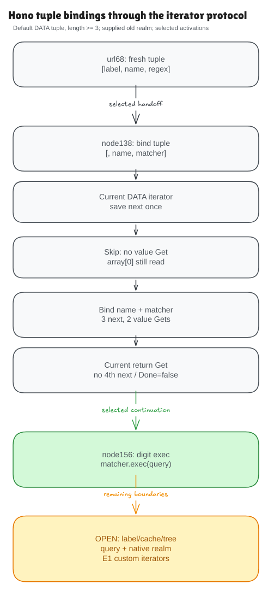

# A constructed tuple becomes actual Hono bindings

The previous milestone proved that Hono's selected constructor expression
produces a tuple and an initialized matcher. This milestone connects that tuple
to the actual statement at node.ts138:

```ts
const [, name, matcher] = pattern
```

The proof now follows selected source activations from construction at url.ts68,
through this binding, to actual `matcher.exec(restPathString)` at node.ts156.
Constructor-to-binding covers every supported safe range. The universal join
to the existing source 156 contract specializes to the digit pattern. The path
string and current standard exec prototype are initial facts; the tuple,
regex record, name, matcher binding and computed `m` are derived.



The [editable diagram](../diagrams/pattern-binding.excalidraw) is committed. The
optional [working scene](https://app.excalidraw.com/s/8wot9n3ajqf/3j7YxLaaYsE)
is private; repository readers can use the exported files directly.

## Destructuring is an iterator operation

It is tempting to read the declaration as two array lookups. JavaScript instead
obtains the array's iterator method, creates an iterator and saves its next
method. The model represents those operations, including a typed Symbol.iterator
key and current prototype lookups. It does not substitute a promised triple of
results or treat the string `"@@iterator"` as a symbol.

The iterator keeps the array reference and a next-position cursor. Every resume
reads the current array length and element. It cannot keep an old copied list
when the array changes. Kernel examples check mutation between resumes, saved
next-method identity, current inherited return lookup and permanent exhaustion.

## Skipping and closing mean different things

The leading comma performs a step but skips reading that iterator result's
value property. The standard array iterator still reads array index 0 to create
its result. These are different operations: skipping a result value does not
guarantee that the original array element was never read.

The next two steps read the values for name and matcher. For a normal tuple
with at least three elements, the proof gives exactly three resumes, two result
value reads and one current return lookup at close. There is no fourth resume.

After yielding three elements from a three-element array, the iterator has not
yet tested for exhaustion. Its record is still not done. Close with a missing
or null return method does not change that flag or exhaust the underlying
iterator. The model's cursor is a next-position projection, not the literal
local index of a suspended native generator.

The universal standalone source contract covers the admitted default DATA
arrays with at least three values. Short and empty arrays have operational laws,
kernel examples and finite comparisons: they exhaust once, bind undefined where
appropriate and omit close after becoming done. A general short-array source
contract remains additional work.

## What the composition removes

The constructor proof derives a fresh tuple. Valid old symbol metadata proves
that this new array has no own iterator override; it is not an assumed future
successful lookup. The binding proof then derives the actual name and matcher
environment entries. Its old-cell frames preserve the new regex's initialized
record and prototype. Those facts establish the inputs for the earlier digit
exec theorem, which computes the actual match or null result.

The main claims are `source_binding_protocol_satisfies` in
[Correctness.lean](../../HonoLean/Upstream/NodePatternBinding/Correctness.lean) and
`source_construct_binding_digits_exec_satisfies` in
[Composition.lean](../../HonoLean/Upstream/NodePatternBinding/Composition.lean).

This is a selected activation handoff. It does not prove Hono's child-pattern
installation, cache/branch reachability, intervening statements or production
of restPathString at lines 146–154. Those remain part of the full goal.

## What the checks can observe

The suite compares 939 binding fixtures and 3,946 selected constructor/binding/
exec fixtures against an independent oracle, Lean, Bun and Node. It checks
seven supported statement mutations, outer shadows, allocated opaque values,
UTF-16 data, short arrays and current symbol overrides. The pipeline corpus
includes all 1,953 supported ordered range pairs; that finite evidence does not
broaden the universal digit-only source 156 join.

Native observations cover the visible arrays, objects, bindings, matcher results
and frames. The model also checks iterator/result cells, cursors and protocol
events. These remain MODEL ONLY: the harness does not fabricate identities or
allocation counts for native internal objects that the statement never exposes.

The earlier `ENGINE-ELISION-1` reproducer stays unchanged. Pinned Bun reads a
custom iterator result 0 value getter that pinned Node skips. The default DATA
iterator results in this proof have ordinary own data fields, so that accessor
counterexample is outside this admitted domain. The proof does not claim native
internal trace equality or general iterator adequacy. See the
[audit](pattern-binding-audit.md) for these boundaries.

## What comes next

Hono currently supplies the constructor's `match` array to this selected source
chain. The next [label-match plan](label-match-plan.md) derives that array from
the actual regex literal and `label.match(...)` call at url.ts60. This removes
another supplied input; cache selection, installation and the containing search
control flow will still need their own source connections.
