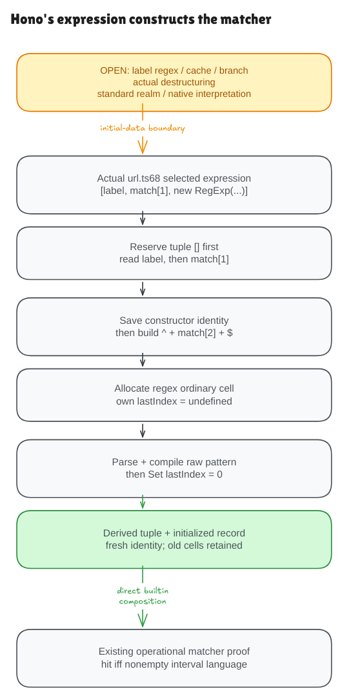

# Hono constructs the matcher

Previously, the builtin-exec proof began with an initialized regex record.
This milestone derives that record from Hono's actual selected expression:

```ts
[label, match[1], new RegExp(`^${match[2]}$`)]
```

This is the terminal tuple expression at `src/utils/url.ts:68` in the pinned
Hono source. We prove the expression's behavior for the supported range-plus
patterns. Choosing this branch, recognizing the original label, using the
cache and later destructuring the tuple remain separate source obligations.



The [editable diagram](../diagrams/pattern-construct.excalidraw) is committed;
the optional [working scene](https://app.excalidraw.com/s/8wot9n3ajqf/6lPn44wcVfz)
stays private. GitHub readers can use the files directly.

## Inputs become a new object

The initial facts describe an existing `match` array. Its index 1 holds the
name; its index 2 holds a raw body such as `[0-9]+`. They also describe the
current standard RegExp constructor identity and its declared prototype.
There is no already-initialized matcher, compiled program or completed tuple
among the inputs.

The new parser retains the array literal, template and `new` expression as
syntax. It does not turn this source into a special instruction meaning
“return a correct matcher.” The evaluator follows the syntax, builds the actual
pattern string and runs the genuine small parser and compiler from the earlier
milestone. For `[0-9]+`, the constructed source is exactly `^[0-9]+$`.

The proof derives a fresh tuple containing the original label, the actual name
read from index 1 and a fresh regex reference. It also derives that regex's
ordinary properties, internal source, empty flags and compiled range program.
Earlier objects, arrays, bindings and initialized regex records are preserved.

The universal contract covers every ordered range with safe ASCII digit or
letter endpoints. The interval can include punctuation, as in `[A-z]` or
`[9-A]`. This is the same declared small regex language used by the earlier
machine proof; it is not all JavaScript regex syntax.

## Order is part of the behavior

The tuple is allocated before any element is evaluated. Then JavaScript reads
the label and name, saves the current constructor, and evaluates the template's
body. Only after argument evaluation does it check construction support.

Saving the constructor matters if argument evaluation changes a binding. A
native boundary probe reads the name, saves one constructor, then has the body
getter replace that binding with another. The saved first constructor runs.
The normal formal domain uses plain data strings; effectful native getters
are explicitly separate evidence.

The model then allocates the regex ordinary object with its own `lastIndex`
property initially undefined. Initialization parses and compiles the pattern,
then performs the ordinary property write to zero. Its final descriptor is
writable, nonenumerable and non configurable. The model's brand table stores
initialized records; it does not represent every transient native internal
slot between allocation and initialization.

Constructor selection uses the function's identity. An alias of the standard
constructor works; a different function merely named RegExp does not become
the builtin. Other native constructors, bound constructors and non-string
coercions remain outside this closed constructor model.

## The created matcher can execute

The composition theorem takes the produced tuple's regex reference and applies
the existing builtin implementation. Its hit/miss result follows the independent
nonempty-interval language contract, with the familiar fresh match metadata and
retained nonglobal `lastIndex`.

This reduces the earlier supplied-record assumption. It does not yet run Hono's
actual tuple destructuring or prove the whole call path from `getPattern` to
`Node.search`; those links remain on the worklist.

The main claim is `PatternConstruct.source_construct_satisfies` in
[Correctness.lean](../../HonoLean/Upstream/PatternConstruct/Correctness.lean).
The direct builtin bridge is `source_construct_then_direct_builtin_satisfies`
in [Composition.lean](../../HonoLean/Upstream/PatternConstruct/Composition.lean).

The checks compare 4,061 full-world constructor-and-query fixtures with an
independent oracle, Lean, Bun 1.4.0 and Node 22.22.2. They include all 1,953
ordered endpoint pairs, UTF-16 label/name values, old-state frames, six supported
source mutations and constructor aliases. Compiled instructions are checked
only on the model side; native engines do not expose that representation.

The actual Hono probes also explain why the cache remains an important gap.
A cold terminal construction starts with `lastIndex = 0`, but a cache hit reuses
the same tuple and matcher, including a later mutation to 17. The cache key also
collides for absent `next` and the string `"undefined"`; whichever call occurs
first determines the retained terminal or lookahead matcher. Both call orders
are preserved. We must prove that provenance rather than assume each call
constructs a fresh matcher.

See the [audit](pattern-construct-audit.md) for the exact source boundary and
the remaining constructor, frontend, native and whole-Hono obligations.

The [next binding plan](pattern-binding-plan.md) follows the actual iterator
semantics of Hono’s destructuring statement.
