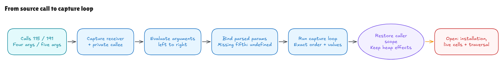

# From a real call to the capture loop

The [previous initialization milestone](node-initialization-walkthrough.md)
explains where a Node's initial data comes from. This milestone connects two
actual calls to the already proved `#pushHandlerSets` body. Earlier proofs
supplied the body's local bindings. Here, the parsed method signature and
argument expressions determine those bindings.

The source is Hono revision
`5ca49b0720755c585c9a9835f0a479ceea36fb52`,
[`node.ts`](https://github.com/honojs/hono/blob/5ca49b0720755c585c9a9835f0a479ceea36fb52/src/router/trie-router/node.ts#L64).
The complete private method is lines 64–84; the selected calls are lines 115
and 191. The [source record](../../verification/private-call/source.json) binds
their exact bytes, offsets, Git blob and hashes.



[Editable diagram](../diagrams/private-call.excalidraw) ·
[Live scene](https://app.excalidraw.com/s/8wot9n3ajqf/2EDpPe85ZMd)

## The argument positions matter

The method declares five parameters:

```ts
handlerSets, node, method, nodeParams, params
```

The literal-child call passes four values:

```ts
this.#pushHandlerSets(handlerSets, nextNode, method, node.#params)
```

The fifth parameter receives undefined. The caller's `node` is the parent;
inside the method, the parameter named `node` receives `nextNode` instead.
The receiver `this` and that node parameter can be different objects.

The simple-parameter call passes five values:

```ts
this.#pushHandlerSets(handlerSets, child, method, params, node.#params)
```

This puts the temporary `params` into the fourth position, named `nodeParams`,
and the old `node.#params` into the fifth position, named `params`. Those two
objects have different roles in the capture rule. For two keys whose old values
are `old0, old1` and temporary values are `temp0, temp1`, with all four values
truthy, the first call captures `old0, old1`. The second captures `old0, temp1`.
The first-key precedence rule explains the difference.

## A call is an ordered operation

The call rule first evaluates the receiver and reads its private callee. Only
then does it evaluate the arguments, from left to right. A missing private
brand therefore fails before argument effects. Callability is checked after
arguments; an argument can run before a noncallable callee is rejected.

The rule retains the captured receiver and callee. It does not look them up
again after argument effects. Native probes exercise those distinctions,
including replacement of a private data-field callee during an argument.
That mutable-field probe explains evaluation order; it does not claim that
Hono's private method is writable.

The method executes using its captured lexical and private-name environments.
Its parameters shadow captured names. Missing parameters receive undefined,
and extra arguments are evaluated even when no formal parameter receives them.
The optional marker changes type metadata, not argument-count enforcement.

Normal fallthrough returns undefined. An explicit return preserves its value,
even if the TypeScript annotation says `void`. After successful execution,
the caller's environment and active private-name scope return; heap changes
from argument and body execution remain visible.

## What the source connection covers

The [generic call rule](../../HonoLean/Upstream/SourceSubset/PrivateCall.lean)
is an explicit extension for top-level private calls. It uses the existing
expression evaluator for receiver/arguments and the existing block evaluator
for the parsed body. It does not silently teach those older evaluators arbitrary
nested block-method invocation.

The parser rejects direct writes to captured lexical names. Captures are
modeled as frozen values here, so accepting those writes would lose their
native shared-cell effects. Formal parameters and supported local loop counters
can still change. Captured spellings are treated conservatively even when a
nested local shadows one. General live lexical cells and callback effects
remain separate obligations.

Block-method closures use an explicitly separate range of function handles
from the existing expression-only helper table. The call runner checks that
the ranges do not collide. Native unified function objects and general callable
dispatch remain interpretation obligations.

The [concrete source parser](../../HonoLean/Upstream/NodePrivateCall/Program.lean)
retains the method's five names, optional marker and type annotations, and ties
its body to the existing complete methods-loop program. The independent call
contract uses that loop's ordered hit/capture relationship. Read and structural
layout conditions describe the admitted starting state, without supplying a
completed body execution or desired final answer.

[`parsed_four_satisfies` and `parsed_five_satisfies`](../../HonoLean/Upstream/NodePrivateCall/Correctness.lean)
prove that connection for the two selected call entries. The
[nonempty examples](../../HonoLean/Upstream/NodePrivateCall/Examples.lean) combine
miss, GET and ALL rows, a repeated handler and two capture keys. They check both
the positional difference and caller restoration, including a control with the
same supplied private-name scope on both sides. These explicit entry states do
not establish that the surrounding search has reached them.

The private method closure and its read handle are still explicit source-bound
inputs. This milestone does not derive their installation from full class
evaluation. Private method writability/kinds, live module cells, class creation,
surrounding search traversal, nested arbitrary calls and native language
adequacy remain open. The selected body does not read `this`. The later
[private-write milestone](private-write-walkthrough.md) adds runtime this for
method bodies; this call-entry subset still rejects this in its argument list.

## Reproduce the checks

```sh
lake build
lake env leanchecker --fresh HonoLean
python3 verification/private-call/tests.py --hono /path/to/pinned/hono
```

Five finite groups compare 518 exhaustive and 390 seeded/long contexts (908
total). They execute the exact declaration and selected calls inside
explicit native class scaffolding, parsed Lean execution and an independent
positional/capture oracle. Inputs include mixed direct/ALL/miss rows, repeated
record references, nonempty captures, UTF-16 names and long cases. Six source
edits, two metadata controls, artifact mismatches and hidden checkout edits test
sensitivity. The wrapper admits extra caller names for fault variants; the
exact four-argument theorem retains only its actual source bindings.
Native wrappers guard Bun 1.4.0 and all 315 pinned source/package blobs;
TypeScript transpilation remains explicitly unverified.

See the [independent audit](private-call-audit.md) for reviewed guarantees,
validation results and remaining boundaries.
