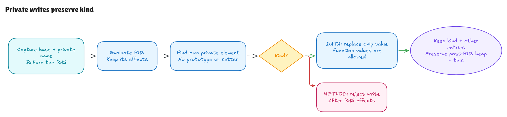

# What a private assignment changes

The [installation milestone](class-installation-walkthrough.md) derived private
method read handles. This milestone adds stored DATA/METHOD kinds and connects
four actual Hono assignments to one shared assignment evaluator.

The source is Hono revision `5ca49b0720755c585c9a9835f0a479ceea36fb52`,
[`node.ts`](https://github.com/honojs/hono/blob/5ca49b0720755c585c9a9835f0a479ceea36fb52/src/router/trie-router/node.ts#L88).
The [source record](../../verification/private-write/source.json) binds exact
bytes, spans and hashes for lines 88, 109, 131 and 202. The containing search
method is provenance, not a claim that its complete traversal is verified.



[Editable diagram](../diagrams/private-write.excalidraw) ·
[Live scene](https://app.excalidraw.com/s/8wot9n3ajqf/7DNdE9weLbQ)

## Kind belongs to the stored element

Private storage now keeps each element's kind and value together. A DATA field
can contain a number, object, function or any other modeled value. Assigning a
new value preserves its DATA kind. A METHOD element rejects assignment because
of its kind, even though its readable value is a function.

That distinction rules out the shortcut "functions are read-only." A DATA field
holding a function remains writable. The class installer derives the tags from
the parsed field and method declarations; callers do not supply a desired
read-only set.

Existing read contracts use a computed value view named `slots`. It has no
setter and no independent cache. Updates use the tagged `elements` store. Old
mixed-store fixture code was migrated to preserve those tags, so reconstructing
storage from a value-only snapshot cannot silently turn methods into DATA.

## Evaluate the right side before checking the write

Assignment first evaluates the base and resolves the lexical private identity.
It saves that reference before evaluating the right-hand side. It then checks
the saved object's own private element in the resulting state.

Thus an unbranded receiver or METHOD target rejects after right-side effects.
Changing a local target during the right side does not redirect the saved write.
Public names, prototypes, setters, frozen flags and extensibility do not decide
whether a private DATA write is permitted.

The [generic contract](../../HonoLean/Upstream/SourceSubset/PrivateWrite.lean)
states the permitted DATA input, exact replaced value and raw tag/entry frames.
Its input state is the state after evaluating the right side. Successful writes
preserve the other private entries and ordinary heap, arrays, functions, Sets,
lexical environment and runtime this context relative to that state.

Native probes check effects before failures too. The current `Except` model
does not expose partial failure states; these results do not claim rollback or
a universal native exception trace theorem. Private accessors remain outside
the admitted frontend and represented DATA/METHOD subset.

## The four source assignments

| Source | Meaning |
| --- | --- |
| 88: `this.#params = emptyParams` | Replace the current node's reference with the module's shared empty object. |
| 109: `nextNode.#params = node.#params` | Copy a reference, so the two nodes initially share that same params value. |
| 131: `child.#params = params` | Store the wildcard continuation's params value. |
| 202: `child.#params = params` | Store the nonfinal parameter continuation's params value. |

Resetting a reference does not clear the old params object. Propagation does
not clone it. TypeScript's Record annotation adds no runtime validation: the
write rule accepts arbitrary modeled right-side values, including functions,
null, undefined, false, zero and strings.

Runtime `this` now has its own AST/state support. It is not an ordinary variable
named "this." Method activation sets the receiver and restores caller this on
return. Old NoArg and field-initializer parsing restrictions remain explicit;
private-call arguments containing this are still rejected by that entry subset.

## From a write to a call

The [source proof](../../HonoLean/Upstream/NodePrivateWrite/Correctness.lean)
proves the four assignments and derives DATA writability/METHOD rejection from
the tagged class-initialization contract. The
[handoff proof](../../HonoLean/Upstream/NodePrivateWrite/Flow.lean) connects
propagation at line 109 to the actual four-argument call at line 115, deriving
its read premises and preserving the installed method and registered storage. Its structural
layout conditions contain no completed call execution or desired result.

The [nonempty examples](../../HonoLean/Upstream/NodePrivateWrite/Examples.lean)
initialize three nodes, register three handlers, allocate the collector, reset
the root, execute an earlier line 202 write to the parent, propagate at line 109
and call at line 115.
The params slots are written through parsed assignments rather than injected
directly. The examples prove successful ordered captures, method rejection and
caller scope/this restoration.

The earlier line 202 write has its own activation. It is not the mutually
exclusive isLast branch containing call 191. Intervening conditions/wildcard calls, full
traversal and reachability of these selected activations remain open.

## Reproduce the checks

```sh
lake build
lake env leanchecker --fresh HonoLean
python3 verification/private-write/tests.py --hono /path/to/pinned/hono
```

The finite runner uses parsed class installation and canonical source line 202 writes
to prepare inputs, then compares each assignment against pinned-source native
execution and independent value/alias rules. Source mutations affect only the
tested operation. All 3,800 contexts passed: 3,380 exhaustive value/alias/frozen
cases and 420 seeded or invalid-brand/boundary cases. Seven supported source
faults and source/artifact freshness failures are detected. These are finite
checks, separate from the universal conditional Lean contracts.

The managed 329-job root build and fresh kernel replay passed after the AST/state
migration. All seven modified legacy Driver families also passed, including
class installation, initialization, private calls, push, selection and loops.
The pinned main comparison still has 467 agreements and the same exact D1 across
468 lookups. These results preserve earlier evidence without closing whole-Hono
source or native adequacy obligations.

Native scaffolding is type-erased first, then the already plain-JavaScript
assignment text is inserted. This keeps the native engine's METHOD rejection
observable when a deliberate fault targets a method. Both construction steps
remain explicitly unverified tooling, with input/emitted hashes. Bun 1.4.0 and
all 315 pinned source/package blobs are guarded. Proxy cases are finite boundary
observations, not a general Proxy interpretation theorem.

See the [independent audit](private-write-audit.md). Complete class/public-method
evaluation, live module cells, full traversal, private accessors, native unified
function objects, exotic receivers and complete language/host adequacy remain
open in the full-Hono goal.
