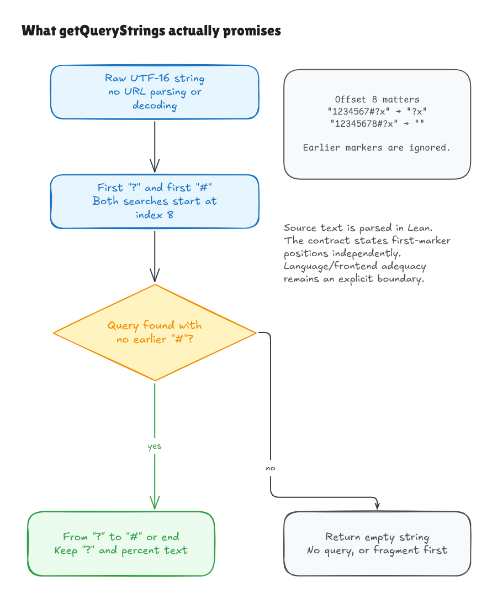

# Verifying the raw query-string helper

This milestone connects the pinned Hono `getQueryStrings` declaration to an
independent contract in Lean. It reuses and extends the source parser and
interpreter from [splitPath](splitpath-source-bridge.md); it does not add a
separate recognizer that returns a predetermined algorithm.

The target remains `5ca49b0720755c585c9a9835f0a479ceea36fb52`. This helper is
marked deprecated upstream, but it is still a published runtime export at that
pin and remains in the verification scope.

## What it promises

Both searches begin at UTF-16 position **8**. Find the first eligible question
mark and the first eligible hash independently. If there is no eligible question
mark, or an eligible hash comes first, return empty text. Otherwise return the
text starting with the question mark and ending before the hash, or at the
input's end when no eligible hash exists.

The input can be any string in the declared domain. The function does not check
URL validity or decode percent text. The question mark is part of the output.
That gives some useful boundary examples:

| Input | Result |
| --- | --- |
| `1234567?x` | Empty: the marker is before position 8 |
| `12345678?x` | `?x` |
| `1234567#?x` | `?x`: the earlier hash is also before position 8 |
| `12345678#x?q` | Empty: an eligible hash comes first |
| `12345678?x%23y#z` | `?x%23y` |

Four two-unit Unicode characters occupy eight code units. Lone surrogates also
remain ordinary units. Counting Unicode code points or decoding the text would
change this contract.



[Editable source](../diagrams/querystrings-contract.excalidraw) ·
[Live scene](https://app.excalidraw.com/s/8wot9n3ajqf/7LPJR3yrS24)

## What Lean checks

[Correctness.lean](../../HonoLean/Upstream/GetQueryStrings/Correctness.lean)
defines the contract with position witnesses: a marker occurs at this position,
and none occurs earlier in the eligible range. The definition never calls the
source evaluator or executable search. The proofs establish a result for every
input and show that the contract determines exactly one output.

The shared parser checks the complete embedded declaration, including its
string-result annotation, signed `-1` literals and nested conditional expression.
`parsed_source_correct` then proves an equivalence: executing the parsed source
returns an output exactly when that output satisfies the independent contract.
The result quantifies over every mathematical UTF-16 list; it does not assume
that execution succeeded or that the input is a well-formed URL.

The reusable [search/slice primitives](../../HonoLean/Upstream/ECMA2025/StringSearchSlice.lean)
have first-occurrence, missing-result and substring-range proofs. They include
negative integer endpoint normalization. Legal string length gives a bound on
the search results needed by the intended safe-integer interpretation.

## Why the language changes matter

The interpreter now has signed integer values, so the missing-search result and
the literal `-1` have the same numeric meaning. General JavaScript floating-point
and coercion behavior remain outside this specialization. Negative array keys
are explicitly unsupported, preserving the distinction from index zero.

Conditional expressions evaluate only their selected arm. Their precedence,
right association and multiline form are checked by examples. Independent review
also caught source traps: a newline followed by minus can continue subtraction,
and `1.slice(0)` is invalid JavaScript syntax even inside a dead branch. The
supported parser rejects those cases. A newline immediately after `return`
continues to reject in this subset.

Three parsed source-body mutations have kernel-checked counterexamples: search
from zero, reverse query/hash order, and search for a hash only after the query.
Changing `<` to `<=` is not one of those faults: the distinct marker values
cannot occupy the same position. A changed program is not automatically an
incorrect program.

## Evidence and remaining boundary

```sh
python3 verification/querystrings/source.py --hono /path/to/pinned/hono
lake build
lake env leanchecker --fresh HonoLean
python3 verification/querystrings/tests.py --hono /path/to/pinned/hono
```

The native suite checks six upstream examples plus eight boundary fixtures,
4,858 generated raw UTF-16 inputs and 1,050 signed search/slice combinations.
It also exercises semantic source mutations and stale/wrong/hidden-edit source
identity failures. Native agreement is finite evidence; the universal model
theorem is checked separately by Lean's kernel. Existing splitPath proofs and
native checks remain regression requirements after the shared language changes.

The [independent audit](querystrings-contract-audit.md) states the reference and
scope precisely. Native interpretation still needs a primitive legal-length
string, standard method lookup, the safe-integer interpretation, and resource
availability. Full ECMAScript/frontend/engine adequacy, module initialization,
distribution build identity and the external extraction tooling remain distinct
obligations. This result does not establish whole-Hono correctness.
