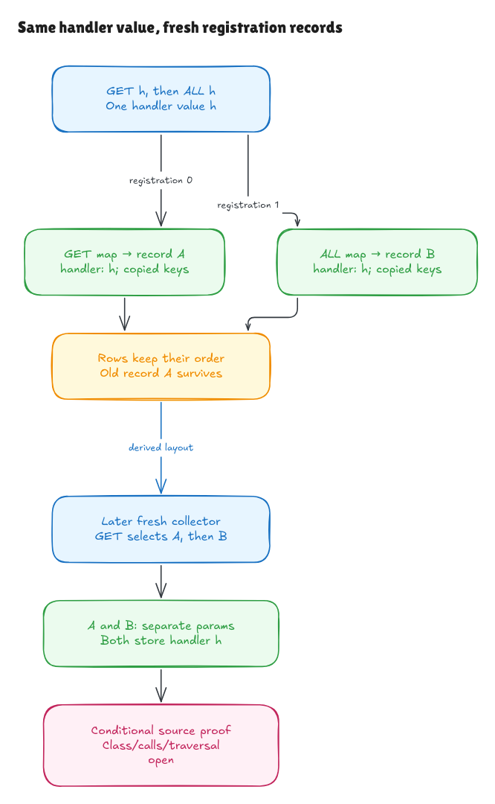

# From one registration to a whole history

The [previous milestone](methods-loop-initial-walkthrough.md) connected one
registration to the later collector and complete methods loop. This milestone
extends that composition to arbitrary finite histories of the exact private
registration-push fragment at one supplied Node owner.

The selected source remains pinned Hono's
[`node.ts:55–61`](https://github.com/honojs/hono/blob/5ca49b0720755c585c9a9835f0a479ceea36fb52/src/router/trie-router/node.ts#L55),
the later collector at line 87 and the complete helper loop at lines 71–83.
These are source fragments under explicit caller activations. They do not yet
prove complete `Node.insert` calls, the traversal choosing `curNode`, class
initialization or the insertion branches producing key events.



[Editable diagram](../diagrams/registration-history.excalidraw) ·
[Live scene](https://app.excalidraw.com/s/8wot9n3ajqf/64Ot7bG4Yx4)

## The concept: prove the next append preserves the past

An induction has a starting case and a step. With zero registrations, the
initial storage remains unchanged. For the next registration, we derive the
source expression's inputs from the current storage, execute that expression
and prove that its endpoint supports another registration.

Repeating that argument handles every finite list length. The theorem does
not ask a caller to supply successful future executions or valid state at
every future prefix. The initial `Seed` supplies the allocated root/owner,
private-name identity and slot, existing dense methods array, and current order
binding. Each request supplies a method, opaque user handler and string events.

The [core contract](../../HonoLean/Upstream/RegistrationHistory/Contract.lean)
describes storage independently of the evaluator. One append adds a fresh outer
method map, a fresh inner handler record and a copied key-array cell. It extends
the methods array in order and stores the incremented score. Old object cells
and other old array cells are preserved. The
[proof](../../HonoLean/Upstream/RegistrationHistory/Correctness.lean) connects repeated
evaluation of the exact parsed source expression to that contract.

The push expression returns the new array length. The enclosing `Node.insert`
discards that value; this is not a proof of the whole method's return behavior.

## Same user handler, different internal records

Registering GET with handler `h`, then ALL with the same `h`, creates two
different internal records. They both store `h`, but each owns its own copied
key array and score. Later capture can give them separate params objects.

That differs from explicitly selecting the very same internal record twice,
which the earlier generic loop theorem also permits under its domain. Fresh
registration creates distinct record identities even when user-handler values,
methods and key lists are equal. No deduplication by handler value occurs.

The fresh addresses follow the append structure. If the initial object heap
has length `b`, registration `i` creates its map at `b + 2*i` and record at
`b + 2*i + 1`. The copied keys occupy the next fresh array cell. These formulas
are proved from source storage, not installed as assumed runtime outputs.

## Supplied events and the carried counter

Each request stages one fresh supported Set cell from its supplied string-event
list. The independent first-occurrence operation gives unique keys in event
order. Duplicate events therefore do not become duplicate key slots.

This staging is explicit caller scaffolding. It does not execute or verify the
full insertion traversal or prove which events `getPattern` and its shared
mutable cache will produce. Earlier Set source proofs remain separate evidence.

The caller activation carries the existing order binding into the next source
expression. It does not install the desired next score. The source's increment
produces the updated binding; induction establishes `initial order + count`.
Native mutable module-cell identity across actual calls still needs a linking
argument. The current evaluator represents lexical bindings as values.

## Feeding the later loop

The [history-to-loop bridge](../../HonoLean/Upstream/RegistrationHistoryLoop/Correctness.lean)
starts with an empty private methods array. It constructs the source history,
executes the actual later empty-collector declaration, derives the protected
initial layout for every stored map/record/key cell, and applies the complete
methods-loop theorem.

The remaining [context](../../HonoLean/Upstream/RegistrationHistoryLoop/Facts.lean)
contains only old parameter/node reads, descriptor/prototype/helper/import
facts, caller arguments, bounds and per-request query conditions. It contains
no chosen handler, completed storage contract, preallocated collector, future
capture entry, prefix readiness or assumed final layout.

Exact own-method hits, own ALL fallback and genuine misses retain separate
conditions. A different method name does not itself guarantee a miss: inherited
truthy `constructor`, `toString` or `__proto__` can be read before ALL fallback.
Empty histories need no per-request lookup condition because no row is visited.

The core append theorem can preserve an arbitrary existing dense prefix. The
composed loop theorem starts from empty methods so every visited row is derived
from the proved history. Interleaved searches, externally mutated existing rows,
registrations distributed across different path-selected nodes and complete
public registration APIs are still further source obligations.

## A nonempty composed example

The [source-history example](../../HonoLean/Upstream/RegistrationHistory/Examples.lean)
registers GET and ALL with the same user handler and then POST with another
value. It proves source execution and independent storage facts, including
duplicate-event removal, distinct records and scores 8, 9, and 10 from an initial
counter of 7.

The [composed example](../../HonoLean/Upstream/RegistrationHistoryLoop/Examples.lean)
has GET, POST and ALL registrations with differing key orders. A GET request
captures the GET record, skips POST and captures ALL. The initial layout and
complete source pipeline are proved from the initial context. Checked output
observations also show that first-key precedence restarts for each record:
the GET id comes from optional params, while the later id in ALL comes from
the node; a captured zero survives nullish selection.

## Checks and interpretation boundaries

```sh
lake build
lake env leanchecker --fresh HonoLean
python3 verification/registration-history/tests.py --hono /path/to/pinned/hono
python3 verification/methods-loop-initial/tests.py --hono /path/to/pinned/hono
```

Four new finite groups cover 1,365 exhaustive prefix histories and 260
generated/long/empty histories. The existing exact-source runners now optionally
observe every append: old rows/records/keys, fresh map/record/key identities,
push return length, scores and order. Repeated supplied user handlers, safe
negative/positive starting counters, UTF-16 keys, repeated queries and empty
histories are included. Three registration-source faults distinguish a missing
increment, missing copied keys and replaced handler value. Two overlap controls
in the preceding suite, which retains its seven faults and type-name variant.

The [five-family identity checker](../../verification/methods-loop-initial/source.py)
binds the reused source artifacts and Lean embeddings. Native runners guard
Bun 1.4.0 and all 315 pinned source/package blobs and record wrapper/emitted hashes.
TypeScript transpilation and the source/engine adequacy boundary remain explicit.

Native probes demonstrate two limits of the normal interpretation. At the
integer precision boundary two scores can both be `2^53`; mathematical Int
increment alone does not establish all IEEE-754 behavior. A custom Set iterator
can mutate an earlier record during a later registration, violating the old-cell
frame outside supported standard iteration. `NativeHistoryBounds` states
arithmetic/size restrictions; it does not establish all native realm, iterator,
array or resource conditions. Reserved inherited lookups and polluted params
setters also retain their observed failures after append.

One actual exported Node probe uses the same user function for GET/ALL/POST.
Its two GET results have distinct params objects; a later search returns fresh
params while earlier returned `[handler, params]` pairs retain their old values.
Those returned pairs differ from the internal collector's mutable record
references. Final sorting/result-pair mapping remains finite evidence here,
rather than part of the universal helper-body theorem.

See the [independent audit](registration-history-audit.md). The source history,
initial-layout and loop proofs remain conditional on the declared semantics and
context. Class/private installation, actual call/module/helper linking,
insertion event production, search traversal and the rest of Hono's published
runtime API remain on the full-runtime goal.
