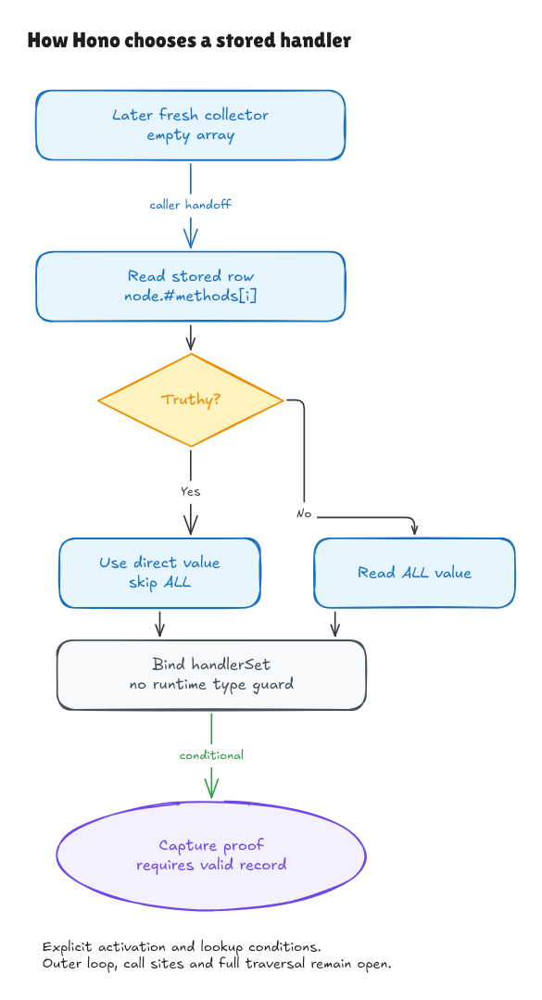

# A later collector and a source-selected handler

The previous [private-push proof](methods-push-walkthrough.md) established stored
method maps and handler records. Its immediate consumer example used a collector
that already existed before registration, and explicitly chose the handler.
This milestone replaces those two shortcuts in the fragment composition.

Four exact source windows are now parsed and connected to contracts:

| Pinned location | Source operation |
| --- | --- |
| `node.ts:87` | `const handlerSets: HandlerParamsSet<T>[] = []` |
| `node.ts:72` | `const m = node.#methods[i]` |
| `node.ts:73` | `const handlerSet = (m[method] || m[METHOD_NAME_ALL]) as HandlerParamsSet<T>` |
| `router.ts:9` initializer | `'ALL' as const` |

The [source record](../../verification/search-entry/source.json) binds each window
to exact pinned bytes, separately from its surrounding method. The collector
is on line **87**; earlier documentation incorrectly linked line 90, an eslint
comment. Those references are corrected without changing the upstream pin.



[Editable source](../diagrams/search-entry.excalidraw) ·
[Live Excalidraw scene](https://app.excalidraw.com/s/8wot9n3ajqf/APG8SaMS8WO)

## What the selection actually means

`||` returns one of its operands. It does not turn the selected handler into
a Boolean. The rule is:

1. Read `m[method]` once.
2. If that value is truthy, return that same value without evaluating the ALL
   operand or even looking up its binding.
3. Otherwise, read and return `m[METHOD_NAME_ALL]`, even if that result is falsy.

Zero, false, null, undefined and the empty string therefore trigger fallback
in this model. Empty arrays, empty objects and functions are truthy. This is
different from `??`, which falls back only for nullish values.

The independent `Choice` contract states those two branches using the existing
mathematical truthiness relation and ordinary property reads. The admitted
normal domain requires a successful fallback binding/read **only when needed**.
A truthy direct handler can therefore satisfy the theorem even when evaluating
the ALL operand would fail. The proof also constructs a successful endpoint;
it does not assume the desired selected value or a successful capture loop.

When `method` itself is `ALL`, a falsy first read makes the expression read the
same property again. The normal model's supported reads are stable, but native
getters can return different values. The retained native probe returns zero
on the first ALL read and a record on the second, recording two accesses.

## Types do not establish the handler's shape

The parser retains the declaration annotation and `as` assertion as explicit
type syntax. The modeled runtime erases them, with a checked model-erasure
lemma. That is not a proof of the TypeScript compiler, typechecker or module
system.

`as HandlerParamsSet<T>` performs no runtime validation. A native probe returns
the number 17 through that assertion unchanged. The generic selection theorem
therefore does not claim every selected value is a valid handler record.
The composed capture proof obtains its record shape from actual registration
storage, not from the asserted type.

The actual ALL initializer evaluates to the uppercase string. Establishing that
initializer's value is separate from proving export/import binding identity;
module linking remains explicit. The exact registered-method branch can skip
ALL entirely, so its specialization needs no fallback-read premise.

## What changed in the composed proof

The [bridge](../../HonoLean/Upstream/SearchEntry/Bridge.lean) follows actual source
operations through this sequence:

```text
registration push
  → later fresh empty collector
  → explicit helper activation/argument handoff
  → actual private row declaration
  → actual handlerSet declaration
  → existing capture-loop theorem
```

The collector is allocated after registration's key snapshot. Its identity,
empty contents and separation from old arrays are derived from the actual
typed declaration. The row is read from the private methods array at the
caller-supplied index. The handler binding then comes from executing the
selection declaration; no `m` or `handlerSet` result is supplied as an assumption.

For the universally composed path, the query method equals the newly registered
method. The stored map owns that key and points to the source-created record,
so the direct result is truthy. Separate generic theorems cover ALL fallback
under its explicit lookup conditions. The composition does not silently extend
an exact-method hit into every request against an ALL registration.

An [inhabited example](../../HonoLean/Upstream/SearchEntry/Examples.lean) includes
actual typed Set creation, duplicate `id` events, registration, the later
collector, row/selection declarations and capture. Caller bindings initially
containing unrelated false/null values do not supply the chosen row or handler.

These fragments live in different native activations: collector in `search`,
row and selection in `#pushHandlerSets`, and ALL in module scope. The model
exposes the activation/argument/import handoffs. It does not claim the fragments
form one contiguous lexical block or prove the intervening calls and traversal.

## Prototypes and remaining control flow

Property reads include inherited properties. In an ordinary map with an ALL
record, a request for `constructor`, `toString` or `__proto__` can produce an
inherited truthy value before fallback is considered. The native probes preserve
those observations. An own registered-method hit and an unregistered-method
miss are different proof obligations.

The prototype model is a relevant-descriptor projection with an explicit frame,
not an enumeration of every property on native Object.prototype. Effectful
getters, proxies, coercion and unsupported Number values require further models.
The TypeScript assertion does not remove these obligations or the earlier
reserved-method mutation/exception findings.

The outer methods-array loop, its saved length/index, the actual `if(handlerSet)`
guard, helper call sites, path traversal, temporary capture state and final result
mapping are still open. The composed hit supplies a truthy record, but executing
its proved body does not prove all surrounding control flow.

## Checks and limits

```sh
lake build
lake env leanchecker --fresh HonoLean
python3 verification/search-entry/tests.py --hono /path/to/pinned/hono
```

Five test groups include 6,045 own/inherited/lazy selection contexts, 407
registration/later-collector/selection/capture contexts, six supported source
faults, an erased type-name variant, source/artifact and hidden-checkout edits
in both files, getter/type-boundary probes and bounded actual Node observations.
The native harness executes the exact TypeScript text through Bun 1.4.0 and
records input/emitted hashes, explicitly marking transpilation unverified.

Independent review found and fixed acceptance of a newline **before** `as`;
regressions distinguish it from a permitted newline after the keyword. The
[audit](search-entry-audit.md) records the source, contract and scope checks.
Native engine/frontend adequacy, class initialization, mutable lexical/module
cells, interstitial frame preservation and whole routing/package coverage
remain open. No comparison exception or generated coverage row is added.
